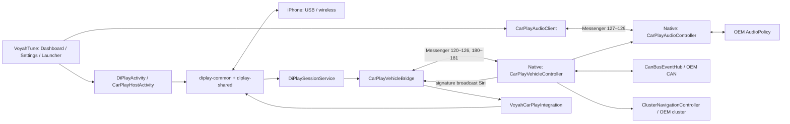

# DiPlay в VoyahTune: спецификация интеграции и восстановления

> Разделы об удалённых JS-агентах и результаты их старых проверок сохранены как
> история исследования OEM. Текущие перехваты перенесены в единый
> [native/Java runtime](../Packaging/new/README.md); обязательные проверки выполняет
> `Packaging/new/scripts/check_java_agents.py`. Старые команды JS-тестов не применяются.


Этот документ — контракт адаптации, по которому восстанавливают интеграцию после
полной замены исходников DiPlay. Он описывает исходники с выборочным переносом DiPlay на **7 ноября 2026**;
состав конкретного опубликованного релиза определяется его manifest и revision.
Имена upstream-классов могут измениться: при обновлении сохранять поведение
и границы ответственности, а не только переносить строки патча.

Правила работы лежат в [корневом AGENTS.md](../AGENTS.md), локальные правила DiPlay —
в [RestoreMode/diplay/AGENTS.md](../RestoreMode/diplay/AGENTS.md). Этот документ —
единственная полная спецификация; README и локальный AGENTS содержат ссылки на неё.

## 1. Происхождение и границы

- База: **DiPlay main от 21 октября 2026**,
  commit **`143f4674b60b564a16baae5110b3b90fb7277631`**, после релиза
  `v0.2.21` (`49bf3bc2b011cb5ee7c7f4da9b99b18cbd3a23a2`),
  репозиторий [shihabal3amri/DiPlay](https://github.com/shihabal3amri/DiPlay).
- Отдельно перенесён [PR #1010](https://github.com/shihabal3amri/DiPlay/pull/1010),
  commit **`70649715394ee1731dd6ed42656d68e4341d6905`**: оценка музыкальных
  часов и запас после rebuffer. Возврат задержки заменён собственной плавной
  реализацией, UDP reorder/resend добавлен отдельно (§9). Он не входит
  в зафиксированный main; его адаптации и проверки описаны в §9/10/12.
- Поверх базы выборочно перенесены исправления из main **`615b32ce0b40cd0b99ce94ba23a512001553684f`**
  (0.2.22), 5 ноября 2026: #1148, #1122, #1123, #1125, #1126, #1128, #1129,
  #1131–1134, #1138, #1139, #1141, #1144, #1057, #1058, #1060, #1062, #1066,
  #1097. Это **не полное обновление baseline**; clock trim #1070/#1080,
  OEM-функции и standalone updater не импортированы. Контракты и карта — §9.1/10.1.
- Дополнительно 7 ноября 2026 адаптированы открытые upstream
  [PR #1197](https://github.com/shihabal3amri/DiPlay/pull/1197),
  commit **`bfd5d9f0d91f578d151b2b51a1e9a25c24608a59`** (маскирование паролей iAP2),
  и [PR #1254](https://github.com/shihabal3amri/DiPlay/pull/1254),
  commit **`1039015e1994669163da8adbdbea6a891552a5dd`** (новая попытка после
  остановки retries). Собственный fallback повреждённой Wi-Fi-группы также
  маскируется. Контракты и карта — §9.2/10.1; baseline main не менялся.
- Проверка upstream **7 ноября 2026**: main остаётся на `615b32ce`, новых commits
  относительно источника выборочного переноса нет. Остальные открытые кандидаты:
  [#1178](https://github.com/shihabal3amri/DiPlay/pull/1178) (ранний RFCOMM EOF),
  [#1251](https://github.com/shihabal3amri/DiPlay/pull/1251) (USB attach без broadcast)
  и [#1252](https://github.com/shihabal3amri/DiPlay/pull/1252) (wired pairing нескольких
  iPhone). [#1124](https://github.com/shihabal3amri/DiPlay/pull/1124)/[#1130](https://github.com/shihabal3amri/DiPlay/pull/1130)
  требуют сохранения наших MFi4/Ultra и listener ownership;
  [#1206](https://github.com/shihabal3amri/DiPlay/pull/1206) — адаптации заполнения
  окончательно потерянного звука **после** собственного UDP recovery, без замены
  музыкального регулятора. Наличие PR не подтверждает совместимость с Voyah.
- Копия [RestoreMode/diplay](../RestoreMode/diplay/README.md) — vendored source,
  не submodule. Модули `common` и `shared` импортированы; `mobile` не используется.
- Иконка `ic_car_home.png` и таблица манёвров взяты/адаптированы из VoyahPlay,
  commit **`850b196b09dead3180b027a6f77ad4e040a9bea0`**. Таблица имеет происхождение
  GPL-3.0 и наблюдалась в форке на H97; это не подтверждение всех OEM-прошивок Voyah.
- Сохранять [LICENSE](../RestoreMode/diplay/LICENSE),
  [THIRD_PARTY_NOTICES](../RestoreMode/diplay/docs/THIRD_PARTY_NOTICES.md),
  лицензии вложенных компонентов и атрибуцию заимствованных частей.
- DiPlay входит в **один APK RestoreMode** (`ru.big.town.restoremode`). Настройки
  CarPlay и плитки главного экрана открывают его внутри этого APK. Отдельный APK DiPlay
  не устанавливается, официальное обновление его APK не обновляет встроенную копию.
- Протоколы AirPlay/iAP2/MFi, кодеки и JNI целиком не переписаны: наши изменения
  подключают UI, источники автомобиля, маршруты аудио и жизненный цикл сессии.
- Java-база Native/RestoreMode общая. OD-хук `launcherdock.js` показывает VoyahTune и отдельный CarPlay при включённой
  функции; выключенный CarPlay недоступен в All Apps и для назначения в док; изменение loader или root-службы не требуется.
  OEM-различия обрабатывать адаптерами в `Packaging/new/`; не создавать второй CAN-клиент.

## 2. Архитектура и обязательные границы



| Слой | Ответственность и инвариант |
| --- | --- |
| `RestoreMode/app` | Дизайн VoyahTune, настройки, выбор виджетов, Messenger-клиент Native. Здесь находятся зависимости от API приложения. |
| `diplay-common` | Штатные экраны подключения/проекции, сервис сессии, интерфейсы подключения UI и автомобиля. Не импортирует `ru.big.town.restoremode.R` или классы Native. |
| `diplay-shared` | Протоколы, медиатранспорт, буферы скорости/манёвров. iAP2/аудиопотоки не вызывают OEM Binder напрямую. |
| `Native` | Единственный доступ к автомобильным данным через общий `CanBusEventHub`, запуск на дисплеях, запись манёвров в OEM cluster и OEM-фокус/громкость CarPlay. |
| `SharedAndroid` | Общие идентификаторы `CarPlayTarget` и контракт `CarPlayVehicleProtocol`; обе стороны компилируются с одним контрактом. |

`VoyahApplication.onCreate()` устанавливает три адаптера:

1. `VoyahCarPlayIntegration.install(new CarPlayVehicleBridge(this))`.
2. `CarPlayHomeUi.install(CarPlayHomeScreen::new)`.
3. `CarPlayWindowUi.install(new CarPlayWindowPolicy())`.

Первый включает наличие интеграции (`available`) и источники Voyah, второй заменяет
только стартовый экран, третий задаёт безопасную область окна, текст ошибки
аутентификации, значок подключения и фиксированную тёмную палитру host UI. Их отсутствие не должно требовать ссылки библиотеки на
приложение: штатный home остаётся fallback. Статические регистрации не должны
удерживать Activity; bridge хранит application context, фабрика создаёт отдельный View.

## 3. Сборка, манифест и authentication assets

[RestoreMode/settings.gradle.kts](../RestoreMode/settings.gradle.kts) подключает
`:diplay-common`, `:diplay-shared` и каталог `diplayLibs`. Внутри common зависимость
на `:shared` заменена на `:diplay-shared`, обращения к каталогу — на `diplayLibs`.
[app/build.gradle.kts](../RestoreMode/app/build.gradle.kts) зависит от common;
`common` экспортирует shared. Не подключать upstream `mobile`, applicationId или его launcher.

Текущая конфигурация: AGP **9.3.0**, Gradle **9.5.0**, compileSdk **37**; приложение
сохраняет minSdk **30**, targetSdk **35**. Библиотеки имеют minSdk 24 (upstream 0.2.21); targetSdk 37
в shared не означает смены targetSdk APK. Проверенное окружение — JDK 21, NDK
**28.2.13676358** для DiPlay и **27.0.12077973** для голосовой части RestoreMode.
Release ABI приложения — arm64-v8a, debug включает arm64-v8a и x86_64; shared также
умеет armeabi-v7a, но итоговый набор определяется приложением. Версия APK — VoyahTune
из `versions.json`, версия DiPlay ведётся отдельно в этой спецификации.

Манифест библиотеки объединяется с
[манифестом приложения](../RestoreMode/app/src/main/AndroidManifest.xml). Сохранить:

| Компонент | Итоговое требование |
| --- | --- |
| `DiPlayActivity` | `singleTask`, affinity `${applicationId}.carplay.settings`, label VoyahTune CarPlay, тёмная иконка `@drawable/carplay_home_logo`; upstream intent-фильтры удалены через `tools:node="removeAll"`. |
| `CarPlayLauncherActivity` | Экспортированный MAIN/LAUNCHER-вход и bind fallback плитки 1×1; affinity `.carplay.launcher`, `excludeFromRecents`, прозрачная тема, тёмная иконка CarPlay. Отдельная запись CarPlay использует тот же тёмный значок, что плитка 1×1. |
| `CarPlayHostActivity` | `singleTask`, affinity `${applicationId}.carplay`, resizeable/configChanges и штатный USB attach intent из common. |
| `DiPlaySessionService` | Штатный foreground service connectedDevice/microphone/location с учётом разрешений; не отдельный процесс. |
| `BootReceiver` | `enabled=false` через manifest override. Наличие опции boot в штатном UI не включает этот receiver. |
| `PhoneBluetoothReceiver`, `UpdateApkProvider` | Удалены manifest overrides. `REQUEST_INSTALL_PACKAGES` от standalone DiPlay также удалено; обновлением встроенного движка управляет VoyahTune. |
| `AdbClusterActivity`, `MyCarAppService` | Удалены manifest merge overrides. Не возвращать при обновлении. |
| Native IPC | RestoreMode запрашивает `ru.big.town.anative.permission.BIND_SET_MODES_SERVICE`; служба Native защищена этой signature-permission. APK должны иметь совместимую подпись. |

Название приложения и `MainActivity` используют собственный нетранслируемый ресурс
`voyahtune_app_name`. Не использовать для них `app_name`: локализованные варианты
DiPlay (`values-ru`, `values-uk`, китайские locale) иначе перекрывают имя приложения.

Локальная пара хранится в `Credentials/CarPlayKeys/offline-mfi/` от корня проекта.
Весь `Credentials/` исключён из Git; файлы передаются отдельно от исходников.
Gradle автоматически использует эту локальную папку. Другой источник можно задать
через окружение самого Gradle/сборщика релиза:

```sh
export DIPLAY_AUTH_ASSETS_DIR="$PWD/Credentials/CarPlayKeys"
```

Для LOCAL MFi Gradle получает **внешний** `DIPLAY_AUTH_ASSETS_DIR` со структурой:

```text
offline-mfi/
  identity.pk8
  certificate.p7b
```

Задача `prepare<Variant>CarPlayAuthentication` копирует в generated assets только
эти два непустых файла. Посторонние файлы из папки credentials в APK не попадают.
Release-сборка останавливается, если пары нет; явный `DIPLAY_AUTH_ASSETS_DIR` имеет
приоритет над локальной папкой и также требует полной пары. Без обоих источников
source-only debug-сборка остаётся возможной, но LOCAL MFi в ней не заработает.
Проверка наличия файлов не доказывает соответствие ключа сертификату; bootstrap
проверяет пару при загрузке. Упаковку и наличие обоих assets в итоговом APK проверять
отдельно от подписи APK. Ключи и сертификаты не выводить в логи.

`DiPlayBootstrap.ensure()` сначала применяет `VoyahCarPlayDefaults`, затем для
LOCAL MFi устанавливает assets в `noBackupFilesDir/offline-mfi` через staging,
проверку `LocalMfiAuthenticationClient.load` и rename. Существующая директория
не перезаписывается; новые assets в APK не заменяют установленную identity.
Process-local `ready` предотвращает повторную загрузку. Обновление identity — отдельная
миграция с проверкой новой пары и восстановлением после ошибки, без очистки данных
всего RestoreMode. Имя/формат каталога и identity должны пережить замену upstream.

В исходном эксперименте использовалась пара из APK DiPlay 0.2.14. Для восстановления
потребуется отдельно сохранённый доверенный runtime-артефакт: документ и исходники
не содержат ключей, сертификатов или механизма их автоматического получения.
Не печатать их содержимое в документацию, логи, патчи и Git. Настройки отдельного
старого экспериментального APK в RestoreMode автоматически не мигрируют.

## 4. Запуск, виджет и владение сессией

Плитка CarPlay 1×1 использует тёмный значок
[drawable-nodpi/carplay_home_logo.png](../RestoreMode/app/src/main/res/drawable-nodpi/carplay_home_logo.png),
общий шаблон `tile_app_shortcut` и подпись «CarPlay». Отдельная launcher-запись CarPlay использует тот же тёмный ресурс;
зелёная иконка и её исходники/производные удалены.
Значок стартового экрана и большой заглушки сохраняется в
`drawable-nodpi/carplay_home_logo.png`. Исходник основного приложения —
[artwork/restoremode-launcher.png](../RestoreMode/artwork/restoremode-launcher.png)
(серый автомобиль). Ресурсы находятся в `app/src/main/res/mipmap-{mdpi,hdpi,xhdpi,xxhdpi,xxxhdpi}`:
`ic_restoremode[_round].webp` — 48/72/96/144/192 px;
adaptive foreground `restoremode.webp` —
108/162/216/324/432 px, изображение занимает весь слой без полей по выбору пользователя.
Adaptive XML в `mipmap-anydpi-v26` задаёт тёмный фон и системную маску, которая может
обрезать края композиции; round-варианты legacy имеют круглую альфа-маску. WebP сохраняется без потерь,
512 px PNG основного приложения лежит в `app/src/main/ic_restoremode-playstore.png`.
При обновлении upstream сохранять эти app-ресурсы.

`CarPlayTarget` задаёт стабильные значения:

```text
PACKAGE  = ru.big.town.restoremode
ACTIVITY = com.shilapi.xcertplay.DiPlayActivity
ENTRY    = com.shilapi.xcertplay.CarPlayEntryActivity
PROJECTION = com.shilapi.xcertplay.CarPlayHostActivity
LAUNCHER = ru.big.town.restoremode.carplay.CarPlayLauncherActivity
ID       = ru.big.town.restoremode/com.shilapi.xcertplay.DiPlayActivity
```

`ID` — стабильная логическая цель, записанная как компонент, а не имя пакета.
`launchIntent(context, target, displayId)` создаёт MAIN + LAUNCHER с явным
компонентом: для CarPlay на физических 0/1 — `ENTRY`, на VirtualDisplay (>1) —
`PROJECTION`. Перегрузка без displayId использует `ENTRY` на основном экране. Native передаёт
фактический displayId виджета; существующие ID в профилях не требуют миграции.
`matches` для CarPlay принимает только `com.shilapi.xcertplay.*` внутри
RestoreMode: пакетная фильтрация без имени Activity закроет также Dashboard/настройки.
Для обычного `PACKAGE` на физических экранах helper использует `DashboardTarget`:
`MainActivity` на 0 и `PassengerDashboardActivity` на 1. У сеток отдельные задачи
с `singleTask` и разными affinity; запуск одной не завершает другую или CarPlay.

OD All Apps в `Packaging/new/adapters/launcher/split-navigation.js` добавляет VoyahTune с явным
`MainActivity` и отдельную запись «CarPlay» с `CarPlayLauncherActivity`. Доступность
CarPlay проверяется через `PackageManager.getActivityInfo`: выключенный компонент
исключается из обоих списков и из cached synthetic-записей, в том числе до обработки
PACKAGE_CHANGED. Повторные обновления не дублируют ярлык. Старый клик по выключенному
ярлыку отклоняется. Выбор обычного пакета VoyahTune всегда открывает Dashboard нужного
физического дисплея; он не использует неоднозначный package launcher intent.
`SettingsAppPicker` добавляет `CarPlayTarget.ID` для выбора дока только при включённой
функции. Её выключение также отключает launcher-компонент для сторонних лаунчеров.
Название и иконка VoyahTune берутся из ActivityInfo компонента.
После OEM bind для добавленной записи скрывается шаблонный ImageView drawable,
а настоящая иконка устанавливается в background. Исходные background/drawable
хранятся в WeakHashMap и восстанавливаются перед обычным и payload bind: при
перелистывании переиспользованный holder не переносит фон VoyahTune на штатные
приложения. Обновление/удаление пакета сбрасывает кэш иконок и пересобирает списки.
Клик сохраняет физический экран владельца All Apps (0/1); OD-хук выбирает
соответствующий компонент сетки, в том числе в перегрузках OEM `AppLauncher.startApp`.
Обе перегрузки (Intent и package/class) также распознают сохранённый компонент
debug-демо `VoiceAnimationPreviewActivity` как запуск Dashboard: на экране 1
открывается пассажирская сетка, на 0 — водительская. У демо удалён LAUNCHER-фильтр;
без явного `voiceAnimationPreview=true` сама debug Activity тоже возвращает
соответствующую сетку, включая повторный Intent. Это защищает от кэша OEM после
обновления APK. Явные компоненты CarPlay и настоящий `VoiceActivity` проходят
исходным маршрутом. PI-хуки этим изменением не затрагиваются.
Для применения управления ярлыками CarPlay на OD требуется обновить
`Packaging/new/adapters/launcher/split-navigation.js` в
`/data/local/bin/launcherdock.js`. Файл публикуется атомарно с правами `0644`.
Загруженный Frida-агент остаётся в текущем процессе лаунчера после замены файла,
поэтому новая версия применяется при следующем запуске этого процесса: после
его точечного перезапуска либо штатной перезагрузки ГУ. Перезапуск одного loader
не заменяет уже установленный агент; повторная инъекция в тот же процесс запрещена
его one-shot-контрактом.
Стартовая и проекционная Activity CarPlay включены в `ourInsetActivity`: док остаётся
видимым над зарезервированной ими полосой, как над Dashboard.

Долгое нажатие «Все приложения» в водительском OD-доке открывает явный компонент
сетки для дисплея кнопки с action `ru.big.town.restoremode.OPEN_DASHBOARD`
без категории LAUNCHER и с флагами NEW_TASK | CLEAR_TOP | SINGLE_TOP:
настройки и другие экраны над Dashboard снимаются,
а существующая главная используется повторно. Запуск сохраняет физический displayId
кнопки (0/1, fallback 0) и fullscreen windowingMode. Короткое нажатие остаётся штатным.
Отдельный action отличает этот переход от обычного возобновления launcher task.
Тот же путь используют назначенные на VoyahTune короткие/долгие нажатия Home/All Apps
и пользовательские слоты дока; сохранённый экран настроек не является целью запуска.
CarPlay task с отдельной affinity при этом не завершается.

`DashboardTransferPolicy` через callbacks `VoyahApplication` запрещает OEM-перенос
собственных Activity VoyahTune только в OD. Используется
`MultiDisplayManager.setEnableActivityAnimation(activity, false, true)` при создании
и после resume/подключения окна. `com.shilapi.xcertplay.*` и `CarPlayLauncherActivity`
исключены: запрета на весь пакет RestoreMode нет. API проверен по декомпиляции
VehicleSettings Sport+ 13.1; при его недоступности пишется предупреждение, приложение
продолжает работать. Фактический запрет жеста и перенос CarPlay требуют проверки на ГУ.

Нажатие значка автомобиля **Voyah Free** на iPhone приходит как AirPlay `requestUI`.
Controller передаёт его в app-owned callback
`VoyahCarPlayIntegration.Host.openDashboard(displayId)` на главном потоке; имя callback
сохранено для совместимости, его цель — главный экран DiPlay. Библиотека
не импортирует классы приложения. Проверка activeSession/closed выполняется перед
постановкой в очередь и перед запуском: старый телефон/закрытая сессия не открывают UI.
`CarPlayDashboardLauncher` открывает `DiPlayActivity` с явным `page=home`,
NEW_TASK/CLEAR_TOP/SINGLE_TOP и fullscreen на соответствующем физическом дисплее.
Явная страница исключает launcher-автопереход в проекцию и автоподключение;
сама сессия и её UI task не завершаются. Для отдельного CarPlay сохраняется физический
экран. Полноэкранный VD получает от Native
`CarPlayTarget.EXTRA_HOST_DISPLAY_ID` (только 0/1); `CarPlayWindowPolicy` сохраняет
пару VD/физический экран без удержания Activity, чтобы возврат шёл к исходному хосту.
При переносе Native обновляет эту пару explicit broadcast
`CarPlayTarget.ACTION_HOST_DISPLAY_CHANGED` в `CarPlayHostDisplayReceiver`.
Обе стороны защищены signature permission Native; принимаются только VD >1 и
физические 0/1. Хост проверяет экран после layout/resume/focus и в существующем
цикле надзора, отправляя только изменения. Первоначальный extra не перезаписывает
новый экран того же VD при повторных insets; перенос не пересоздаёт проекцию.
Для VD виджета берётся последний физический экран Dashboard, запомненный в onResume
(fallback 0). Запись полноэкранного VD не применяется к другим VD. Этот маршрут
не передаёт запрос запуска CarPlay в Native и не переносит проекцию в виджет.
Отказ интегрированного запуска оставляет текущий UI; системный CATEGORY_HOME остаётся
fallback только для controller без app-owned callback.

- Launcher связывается с Native и посылает существующее сообщение **34**, `arg1=1`,
  `left=CarPlayTarget.ID`, `right=""`, `displayId` своего окна. Native принимает
  только физические 0/1; старые вызовы без displayId сохраняют водительский экран 0.
  Тайм-аут ожидания службы — 5 секунд.
- Отдельные входы CarPlay (launcher, ярлык, разворачивание виджета, док и руль)
  открывают Native-хост на выбранном физическом 0/1. В OD при выключенном
  «Полноэкранный CarPlay» (default false) используется `CarPlayWindowedActivity`
  с обычной NoActionBar-темой, отступами дока/системных панелей и высотой 720/560 px
  по положению подъёмного экрана. Дополнительной 30-px полосы и скрытия OEM-панелей нет.
  При true используется `CarPlayFullscreenActivity` с fullscreen-темой.
  Affinity раздельные: `ru.big.town.anative.carplay.windowed` и
  `ru.big.town.anative.carplay`; закрытие одного режима не удаляет task другого.
  Оба компонента используют управление VD и жизненным циклом из `SplitHostActivity`.
  Повторный запуск сохраняет VD только при совпадении режима, экрана и DPI.
  При смене опции сессия отключается, Native сразу освобождает старый standalone-host/VD
  и отменяет ещё не исполненные запросы его запуска. Автоматического открытия нет:
  новый host с выбранной темой окна создаётся при следующем открытии CarPlay.
  Возврат в прежний host после изменения опции запускает компонент нового режима
  через ту же последовательную очередь; неподходящий host не возобновляется.
  PI сохраняет существующий fullscreen-компонент независимо от этой OD-настройки.
  Сам `CarPlayHostActivity` запускается владельцем на VD внутри этого хоста.
  Обе панели используют `TextureView`, как виджет; касания
  пересылаются на VD штатным путём Native. В полноэкранном компоненте радиус равен
  нулю, системные insets потребляются, окно заполняет физические **1920×720 px**.
  При включённом скрытии OEM-панелей padding равен нулю, TextureView и VD занимают
  все **1920×720 px**; без скрытия они отступают от штатного дока/статус-бара (§5).
  Боковой полосы доступа и белой точки нет.
  Касания остаются локальными для TextureView; плавающая навигация описана ниже.
  Android immersive flags повторяются при resume/focus; OEM-панели скрывает
  отдельный OD-контракт ниже. Высота корня хоста всегда **720 px**,
  независимо от положения подъёмного экрана: начальное чтение свойства/настройки
  и события `action.qg.layout.changed` не уменьшают его до 560 px. Режим CarPlay
  определяется до первого применения высоты и создания поверхности/VD.
  Обычные приложения и двухпанельные сплиты сохраняют `SurfaceView`, свои скругления
  и переключение высоты 720/560 px. Геометрия встроенного виджета не меняется.
  При пассивном скрытии полноэкранной TextureView VD паркуется на
  `EmbeddedWidgetSurface` и продолжает читать кадры; возврат присоединяет поверхность
  к прежнему VD без нового запуска проекции. Завершение хоста освобождает VD и
  парковочную поверхность. Поколение запроса отменяет устаревший полноэкранный запуск
  после нового запроса CarPlay, включая переход в виджет.
- **OEM-панели OD:** `launcherdock.js` скрывает док только при живой
  верхней `ru.big.town.anative.CarPlayFullscreenActivity` на физическом 0/1
  и включённом `voyahtune_carplay_hide_system_bars`. Оба launcher-адаптера
  сохраняют док при fullscreen без скрытия независимо от pin/package fullscreen.
  OEM-статус-бар использует отдельный тип окна 2118; Android immersive его не скрывает.
  В фактическом SystemUI 1.0 (versionCode 1) обработчик
  `SYSTEMUI_STATUS_BAR_MODE_VISIBLE` принимает команды только от
  `com.qinggan.app.gallery`. Запросы `QGToolCommon.showStatusBar` из лаунчера
  доходят до получателя, но игнорируются; это подтверждено логами на машине.
  Поэтому OD `app_client.js` содержит отдельный адаптер `com.qinggan.systemui`:
  добавляет точный fullscreen component в `StatusBarInvisibleItem.isHit` и
  ограничивает повторный показ через `PhoneStatusBar.addStatusBarWindow/Second`.
  Он читает текущую верхнюю Activity, не принимает решение по запрошенному флагу
  и не подменяет отправителя галереей. Камера, видео и прочие штатные исключения
  сохраняют исходные правила SystemUI. Видимость дока проходит через controller/model gates.
  `TOP_ACTIVITY_CHANGED` и завершение переноса согласуют оба физических дисплея:
  старый возвращает панели, новый скрывает их. Владение скрытием хранится по
  дисплеям в preferences launcher `voyahtune_carplay_chrome`; смена Activity, в том
  числе внутри Native, или отсутствие живого foreground снимают владение после
  отправки восстановления и показа дока. Пока есть владение, проверка раз в секунду
  покрывает смерть процесса/пропущенное событие и отправляет QGBus-событие
  `VOYAHTUNE_CARPLAY_STATUS_BAR_SYNC`. Адаптер SystemUI принимает его только от
  лаунчера как повод перечитать обе Activity. Он также пересчитывает состояние
  при позднем подключении и раз в секунду, пока сам скрывает хотя бы одну панель;
  исчезновение верхней Activity восстанавливает штатную видимость.
  Ошибка восстановления сохраняет владение для повтора; сбой одного экрана не
  блокирует другой. Начальный navbar pass восстанавливает сохранённые панели после
  перезапуска launcher. OD `load.bin` подключает адаптер через существующий поток
  app_client: точный главный процесс user 0, одна попытка на boot/PID/start time,
  защита от быстрых падений и два маркера готовности. Для SystemUI timeout 124
  допускается только при обоих маркерах и прежней идентичности живого процесса.
  Новые файлы payload или изменение установочного контракта не требуются.
  **Краевые маркеры:** OD не подключает `app_client.js` к Hiboard и не
  перехватывает `BlindsWindow.handleTouch`. Пакет `com.qinggan.app.hiboard`
  исключён из discovery, включая пользовательские списки fullscreen/DPI и оба ABI.
  Штатные жесты остаются в OEM. Native не создаёт временный deadline показа панелей;
  launcher/SystemUI сохраняют чтение прежнего deadline для совместимости, срок
  ограничен 10 секундами. При обновлении уже внедрённый вечный Frida-hook исчезнет
  после перезапуска процесса Hiboard или ГУ; одной замены файлов недостаточно.
- **Плавающие «Назад»/Home при скрытых панелях OD:** `launcherdock.js` и адаптер
  SystemUI публикуют независимые признаки `Settings.Global` для физических 0/1:
  `voyahtune_carplay_dock_hidden_0/1` и `voyahtune_carplay_statusbar_hidden_0/1`.
  Значения 1/0 записываются после вызова скрытия/показа соответствующей OEM-панели;
  ошибка вызова не подтверждает новое состояние. Повторная запись того же значения
  не создаёт лишнее событие. Скрытие любой панели принудительно показывает обе
  навигационные кнопки поверх живого `CarPlayFullscreenActivity` на том же экране,
  даже при выключенном постоянном показе и пустом списке полноэкранных пакетов.
  Отсутствующие отчёты старого или ещё не подключённого хука тоже включают кнопки
  в полноэкранном CarPlay. Когда обе панели показаны либо сверху другая Activity,
  принудительный показ снимается. Устаревшие признаки сами по себе не создают оверлей.
  `BackButtonService` наблюдает ключи, перечитывает foreground физических задач
  и проверяет его раз в секунду во время принудительного показа; VD исключены.
  Перенос 0↔1 удаляет прежнее окно и показывает кнопки на новом физическом экране.
  Включённая OD-настройка fullscreen CarPlay удерживает accessibility-сервис готовым;
  DOCK_CONFIG и создание fullscreen host повторно согласуют его подключение.
  Startup/wake восстанавливает его по всем актуальным причинам, не записывая
  `floatingBack=true`. Пользовательские флаг, сторона и смещение сохраняются.
  Вне этого случая действуют прежние правила постоянного показа и fullscreen-пакетов.
  `FloatingNavigationOverlay` использует отдельный display context и accessibility
  token каждого окна; внешний вид прежний: белые значки, 45 dp, зазор 10 dp,
  расширенная область касания и перетаскивание вдоль выбранной стороны.
  На экране 0 действия выполняются через AccessibilityService; на 1 — через
  адресованные физическому дисплею KeyEvent Home/Back с существующим INJECT_EVENTS.
  Новый путь пассажирских действий и автопоказ требуют отдельной проверки на ГУ.
  PI не получает override или новые hook-ресурсы. Для доставки нужны согласованные
  Native и OD `launcherdock.js`/`app_client.js`; обновление RestoreMode для этого
  изменения не требуется. Installer пересобирать не нужно.
- **Настройки → Главный экран → CarPlay**, сразу после «Быстрого доступа»:
  обычный `SettingsWidgetCard` с включением
  и переключателем **«Ярлык / Окно»**. Карточка занимает всю доступную ширину
  своей строки (`settingsLastFull`). Новое включение создаёт ярлык **1×1**;
  режим окна показывает общий макет сетки **12×5**, ширину/высоту и число занятых
  ячеек. Первое окно — **8×5**, последующий возврат из ярлыка восстанавливает его
  размер. Размер **1×1** зарезервирован для ярлыка: у окна шириной 1 минимальная
  высота 2. `CarPlayWidgetSettings` сохраняет запись AppWidgetStore с прежним ID,
  DPI и параметрами автозапуска; меняются только размеры. VD и владение сессией
  используют прежний путь Dashboard/Native. Автозапуск ярлыка блокируется Dashboard.
  Выключение удаляет соответствующую плитку; новое включение снова создаёт ярлык.
  Та же карточка доступна в настройках пассажирского экрана: запись хранится
  в `DrivePreferencesPassenger` с префиксом ID `passenger-`, а синхронизация порядка
  получает пассажирский профиль и общие определения сценариев. Водительская запись
  и её размеры сохраняются независимо.
- Чистые записи CarPlay показываются в отдельных блоках виджетов, без профилей
  приложений и кнопок добавления. AppWidgetStore оставляет одну чистую запись CarPlay,
  сохраняя ID, размер и параметры первой; повторное добавление возвращает её.
  Старые смешанные профили остаются в общем редакторе,
  чтобы не терять другие приложения. Общий лимит 20 и `TileOrderStore.sync`
  сохраняются. Через выбор обычного приложения отдельный CarPlay больше не добавляется.
- `DashboardActivity`: 1×1 открывает полноэкранный VD-хост CarPlay на своём физическом
  дисплее 0/1, не создаёт embedded Surface внутри Dashboard и не автозапускается при простой
  отрисовке Dashboard. Тап по любой части ярлыка запускает Native message 34;
  если Dashboard ещё не связан с Native, он открывает CarPlayLauncherActivity
  на том же физическом дисплее для отдельного bind, сохраняя общий порядок передачи.
  Отказ/timeout не запускает CarPlay напрямую в обход Native.
  `CarPlayWidgetPlaceholder` для 1×1 включает общий `tile_app_shortcut`: фон
  `card_dark_ripple`, скругления и отступы обычной плитки, тёмный значок CarPlay
  56dp и подпись «CarPlay». Большой неактивный виджет показывает чёрный фон и
  центральную кнопку `carplay_home_logo` 112dp. Badge и launcher controls скрыты;
  долгое нажатие позволяет двигать плитку.
  Активное окно CarPlay обрезается вместе с фоном контейнера по радиусу 44dp
  (`carplay_widget_corner_radius`); обычные виджеты и ярлык 1×1 сохраняют свои
  скругления. При снятии проекции стандартный outline контейнера восстанавливается.
  Большие размеры используют VirtualDisplay Native и штатную передачу ввода;
  Native сразу запускает `CarPlayHostActivity`, чтобы показывать проекцию iPhone,
  а не стартовые карточки `DiPlayActivity`. Запуск выполняет владелец VD.
  Перед их ручным запуском освобождаются другие активные виджеты CarPlay.
  Автозапуск окна выполняется после ответа Native о сохранённых виджетах и не
  перехватывает проекцию с основного дисплея. Поколение запроса исключает устаревший
  ответ после ручного открытия ярлыка/
  полного экрана или другого виджета; ответы старого query также игнорируются.
  Перед полноэкранным запуском Dashboard снимает только свои видимые CarPlay
  поверхности и отправляет passive detach: VD сохраняется на парковочной поверхности
  до удаления старых tasks, а поздний TextureView callback не создаёт виджет заново.
- При уходе с Dashboard, уничтожении TextureView и перерисовке сетки CarPlay —
  исключение из общего освобождения виджетов. Dashboard отправляет passive detach;
  Native сохраняет тот же VirtualDisplay, Activity и displayId. Поверхность временно
  заменяется на ImageReader того же размера, его кадры потребляются без копирования
  в единственном фоновом потоке. Не использовать `setSurface(null)`/release для
  такого ухода: погасший или удалённый дисплей может уничтожить UI и вызвать reconnect.
  При возвращении Dashboard запрашивает действующие CarPlay-виджеты у Native и
  присоединяет новую поверхность к прежнему VD без запуска новой Activity/сессии;
  это работает и после пересоздания Dashboard, независимо от `autoStart`.
  Поколение запроса отсекает ответы после pause/ручного закрытия/нового запуска,
  поздний callback старого TextureView не затрагивает заменивший его виджет.
  Фоновый ImageReader закрывается после reattach, явного release или остановки Native.
  Обычные приложения продолжают освобождаться при уходе с Dashboard.
  Явный крестик/удаление виджета, открытие CarPlay на другом дисплее и остановка
  Native сохраняют свои отдельные правила; это не пассивный уход с экрана.
- `AppDisplayLauncher` завершает прежние UI tasks CarPlay, включая уже перенесённые
  Android на целевой дисплей после release VirtualDisplay; Dashboard не затрагивается.
  Дожидается удаления и запускает целевой компонент с `launchDisplayId`.
  Запрос на физический 0/1 направляется в полноэкранный VD-хост с fullscreen
  windowingMode; его панель запускает projection на собственном VD через тот же
  последовательный teardown, что виджет. После удаления tasks Native сам освобождает
  прежние CarPlay VD виджетов и парковочные поверхности, затем уведомляет Dashboard
  вернуть заглушку: cleanup не зависит от
  наличия активного broadcast receiver у Dashboard. Кнопка разворачивания виджета
  отправляет этот же запрос, сохраняя VD до удаления tasks. При переходе в другой виджет общего broadcast
  нет: Dashboard уже освободил исходный, уведомление могло бы закрыть и новый.
  При переходе из полноэкранного VD в виджет прежний однопанельный хост завершается
  после удаления его projection task. Надзиратель панелей различает CarPlay target
  и Dashboard/launcher того же APK: чужая activity RestoreMode не считается живой
  проекцией и не снимается при её переносе.
  Не применять force-stop пакета. CarPlay исключён из обычного `DockLaunchGuard`.
- `DiPlayActivity.openProjection()` определяет displayId собственного `decorView`
  (fallback WindowManager). На физических 0/1 сохраняет прямой запуск
  `CarPlayHostActivity` с ActivityOptions и REORDER_TO_FRONT. На VD при доступной
  Voyah-интеграции передаёт запрос через `CarPlayProjectionClient` владельцу VD, Native:
  обычному UID RestoreMode Android 11 может запретить создание отдельной projection task.
  Native принимает только действующий VD виджета/панели с CarPlayTarget.ID, запускает
  фиксированный projection-компонент и отвечает результатом. Повторный тап до ответа
  игнорируется; отказ, отсутствие службы или timeout 5 секунд показывают ошибку и
  разрешают повтор. Клиент не создаёт CAN-подписку, освобождает bind после ответа/timeout
  и проверяет Activity/display перед отправкой. При прямом запуске отказ также не
  роняет приложение. Сброс данных, пересоздание VD или перенос на физический экран
  для этого перехода не нужны.

Явное отключение через home, настройки VoyahTune, уведомление или «Отмена» проходит
через `CarPlaySessionHosts`: слабый реестр закрывает все Activity сессии, включая
ожидание разрешений/выбора телефона до создания controller. Текущий owner выполняет
асинхронный teardown транспорта и медиаресурсов; UI tasks удаляются сразу через
`finishAndRemoveTask()`. Завершение stop не запускает новых окон. Пассивный Back,
удаление UI task и внутренний перенос сессии между дисплеями сохраняют отдельные
контракты и не используют этот путь.

`VoyahCarPlayIntegration.Host.closeProjection` передаёт Native ограниченный запрос
`CLOSE_PROJECTION=134` с прежним VD displayId, ответ — `PROJECTION_RESULT=125`.
Native принимает закрытие только для принадлежащего ему действующего CarPlay VD:
освобождает виджет/standalone-host и отменяет отложенные запуски. Это не даёт
надзирателю панели восстановить намеренно закрытую Activity. Ответ со старым VD,
который уже освобождён, не закрывает новый host. Клиент закрытия не удерживает Activity,
освобождает bind по ответу или через 5 секунд; открытие по-прежнему проверяет владельца.

`CarPlayBackgroundSession` — штатный объект в памяти процесса: controller, sink,
размер, display, ownerDisplayId, owner и stopAction. ownerDisplayId фиксируется при
store из WindowManager владельца (доступен уже в onCreate до attach decor).
Это не персистентная сессия и не отдельный IPC-server. На том же дисплее допустим
штатный adopt. При доступной VoyahCarPlayIntegration и другом ownerDisplayId новый
CarPlayHostActivity **не принимает старую сессию**: вызывает stop, ждёт завершения
асинхронного teardown и запускает новый controller/sink с размерами нового окна.
Повторные попытки используют очередь stopWaiters, не создавая параллельный controller.
При переключении виджет ↔ Activity iPhone переподключается для согласования размера.
Не заменять этот порядок вторым параллельно работающим controller/decoder.
Отложенные startup/teardown callbacks завершающейся или уничтоженной Host Activity
не запускают и не принимают сессию заново; поздний bind launcher также игнорируется.

При потере транспорта у уже уничтоженного/закрытого host старый controller/sink
сначала завершают teardown, затем освобождается только их прежний startup-owner.
При отсутствии нового владельца пустой FGS и executors старого host завершаются.
Пятиминутный recovery deadline сохраняется во время передачи: новый host может
автоматически начать подключение, вместо бесконечного ожидания `hasSession=true`
без snapshot. Если окно истекает без host/controller/stopAction, idle-stop атомарно
завершает recovery и снимает expired до вызова completion; следующий обычный запуск
получает новое окно. Поздний completion не очищает нового владельца и не продлевает
его deadline. Поздний stopAction проверяет одновременно host и controller; старое завершение не закрывает
уже принятую другой Activity сессию и не останавливает её foreground service.
Ошибки controller/media teardown журналируются отдельно и не оставляют cleanup
незавершённым из-за исключения рабочего потока. Это восстановление при следующем
появлении host, а не запуск нового UI из фона и не сохранение сессии после смерти процесса.

Пассивный уход отдельной Activity в фон не завершает controller, USB/iAP2, VPN или
службу сессии. В Voyah-интеграции уничтожение **TextureView и SurfaceView** сначала
согласованно отсоединяет живые/retiring decoders от поверхности: живой main decoder
паркуется на собственный offscreen ImageReader независимо от smooth-video, остальные
освобождают свой вывод. Дожидаться подтверждения до release Surface/возврата
surfaceDestroyed; не ставить следом clearSurface(null), которое освободит уже
припаркованный decoder. При новой поверхности/adopt меняется только outputSurface
и запрашивается кадр неподвижного экрана. Если codec не принимает setOutputSurface,
штатный fallback пересоздаёт decoder, сохраняя phone/controller session.
Отложенная смена размера скрытого окна не перезапускает активный controller:
`onStop` сбрасывает ожидающий resize, а последующие layout скрытого Voyah-окна
не создают новый. Это также не даёт устаревшему `pendingDisplaySize` блокировать
повторное подключение живого host в фоне после реального разрыва транспорта.
В `onStart` размер заново берётся из видимого View. Реальная смена дисплея по-прежнему
выполняет отдельный последовательный transfer, описанный выше.

В `DiPlaySessionService.onTaskRemoved` при выключенной `vehicleIntegrationEnabled`
выполняется ранний return: сессия не завершается при переносе task и удалении окна
из recents. Остановка — явное действие пользователя/сессии или проверка смены дисплея новым
хостом; одного факта исчезновения UI недостаточно.
`onCreate` вызывает `VoyahCarPlayIntegration.start`, `onDestroy` — `stop` и reset.
Сервис START_NOT_STICKY; сохранение в рамках процесса не обещает восстановление
после force-stop, смерти процесса или перезагрузки.
Foreground service сам по себе не удерживает CPU/Wi-Fi от сна. Отдельного бессрочного
WakeLock здесь нет: его добавление без связи с питанием автомобиля могло бы мешать
штатному засыпанию. Без журнала конкретного отказа сон/потеря радио и уничтожение
процесса остаются отдельными возможными причинами; исправление ownership не доказывает,
что все пользовательские разрывы вызваны именно им. No-picture-индикатор лишь
показывает подсказку; отсутствие кадров скрытого UI не запускает teardown транспорта.

На OD `Packaging/new/agents/windows.js` усиливает защиту на время foreground-службы
`DiPlaySessionService`: перед штатным `OomAdjuster.applyOomAdjLocked` ограничивает
`curAdj` основного процесса RestoreMode значением 0 (foreground app), не меняя
raw adj, scheduling или persistent-флаг. После остановки службы следующий штатный
пересчёт возвращает обычный приоритет. Учитывается конкретная служба, а не любая FGS
в приложении; процесс `:ota` и чужие пакеты не защищаются.
Для этого же WindowProcessController `ActivityRecord.isDestroyable` возвращает false
только у `CarPlayHostActivity`: обычное освобождение фоновой Activity не разбирает
проекцию. Сопоставление через WeakHashMap не переносит защиту на повторно использованный PID.
Явные finish/removeTask, смена дисплея и остановка подключения не блокируются.

ABI сверяется с Android 11 ([OomAdjuster](https://github.com/aosp-mirror/platform_frameworks_base/blob/android11-release/services/core/java/com/android/server/am/OomAdjuster.java),
[ActivityRecord](https://github.com/aosp-mirror/platform_frameworks_base/blob/android-11.0.0_r48/services/core/java/com/android/server/wm/ActivityRecord.java));
поддерживается коллекция служб через accessors либо поле `services` ранних сборок.
Несовместимость отключает только эту пару hooks, ошибка во время работы возвращает
штатное поведение; причины и включение/снятие защиты пишутся в `vt_vdbypass`.
Это повышение устойчивости, а не гарантия против force-stop, crash или критического
OOM; после смерти процесса подключение всё равно устанавливается заново.
Совместимость OEM ABI и реальные переходы в фоне требуют проверки на ГУ.

`MapEmbedService` upstream обслуживает дополнительную карту, не встраивание полного
экрана. Не подменять им VirtualDisplay-путь.

В карточке виджета CarPlay только для режима «Окно» доступен переключатель
«Автоматический запуск» (`Entry.autoStart`, по умолчанию false). При появлении
Dashboard сначала восстанавливает сохранённую VD-поверхность; если её нет,
включённый переключатель запускает DiPlay в видимом окне без пользовательской
задержки. Повторное скрытие/появление использует существующую сессию. В режиме
«Ярлык» автоматического запуска нет. Общий переключатель автоподключения
из раздела VoyahTune → CarPlay удалён; сохранённая настройка подключения iPhone
не перезаписывается.

В «Оформление и поведение» для OD доступны независимые переключатели
`dockHomeShortVoyahTune` и `dockAllAppsShortVoyahTune`. По умолчанию false:
короткое нажатие вызывает штатный Home/список приложений, долгое — главную VoyahTune.
При true действия меняются местами. `SplitConfigSync.pushDock` передаёт значения
защищённому Native config receiver, который зеркалирует их в `Settings.Global`
с префиксом `voyahtune_` только для OD. Хук читает значения при нажатии; штатное
действие выполняет исходный onClick с защитой от повторного перехвата.
Пассажирский док и PI-хуки не изменяются.

У каждого назначенного приложения в водительском доке PI и OD есть поле **«Иконка в доке»**:
«По умолчанию», «Навигация» и «Музыка», с предпросмотром в диалоге.
Обычные приложения по умолчанию используют иконку пакета, CarPlay — `carplay_dock_logo`.
Варианты навигации и музыки используют оригинальные PNG Launcher 1.0.6 (14)
`dock_navigation_icon` и `dock_music_icon` из RestoreMode с холстом 116×90 px.
Выбор каждого слота хранится в `dockOverride{1,2}Icon`, передаётся через DOCK_CONFIG
как `dock{1,2}Icon` (`default/navigation/music`) и зеркалируется Native в
`voyahtune_dock{1,2}Icon` в обоих профилях. DOCK_RELOAD применяет его сразу.
Сброс слота и выбор другого приложения возвращают `default`;
при недоступном ресурсе хук использует обычную иконку приложения.

В выборе приложения для слотов дока доступен `CarPlayTarget.ID` с подписью
VoyahTune CarPlay. Хуки PI и OD проверяют включённый экспортированный
`CarPlayLauncherActivity` для этого target и загружают отдельный ресурс
[`carplay_dock_logo`](../RestoreMode/app/src/main/res/drawable-nodpi/carplay_dock_logo.png)
из RestoreMode только для слота дока; при отсутствии ресурса в установленном APK
используют иконку `CarPlayLauncherActivity`. Ресурс имеет прозрачный холст 116×90 px,
рисунок 47×49 px с полями 35/19/34/22 px (слева/сверху/справа/снизу),
по геометрии `music_icon.png` штатного Launcher 1.0.6 (14), и серо-синюю палитру.
Хуки используют его напрямую, сохраняя поля и пропорции без конверсии в 50×50.
В All Apps, плитках и экранах CarPlay
сохраняется `carplay_home_logo`. OPEN_FREEFORM передаёт стабильный CarPlay target в существующий AppDisplayLauncher:
перенос окна и владение сессией совпадают с ярлыком 1×1. Основной пакет VoyahTune
по-прежнему открывает Dashboard.

PI использует свой `NavigationBar` с `mScreenId`; выбор значков меняет только
два водительских слота. Перерисовка после смены темы и подъёма экрана сохраняет
выбранный стиль. CarPlay Activity включены в политику удержания дока.
Повторное нажатие возвращает действующий fullscreen CarPlay-хост на том же экране
и с тем же DPI без пересоздания VD; эти условия в Native общие для PI и OD.
Перенос в PI проверяется юнит-тестами; работа на PI-автомобиле не подтверждена.
Изменения загрузчика и пересборка GUI Installer для этого переноса не нужны.

## 5. Стартовый экран, настройки и автоподключение

При создании Native в обоих профилях вызывается `StartupBluetooth.enable`: фоновый
запрос `BluetoothAdapter.enable()` с проверкой STATE_ON/STATE_TURNING_ON и защитой
от параллельных запросов при пересоздании службы. Используются существующие
BLUETOOTH/BLUETOOTH_ADMIN разрешения Android 11. Отсутствие адаптера, отказ API
и исключение записываются в лог; результат принятия запроса не считается
подтверждением включённого радио. Ошибка Bluetooth не блокирует включение Wi-Fi.
Повторные start/bind живой службы не отменяют ручное выключение Bluetooth.

В обоих профилях `SetModesService.onCreate()` автоматически запрашивает включение Wi-Fi через
системный `WifiManager`: Native установлен как системное приложение и уже имеет
`ACCESS_WIFI_STATE`/`CHANGE_WIFI_STATE`. Это работает также при создании службы
через bind. Запрос выполняется в отдельном потоке с application context, не блокирует
главный поток или CarPower и не дублируется, пока предыдущий запрос ещё выполняется.
При состояниях ENABLED/ENABLING переключение не отправляется; отказ/исключение
записываются в журнал без остановки Native. Принятие запроса не подтверждает завершение
включения радио. Повторные start/bind живой службы не включают Wi-Fi заново:
ручное выключение действует до следующего создания службы.

`CarPlayHomeUi` — интерфейс между common и app. `Factory.create(context, actions)`
возвращает `Screen(view, updateAutoConnect, update)`. Actions предоставляют wireless,
USB, settings, back, choosePhone, disconnect, setAutoConnect, hotspotSettings. В common
остаётся выполнение действий; app только рисует экран и передаёт события.

`DiPlayActivity.render()` создаёт этот Screen **только для page=home**, вставляет его
непосредственно в безопасную область без ScrollView; остальные страницы DiPlay штатные. Каждый render сбрасывает
старую ссылку Screen. `refreshStatus()` обновляет home и штатные controls, включая
ошибку authentication, последнюю подтверждённую ошибку подключения, выбранный телефон
и наличие сессии. Последняя ошибка с локальным временем передаётся через `Screen.update`
в существующую нижнюю строку; authentication имеет приоритет. Установленная сессия
скрывает и очищает запись. Штатное предупреждение BYD о выключенном хотспоте не возвращать.

`CarPlayHomeScreen` использует SettingsComponents и ресурсы
`settings_*`: Arimo, цвета карточек, скругления, ripple/focus. Фон всего home задаётся
текущей палитрой DiPlay (`BG`), как на остальных его страницах.
Сохранять **три равные компактные
карточки в один горизонтальный ряд**: беспроводное подключение, USB, настройки.
Компактный режим — высота <450dp или ширина <700dp; меняются размеры, не число колонок.
Высота ряда карточек — 156/184dp, значки — 40/48dp; ряд расположен по центру
безопасной области экрана и не растягивается по высоте. Заголовок закреплён сверху,
ошибки и отключение — снизу.
В углу заголовка — предоставленный пользователем PNG `drawable-nodpi/carplay_home_logo.png`
(192×192), ImageView 46dp с FIT_CENTER без tint; цвета и прозрачность оригинала сохранены.
Значок декоративный: accessibility читает соседний заголовок CarPlay.
Работающая сессия меняет действие первой карточки на «Открыть CarPlay».
На home остаются статус подключения, ошибки и отключение сессии; подсказка
про точку доступа и предупреждение о её состоянии под плитками скрыты. Ошибки
подготовки подключения (`setupError`), включая авторизацию, сохраняются.
Слоган готовности, переключатель автоподключения, выбор iPhone и кнопка настройки
точки доступа скрыты; сохранённые настройки не перезаписываются.
Во встроенной сборке штатный раздел DiPlay WHEEL_KEYS скрыт
через filteredSection: ни карточка кнопок руля, ни её Siri/назначения/настройки
службы не попадают в UI и поисковый индекс, даже до регистрации Voyah-адаптера.
Новый LAUNCHER_BUBBLE также скрыт; его lifecycle callbacks и показ заблокированы
standaloneAppEnabled, даже при сохранённом opt-in и выданном overlay permission.
Настройки руля и Siri доступны через
VoyahTune; скрытие не изменяет сохранённые preferences или обычную обработку медиаклавиш.
Новая пользовательская привязка play/pause DiPlay не работает при доступном
Voyah-адаптере, чтобы не конкурировать с Native.
Слева от логотипа CarPlay расположена кнопка «Назад» с ресурсами
`settings_back`/`settings_icon_back`, как в Advanced (72dp, в компактном режиме 56dp).
Она вызывает Actions.back → DiPlayActivity.onBackPressedDispatcher.onBackPressed()
без disconnect/stop сессии. Внизу справа всегда видна отдельная кнопка «Выйти»:
она вызывает `CarPlayHomeUi.exitToHome()`: открывает штатный домашний экран автомобиля
через `ACTION_MAIN` + `CATEGORY_HOME` на соответствующем физическом экране (§4),
затем удаляет выделенные UI tasks
`DiPlayActivity` и `CarPlayHostActivity` по точному компоненту baseIntent, затем
завершает текущую Activity через `finishAndRemoveTask()`. Поэтому оставшийся экран
подключения не появляется под настройками. Другие tasks RestoreMode сохраняются.
Действие не зависит от обработчика Back и не вызывает disconnect/stop сессии.
`VoyahCarPlayIntegration.Host.physicalDisplayId` сопоставляет VD его физическому
экрану через сохранённое состояние `CarPlayDashboardLauncher`; без интеграции
сохраняется исходный 0/1, неизвестный VD направляется на 0. Выход не вызывает
`openDashboard`, библиотеки не зависят от компонентов RestoreMode.
`finishActivities()` остаётся отдельной операцией закрытия UI.
Рядом с «Вернуться в настройки» на экране подключения есть «Отмена»: она блокирует
повторные попытки, вызывает явное отключение через `CarPlaySessionHosts` и сразу
закрывает UI через тот же `finishActivities()`. Транспорт и медиаресурсы закрываются
асинхронно; UI не ждёт teardown, home после него не открывается.
Таймера автоматической отмены нет.

Перед первым беспроводным соединением `CarPlayPhoneSelection` читает список
сопряжённых Bluetooth-устройств — тот же источник, что существующий выбор iPhone.
При двух и более различных адресах экран подключения показывает выбранный телефон,
отсчёт **5 → 4 → 3 → 2 → 1** и кнопку «Выберите свой iPhone». Сохранённый адрес имеет
приоритет; если его нет в списке, выбирается первое устройство. Открытый список
приостанавливает отсчёт, выбор сохраняется в DiPlayPreferences; после закрытия списка
или возврата из фона даются новые пять секунд. Исчезновение выбранного устройства
сбрасывает отсчёт для замены; пустой список во время ожидания не запускает транспорт.
При нуле/одном устройстве на входе дополнительной задержки нет; единственное
устройство становится выбранным. USB, adopt активной сессии и её внутренние retry
не получают задержку. Отмена, disconnect и уничтожение Activity удаляют callback
таймера. Сопряжение не доказывает нахождение телефона рядом или поддержку CarPlay.

`CarPlayWindowUi` оборачивает home/settings и весь корневой View проекции общей
безопасной областью, включая экран подключения, видео и жесты.
Политика VoyahTune задаёт тёмный значок `carplay_home_logo` и
постоянно тёмное оформление host UI и экрана ожидания; это не меняет тему проекции
CarPlay, управляемую SWReason. Заголовок экрана подключения — CarPlay, кнопка
возврата — «Вернуться в настройки»; подсказка жеста также называет их «настройки».

Настройки внутри сессии открываются вертикальным свайпом вниз тремя пальцами
по умолчанию; сохранённый выбор двух/четырёх пальцев или отключение жеста остаются
в силе. После выхода за touch slop первое явно преобладающее направление
фиксируется до конца жеста. Горизонтальное начало исключает открытие настроек
и временный показ панелей при последующем отклонении вверх/вниз. Исторические
MOVE-сэмплы обрабатываются перед текущим, поэтому объединение событий Android
не меняет выбор направления. Поднятие пальца или смена их числа отменяет
распознавание до UP/CANCEL; новый DOWN начинает независимый жест. Незавершённые
касания в iPhone не возобновляются частично, чтобы не создавать ложные нажатия.
Системный горизонтальный перенос между физическими дисплеями остаётся в OEM-маршруте:
его допуск и Native-инъекция не меняются. Вертикальный свайп вверх сохраняет
прежний опциональный временный показ системных панелей без открытия настроек.

`CarPlayWindowPolicy` из app сохраняет
видимые системные панели. На физических дисплеях 0/1 он резервирует 145dp OEM-дока
и `status_bar_height`, используя плотность дисплея, а не масштаб UI DiPlay.
Уже учтённое смещение окна вычитается из OEM-отступов; Android insets объединяются
через максимум, а не сложение. Insets потребляются обёрткой один раз, чтобы внутренний
экран подключения не повторял их. На VirtualDisplay OEM-отступы не добавляются.
Размер видео и передаваемая телефону геометрия берутся из оставшейся области;
координаты касаний используют тот же viewport. Без app-policy библиотека сохраняет
свой исходный режим. Сохранённые предпочтения fullscreen не удаляются.

Беспроводной транспорт по умолчанию для VoyahTune — **Wi-Fi Direct** (`WIFI_P2P`).
`VoyahCarPlayDefaults.initialize` записывает его до загрузки штатных настроек только
при отсутствии `xcertplay_airplay/wireless_hotspot_mode`; сохранённый MANUAL или
EXISTING_WIFI при обновлении не меняется. Проверка отсутствия ключа не зависит от
старого флага `voyah_carplay/initialized`.

`AirPlayPersistence.loadWirelessHotspotMode` также выбирает `WIFI_P2P` при отсутствии
или нераспознанном значении ключа. Сохранённые `MANUAL`, `EXISTING_WIFI` и `WIFI_P2P`
не меняются, включая `MANUAL`, записанный прежней версией как default. Legacy
`LOCAL_ONLY_HOTSPOT` по-прежнему мигрирует в `MANUAL`. Activity и виджет используют
общие preferences.

В OD переключатель **«Приостанавливать автоматический поиск Wi-Fi при CarPlay»**
использует существующий `wifi_direct_scan_pause` (default true, применяется при
следующем подключении). Только `WIFI_P2P` получает lease; USB, ручной hotspot и
EXISTING_WIFI его не создают. `WifiScanPause` передаёт владение установленному
`VoyahWifiScanPause.Host`, реализованному `CarPlayVehicleBridge`; LocalAdb остаётся
выключенным. Перекрывающиеся контроллеры имеют разные owner tokens, закрытый
контроллер не может выполнить отложенный acquire. Уход UI в фон lease не снимает.

Bridge включает `wifiScanPaused` в heartbeat сообщения 123. Native принимает его
только от текущего WATCH-владельца и только в OD; worker раз в 3 секунды публикует
`voyahtune_carplay_wifi_scan_lease` в `Settings.Global` как `boot_count:elapsedRealtime`
исходного heartbeat. Отложенная запись не продлевает его срок. UNWATCH, смена
владельца и destroy очищают запрос. Без heartbeat lease истекает через 10 секунд.

OD `vd_bypass.js` обрабатывает lease на штатном Wi-Fi Handler раз в секунду.
Для Android 11 он разрешает модульный class loader через Binder Wi-Fi-службы,
проверяет `WifiServiceImpl.mClientModeImpl`, `ClientModeImpl.mWifiConnectivityManager`,
`WifiConnectivityManager.mEventHandler/mAutoJoinEnabledExternal` и вызывает
`setAutoJoinEnabledExternal(false)`. Это приостановка autojoin и фонового поиска
ConnectivityManager, не выключение радио и не запрет всех явных scan requests.
Ручное подключение сохраняется. Исходное значение и последующие внешние изменения
autojoin восстанавливаются при снятии/истечении lease, ошибке чтения запроса или
rollback агента; восстановление выполняется на том же Wi-Fi Handler. Старый boot,
будущий timestamp и неподдерживаемый ABI не разрешают приостановку. Подтверждение
пишется в `vt_vdbypass` после проверки состояния; при старте агент ожидает
ещё не готовую Wi-Fi-службу до 30 секунд. Наличие настройки не доказывает работу
на конкретной OEM-прошивке. На ГУ необходимо проверить отсутствие фоновых сканов
и восстановление после разрыва/force-stop. PI не устанавливает Host и не публикует lease.

Русская инструкция ручной настройки точки доступа требует точно скопировать её
название и пароль и предупреждает не менять название: автомобиль может вернуть
старое название в любой момент.

Раздел **VoyahTune → CarPlay** имеет стабильный идентификатор **9** (`SettingsSection.CARPLAY`),
nav id `navCarPlay`, `savesImmediately=true`. `CarPlaySettingsFragment` через публичный
`CarPlaySettingsAccess` читает те же preferences и ту же process-local сессию:

- `DISCONNECTED`, `CONNECTING` (`hasSession`), `CONNECTED` (`active`);
- выбранный iPhone; общий переключатель автоподключения в этом разделе отсутствует;
- «Отключить» при подключении или активной сессии, через штатный асинхронный `stop`;
- «Открыть экран CarPlay» с `page=home`, REORDER_TO_FRONT — без автоподключения.

В начале раздела — «Включить CarPlay», default **true**. Источник флага:
`CarPlaySettingsAccess`, файл preferences `voyah_carplay_availability`, ключ `enabled`.
При false остаются только сам раздел и переключатель; соединение, масштаб, освещённость
и громкости скрываются. Настройки телефона и масштаба сохраняются.

В OD следующий переключатель — **«Полноэкранный CarPlay»**, default **false**:
`CarPlaySettingsAccess`, preferences `voyah_carplay_availability/fullscreen`.
Сохранение через `CarPlayFeature.setFullscreen` и стартовый `SplitConfigSync.pushDock`
передают `CarPlayTarget.FULLSCREEN` (`carPlayFullscreen`) в signature `DOCK_CONFIG`.
Native зеркалирует явно переданное значение в
`Settings.Global.voyahtune_carplay_fullscreen`, default 0; отсутствие extra не сбрасывает
настройку. Все отдельные входы выбирают host по этому значению (§4), включая
возврат из фона. Изменение сразу сохраняет новый режим, запускает асинхронный stop
текущей сессии и передаёт конфигурацию Native без ожидания завершения stop.
Native закрывает окно при изменении зеркального значения и создаёт новое только
по следующему открытию CarPlay; обычная синхронизация
того же значения не пересоздаёт host. Повторный выбор той же опции — no-op,
быстрые переключения публикуют последнее значение; в callback завершения stop
нет повторного применения режима или закрытия окон. Следующий handshake получает
геометрию нового host; существующая защита DiPlay от двух одновременных controller
сохраняется. Опция не меняет геометрию встроенных виджетов и сохраняется при общем
выключении функции.
Обычный компонент не входит в условия скрытия CarPlay-панелей и явно включён в
`launcherdock.js/ourInsetActivity`: штатный док сохраняется по политике обычных окон.
При переходе из полного экрана док и статус-бар восстанавливаются механизмом смены
foreground. Для установки нужны оба APK и актуальные launcher/app-client hooks (§4).

`CarPlayFeature` синхронизирует состояние четырёх входов (LAUNCHER, ENTRY, ACTIVITY,
PROJECTION) через PackageManager с DONT_KILL_APP; обычный MainActivity не отключается.
Повторные входы/USB и отложенный запуск транспорта проверяют флаг в common, Native
проверяет доступность launcher-компонента перед созданием/возобновлением CarPlay VD.
Выключение вызывает асинхронный stop сессии, закрывает её Activity и FGS; signature
DOCK_CONFIG передаёт `carPlayEnabled=false`, Native освобождает только CarPlay-виджеты
и полноэкранный CarPlay-host, если компонент по-прежнему отключён. Поздняя команда
после повторного включения не закрывает новый host. Остальные приложения и их VD сохраняются.

На обоих Dashboard выключаются добавленные CarPlay-плитки и память их запуска;
из составных виджетов удаляются только профили CarPlay, остальные сохраняются.
При удалении выбранного профиля автозапуск составного виджета выключается. Слоты дока
с CarPlay очищаются вместе с подписями, Siri и действия `open_carplay` руля отключаются.
При повторном включении ярлык возвращается; виджеты/док пользователь добавляет заново.
Main/Passenger settings, app/action picker и голосовые настройки скрывают элементы
CarPlay. Внутреннее событие обновляет открытые Dashboard и разделы на обоих экранах.
Dashboard инвалидирует поколение запросов retained-виджетов; запросы, ответы и
запуск CarPlay дополнительно проверяют флаг. Старые открытые диалоги выбора не
могут заново добавить отключённый CarPlay. Отложенные записи громкости отменяются
при выключении и пересоздании строк настроек.

В настройках VoyahTune доступны три темы: **«Классическая — док слева»**
(`DRIVER_SIDE`, default), **«Док снизу»** (`BOTTOM`) и **Aston Martin**
(`DUAL_SIDES`). Источник — `diplay_carplay_dock/dock`; AUTOMATIC и неизвестные
значения читаются как классическая тема. Aston Martin доступна только с Ultra:
её выбор включает fullscreen и скрытие OEM-панелей. Выключение fullscreen
возвращает классическую тему и очищает скрытие; выключение Ultra также сбрасывает
Aston Martin на классическую. Неактивный сохранённый DUAL_SIDES не восстанавливается
при обычном включении fullscreen/Ultra. Сам переключатель Ultra не выбирает
автомобильную тему. Смена темы/Ultra отключает текущую сессию и публикует конфигурацию Native,
следующий handshake использует выбранный профиль. В меню DiPlay отдельного
дублирующего переключателя нет. Дневной/ночной режим остаётся независимым.

Отдельная опция **«Скрывать штатный док и статус-бар»**, default **false**,
хранится в `voyah_carplay_availability/hide_system_bars`. Она доступна только
при fullscreen; в Aston Martin принудительно включена и заблокирована.
`CarPlayTarget.HIDE_SYSTEM_BARS` и `ASTON_MARTIN` передаются тем же signature
DOCK_CONFIG и зеркалируются Native в `voyahtune_carplay_hide_system_bars` и
`voyahtune_carplay_aston_martin`. Отсутствующие extras сохраняют прежнее состояние.
Изменение геометрии/обязательного дока закрывает standalone-host без ожидания stop;
быстрые переключения не применяют устаревшее состояние из callback.

При fullscreen без скрытия `CarPlayFullscreenActivity` сохраняет OEM-панели:
левый отступ равен `navigation_bar_width` установленного launcher (fallback 145dp),
верхний — максимуму системных insets и `status_bar_height`. При скрытии все эти
отступы равны нулю. Launcher обоих OEM-адаптеров и SystemUI читают отдельный флаг
скрытия; один fullscreen component больше не является достаточным условием.
Их поздние запросы не могут скрыть панели при выключенной опции.

Для Aston Martin физический Native-host добавляет прозрачный
[CarPlaySystemDock](../SharedAndroid/src/main/java/ru/big/town/common/CarPlaySystemDock.java)
поверх проекции: справа по центру, ширина **132dp**, padding **16dp** со всех сторон.
Три кнопки используют ресурсы установленного launcher `home_icon_bg`,
`vehicle_second_up_air_ac_normal`, `vehicle_icon_bg` и штатные Home/SHOW_AIR/START_VEHICLE
маршруты на текущем физическом дисплее. Ниже — `icon_pm25` установленного SystemUI
и число салонного PM2.5. Док принадлежит окну: onPause скрывает его и снимает observer,
onResume возвращает только для Aston Martin+fullscreen. Парковка VD не создаёт
отдельного окна поверх другого приложения.

SystemUI-адаптер зеркалирует значение **после** штатного `StatusBarView.setPm25Incar`;
при позднем подключении читает реальный текст видимого `StatusBarPm25View`.
Значение в `voyahtune_carplay_air_quality` имеет формат `boot_count:value`:
предыдущий boot, отрицательное/некорректное или отсутствующее значение даёт «—»,
измеренный 0 сохраняется. Второго CAN-клиента нет. Имена ресурсов и команды
подтверждены локальной декомпиляцией Launcher 1.0.6 (versionCode 14) и SystemUI 1.0
(versionCode 1);
доступность на других OEM-прошивках и физическая работа нового дока требуют проверки на ГУ.

Дискретный слайдер «Масштаб интерфейса»: **75/85/100/115%**, default
**100%**. `CarPlaySettingsAccess` использует существующий
`xcertplay_airplay/ui_scale_percent`, без дублирования в настройках VoyahTune.
Выбор сохраняется при движении ползунка и применяется при следующем подключении;
живое соединение не прерывается. `CarPlayHostActivity.resolvePhysicalSize` читает
preference при подготовке handshake даже у уже существующего host и через
`CarPlayUiScale.physicalSize` умножает обе сообщаемые физические стороны на
`100 / percent` с округлением до миллиметров. Размер видеокадра и координаты
view/safe areas не меняются. Это поправка к текущей физической геометрии DiPlay,
а не Android DPI; 100% сохраняет её. Сам iPhone выбирает итоговую раскладку.
Слайдер доступен при включённом CarPlay независимо от ранее сохранённой темы.

«Смена темы CarPlay по освещенности» использует единственный источник настройки:
`xcertplay_airplay/carplay_night_mode=voyah_light` (`CarPlayNightMode.VEHICLE`).
При отсутствии сохранённого выбора используется SW Reason (VEHICLE); явно выбранный
режим при обновлении сохраняется.
Включение сразу выбирает этот режим в DiPlay; выключение из него возвращает SYSTEM.
Другие вручную выбранные режимы не перезаписываются при выключении. Штатный список
DiPlay также содержит «По освещённости автомобиля (SWReason)»; AMBIENT остаётся
режимом Android TYPE_LIGHT и не является выбором автомобильного SWReason.
Host наблюдает изменение preference, поэтому переключатель применяется и к живой
проекции в виджете без pause/resume, отключения телефона или повторного подключения.

В разделе CarPlay есть четыре ползунка: музыка, навигация, звонки и Siri. Они читают
фактические OEM levels/maxima через отдельный settings-клиент Native, обновляются раз
в секунду при resumed-разделе и отражают изменения от штатных кнопок. Диапазон берётся
из ГУ, значения не дублируются в preferences. Записи при перетаскивании объединяются
с задержкой 120ms, отпускание применяет последнее значение сразу; старый ответ до
записи не откатывает ползунок. Неизвестный/некорректный диапазон выключает соответствующий
ползунок и показывает «недоступно». Открытие раздела не создаёт CAN/CarPlay-подписку и
не захватывает аудиофокус. Эти регуляторы меняют общие штатные уровни ГУ (§9).

Обновление состояния — раз в секунду только в resumed-разделе; обработчики убираются
в pause/destroyView. Отметка «Подключён» берётся из сессии, не из сохранённого MAC.
На время остановки кнопка блокируется до callback. Библиотека не должна зависеть
от Fragment/SettingsActivity, адаптер не должен копировать preferences в DrivePreferences.

Раздел «Дополнительные настройки» (ADVANCED) с экспериментальными опциями скрыт
из меню, обзора, поиска и страницы автомобиля; сохранённая категория ADVANCED
не восстанавливается при открытии настроек. Значения опций сохраняются.
Раздел DiPlay «Аудио» доступен в меню, обзоре и поиске; категория AUDIO
восстанавливается после пересоздания Activity. Он содержит отдельные буферы музыки
для Wi-Fi/USB, громкую связь, подавление эха и фильтр голоса звонков, аудиофокус
и его зависимые опции, buffered music, ограничение низких частот речевого PCM
и вывод звука через Bluetooth автомобиля. Звуковые опции перенесены из скрытого
ADVANCED_MEDIA в AUDIO_ROUTING; их значения и правила применения сохраняются.
Выбор аудиопотоков музыки/навигации и advanced channel mapping остаются скрытыми,
включая поиск; прежние значения не сбрасываются. OEM/BYD phone-audio controls
и экспериментальные видеонастройки остаются в скрытом ADVANCED.
Громкость OEM-каналов регулируется в настройках VoyahTune. В AUDIO также доступно
новое ослабление навигации в дБ: меняет только PCM подсказок, применяется без
переподключения, не меняет OEM-громкость или настройку приглушения музыки.

Без сохранённого `media_buffer_ms` используется **1000 мс** для Wi-Fi и USB
(`AirPlayPersistence.DEFAULT_MEDIA_BUFFER_MILLIS`). Отдельный
`wired_media_buffer_ms` имеет приоритет для USB; при его отсутствии USB продолжает
наследовать старое общее значение. Явные значения, включая прежние 300 мс,
не перезаписываются; чтение default не записывает preference. UI помечает
1000 мс как default, остальные пресеты показывает без такой пометки. Допустимые
пресеты и обработка некорректных сохранённых значений в MediaAudioBuffer сохранены.

### Русский интерфейс

Все строковые ресурсы common/shared покрыты `values-ru`, включая изображение,
аудиофокус, USB-разрешения, карту и диагностику. Вынесенные из кода тексты
I2C-диагностики и уведомления с кнопкой «Отключить» находятся в собственных
`values/strings_voyah_ui.xml` и `values-ru/strings_voyah_ui.xml`.
Названия продуктов/протоколов, команды, исходные ошибки и технические отчёты
сохраняются; текст внутри изображений не изменяется. Язык проекции iPhone
этой локализацией не управляется.

`AppLocale.wrap` при доступной VoyahCarPlayIntegration однократно выбирает русский,
если язык ещё не задан: маркер `diplay/voyah_russian_default_initialized`.
Существующий `app_language`, платформенный выбор Android 13+ и завершённая
платформенная миграция имеют приоритет, в том числе явный выбор системного языка.
Последующее переключение языка не перезаписывается. Wrap/enforce применяется
также в MainActivity, CarPlayVideoActivity и AdbClusterActivity; сервис подключения
получает локализованный base context. Штатные home/host/image crop уже используют
AppLocale. Не заменять это глобальной подменой Locale во всём процессе.
Новые штатные Appearance/Language/About-экраны 0.2.15 сохранены; тема интерфейса
DiPlay отделена от темы проекции CarPlay по SWReason. Стартовый экран остаётся
реализацией VoyahTune с тремя карточками.

При обновлении upstream проверять **все** строковые ключи common/shared и форматные
параметры через SettingsTranslationsTest, а не только префикс settings_.
Новые тексты, заданные непосредственно в UI-коде, также переносить в ресурсы.
AppLocaleTest проверяет default ru и сохранение выбора на Android до/после API 33.

### Условия автоподключения

Одна настройка `diplay/auto_connect` управляется в разделе VoyahTune
и штатном пункте DiPlay «Подключаться при открытии». По умолчанию false. Без выбранного
телефона новый переключатель недоступен; ранее включённое значение можно выключить.

1. `onCreate` без extra `page` ставит `automaticConnectionPending`; при восстановлении
   берёт сохранённый флаг Bundle (по умолчанию false). `onNewIntent` без `page` ставит
   новый запрос. Любое наличие extra `page` означает явную навигацию, не автозапуск.
2. В `onResume` запрос потребляется один раз. Нужны home, живое окно, отсутствие
   `setupError` и сессии, включённый auto_connect и сохранённый `phone_address`.
3. Вызывается обычный `connect(autoConnectWireless(context))`. Транспорт определяется
   `default_connection_mode`: `wireless`, `usb`, `last_used` (fallback для неизвестного
   значения). Последний режим берётся из AirPlayPersistence; не принудительно wireless.
4. `connect` сохраняет штатные проверки hotspot/его параметров, телефона и разрешений;
   затем записывает выбранный транспорт и открывает проекцию на текущем дисплее.
   Сохранённый MAC не доказывает, что телефон сейчас рядом/доступен. Проблемы prerequisites
   могут оставить пользователя на настройке подключения, а не открыть проекцию.
5. Возврат из проекции, внутренних настроек и обычная смена размера не повторяют запрос.
   Установка переключателя сама по себе не запускает подключение в этот момент.
6. Руль, док и ярлык 1×1 используют `CarPlayEntryActivity`: при существующей сессии
   сразу открывается `CarPlayHostActivity`, иначе — `DiPlayActivity`. Проверка выполняется
   до построения стартового UI, независимо от auto_connect. На том же дисплее сессия
   сохраняется; смена дисплея требует teardown и нового подключения с новыми размерами.
   Виджет-окно открывает проекцию напрямую и применяет ту же политику смены дисплея.
7. Кнопка «Открыть CarPlay экран» в настройках VoyahTune запускает непосредственно
   `DiPlayActivity` с `page=home`, даже при активной сессии; роутер для неё не используется.

Android Back из проекции открывает home с `page=home`, сохраняя сессию. Штатный свайп
вниз тремя пальцами (число настраивается) открывает меню DiPlay с переходом в полные
настройки. Автозапуск при загрузке устройства — другой механизм; **BootReceiver в
нашем APK отключён**, его настройка не должна молча включаться при обновлении.
Новый upstream Bluetooth wake отключён: `standaloneAppEnabled=false` скрывает его
переключатель, блокирует receiver и extra автозапуска. Сохранённый preference не
стирается. Запуск в обход Native нарушил бы владение Activity/виджетом (§4).

Восстановление уже начатого подключения ограничено общим окном **пять минут** от
первой потери связи или ошибки подключения. `CarPlayReconnectTimeout` использует
`elapsedRealtime`: сон Android, скрытое окно и открытые настройки не продлевают срок.
Повторные ошибки и замена контроллера внутри recovery сохраняют исходный deadline;
включение Bluetooth и отложенные callbacks проверяют его перед запуском.
По истечении срока `CarPlaySessionHosts.disconnect` завершает транспорт, медиаресурсы
и окна проекции, поэтому оставшийся listener также не принимает поздний телефон.
Успешная AirPlay-сессия отменяет таймер и ожидающий retry; следующая потеря связи
получает новое окно. Явная ручная попытка начинает новый цикл. Этот предел действует
и при выключенном `auto_connect`, который отвечает за подключение при открытии.

## 6. Автомобильный IPC, скорость и тема

Контракт: [CarPlayVehicleProtocol.java](../SharedAndroid/src/main/java/ru/big/town/common/CarPlayVehicleProtocol.java).
Направления и типы Bundle обязательны:

| Message.what | Направление | Поля/правило |
| --- | --- | --- |
| 120 WATCH | RestoreMode → Native | `replyTo`: Messenger подписчика. Один текущий владелец. |
| 121 UNWATCH | RestoreMode → Native | `replyTo`: снять только свою подписку. |
| 122 STATE | Native → replyTo | `speedKmh: int`, `gear: int`, `swReason: int`, `speedTime: long`. Неизвестные значения −1. |
| 123 NAVIGATION | RestoreMode → Native | `replyTo` владельца; `navigationActive: boolean`, `navigationTime: long`, при active также `navigationIcon: int`, `navigationDistance: int`, `navigationRoad: String`; OD heartbeat `wifiScanPaused: boolean` (отсутствие = false). |
| 124 OPEN_PROJECTION | RestoreMode → Native | `displayId: int`, отдельный `replyTo`; только живой Native-owned VD, назначенный CarPlay. |
| 125 PROJECTION_RESULT | Native → replyTo | `displayId: int`, `launched: boolean`; принятие запуска, не подтверждение соединения iPhone. |
| 126 FOCUS | RestoreMode → Native | `replyTo` WATCH-владельца, `audioStream: int` — 3/1/6/22 или −1 для освобождения. |
| 127 QUERY | RestoreMode → Native | Отдельный settings `replyTo`, `audioRequest: long`; чтение громкости без WATCH. |
| 128 SET | RestoreMode → Native | Settings `replyTo`, `audioRequest: long`, `audioStream: int`, `audioLevel: int`; только четыре разрешённых stream, уровень ограничен OEM maximum. |
| 129 VALUES | Native → settings replyTo | `audioRequest: long`, `audioLevels: int[]`, `audioMaxima: int[]`; порядок музыка/навигация/звонок/Siri, неизвестная пара −1/−1. |
| 180 CLIMATE SET | RestoreMode → Native | `replyTo` WATCH-владельца, `request: int`, `field: String`, `value: double`, `deadline: long` в elapsedRealtime. |
| 181 CLIMATE RESULT | Native → WATCH replyTo | `request: int`, `error: int`; 0 означает подтверждение OEM-снимком, а не только принятую запись Binder. |

Аудиочасть определяет
[CarPlayAudioProtocol.java](../SharedAndroid/src/main/java/ru/big/town/common/CarPlayAudioProtocol.java).
FOCUS принимается только от живого текущего WATCH-владельца. Замена владельца,
UNWATCH, смерть подписчика и destroy Native освобождают его OEM-запрос.
Settings-клиент проверяет поколение соединения и revision ответа; pause/destroy
закрывает только свою привязку, не подписку живой проекции.

Сохранение виджета использует расширения существующего message **34** из
[CarPlayWidgetProtocol.java](../SharedAndroid/src/main/java/ru/big/town/common/CarPlayWidgetProtocol.java):
`embeddedDetach=true` с `widgetId` паркует виртуальный дисплей работающего виджета,
в том числе на время редактирования стола. `embeddedRelease=true` освобождает его.
При подключении поверхности `widgetGridSize` передаёт ширину и высоту в ячейках.
После изменения размера Native заново открывает окно проекции CarPlay в итоговых
границах. Общий процесс RestoreMode и CarPlay продолжает работать.
`embeddedCarPlayQuery=true`, `carPlayWidgetGeneration: long`, отдельный `replyTo`
запрашивает живые VD CarPlay. Ответ 34 содержит то же поколение, `carPlayWidgets`
(ArrayList<String> widget IDs) и `carPlayWidgetDpi` (Bundle id → int DPI).
Запрос выполняется при bind/resume/рендере Dashboard. Native исключает отсутствующие
tasks после обычной 3-секундной launch grace; удалённые/превращённые в 1×1 виджеты
Dashboard освобождает явно. Подписка и постоянная ссылка на Activity не создаются.

Все timestamp — **SystemClock.elapsedRealtime**, миллисекунды одной загрузки ГУ,
не UTC и не время iPhone. WATCH/UNWATCH/NAVIGATION обрабатывает SetModesService;
проверку signature permission службы и совместимость подписей APK сохранять.

`CarPlayVehicleBridge` регистрируется Application, запускается сервисом сессии,
биндится к `ru.big.town.anative/.SetModesService`. При неудаче bind/dead binding
повтор через 5 секунд. Каждая новая связь получает новое поколение Messenger:
поздний ответ старого соединения игнорируется. Потеря связи очищает speed/night;
stop снимает подписку, Siri receiver, retry и navigation tick. Привязка к Activity
вместо сервиса нарушит Siri/данные в фоне и при переносе между дисплеями.

`CarPlayVehicleController` использует `CanBusEventHub` с interests CONNECTION,
GEAR, VEHICLE_SPEED, VEHICLE_STATE и фильтром **1072**. Запрашивает скорость/передачу
раз в секунду. При готовности CAN-подписки новой сессии, переподключении CAN и
повторном WATCH читает текущий `BCM_RSM_lightSWReason` (1072) напрямую через TX57
существующего `OemVehicleStateTransport`, вне main/IPC-потока. TX20 не гарантирует
начальное значение: он запрашивает callback, а не возвращает SWReason.
`CarPlayLightState` доставляет прочитанное значение через обычный STATE, поэтому уже
активные Dark/Tunnel/Darkstart применяются без ожидания изменения освещённости.
Дальше SWReason обновляется по событиям CAN; периодического TX20 от CarPlay нет.
Новое событие, переподключение или закрытие подписки отменяют применение запоздавшего
результата чтения. Неудачное чтение не подменяется значением Day; сохраняется штатный
fallback темы до получения данных. Потеря CAN сбрасывает snapshot;
потеря подписчика останавливает polling и закрывает subscription.

Источник скорости: `CanBusEvent.Kind.VEHICLE_SPEED`, interest **1 << 7**, callback
OEM **16**, getter `getVehicleSpeed` в текущем CAN Binder — transaction **26**,
значение км/ч. Это дополнение к существующему hub/router, не новый транспорт.
OEM transaction проверять на целевой прошивке, не заменять условным показателем GPS.

`VoyahVehicleSpeedSource` реализует штатный `VehicleSpeedSource`:

- передача `0=P`, `1=R`, `2=N`, `3=D`, другое неизвестно;
- скорость допустима 0…300 км/ч, преобразование **км/ч / 3.6 → м/с**;
- максимум 32 отсчёта; возраст 0…3000ms, strictly newer timestamp; stale/unknown
  не превращается в нулевую скорость или передачу D;
- смена передачи очищает старые отсчёты; start/stop/reset очищают состояние;
- `drain` отдаёт свежие отсчёты с передачей и опустошает очередь.

`CarPlayHostActivity`: при available включены identification.locationInformationEnabled,
vehicleSpeedEnabled и config.locationReportingEnabled. `VehicleSpeedLocationProvider`
оборачивает GPS provider, а если GPS выключен — пустой provider. Благодаря этому
`$PASCD` со скоростью/передачей передаётся без выдачи фиктивных GPS-координат.
Не связывать включение скорости Voyah с пользовательским GPS-переключателем.
Цепочка отправки: `CarPlayVehicleBridge` принимает STATE/122 и передаёт значения
в `VoyahCarPlayIntegration.update` → `VoyahVehicleSpeedSource`; host подключает
`VehicleSpeedLocationProvider` к `CarPlayController`. Как USB, так и Wi-Fi iAP2
используют `Iap2LocationReporter.startContinuous` после identification/MFi внутри
control loop: при объявленном location включаются GGA/RMC и, при vehicleSpeedEnabled,
PASCD (selector 4), без ожидания 0xFFFA. Первая доступная точка передаётся сразу,
затем `tick` отправляет данные раз в секунду в параметре 0 сообщения 0xFFFB.
В постоянном режиме 0xFFFA/0xFFFC не меняют состав данных, частоту и активность потока;
provider останавливается в finally при завершении канала. Bluetooth bootstrap
не объявляет location и не запускает поток. GPS-переключатель и отсев устаревших
координат/скорости сохраняются. Это принудительная отправка со стороны магнитолы,
а не подтверждённое принудительное использование данных навигацией iPhone.
`Iap2LocationReporterTest` проверяет старт без запроса, Start/Stop без сброса частоты,
отсутствие данных/provider, PASCD без GPS и отсев устаревшей скорости.
[CarPlayVehicleSpeedPipelineTest](../RestoreMode/app/src/test/java/ru/big/town/restoremode/carplay/CarPlayVehicleSpeedPipelineTest.kt)
проверяет настоящий Messenger-приёмник bridge и сериализацию iAP2 с тестовой службой
Native: 36 км/ч → 10 м/с, передачу/контрольную сумму, запрос/остановку, stale/unknown
и отбрасывание ответов предыдущего соединения. OEM Binder и физический канал к iPhone
этим локальным тестом не проверяются.
Передача GPS iPhone по умолчанию включена: loadLocationReportingEnabled возвращает
true при отсутствии `xcertplay_airplay/location_reporting_enabled`. Сохранённые true/false
сохраняются, включая явное отключение на существующей установке. Разрешение точного
местоположения по-прежнему требуется; default не выдаёт Android permissions.

SWReason **2/3/4** (`dark`, `tunnel`, `darkstart`) → night=true, **0/1** → false,
прочее → null. `VoyahCarPlayIntegration.update` хранит raw reason/night и отправляет
изменение через текущий controller только в режиме VEHICLE. `CarPlayThemePolicy`
разрешает в нём `vehicleNight ?: localNight`; SYSTEM/AMBIENT/DAY/NIGHT/SCHEDULE
сохраняют результат штатного контроллера. Потеря Native/неизвестный reason возвращает
локальный fallback. SWReason не входит в `AppAppearanceRuntime`: оформление DiPlay
DARK/LIGHT/AUTO сохраняется, AUTO в VEHICLE следует системной теме Android.

`CarPlayController.setVehicleNightMode` ставит `setNightMode` в touchExecutor,
проверяя closed и неизменность activeSession, перехватывая shutdown race.
Диагностика различает raw SWReason, выбранный режим, разрешённую тему проекции,
оформление приложения и `commandWritten`. Успешная запись не доказывает изменение
экрана iPhone; его собственная настройка темы также влияет на результат.
Не выполнять сетевую отправку из CAN callback. **Заряд и запас хода не подключены**.

### Климат через Vehicle State Protocol

Контракт [CarPlayClimateProtocol](../SharedAndroid/src/main/java/ru/big/town/common/CarPlayClimateProtocol.java)
дополняет STATE/122 полем `climate: Bundle`: известные значения передаются как
`double`, неизвестные ключи отсутствуют. `VehicleClimate` получает снимки и команды
через существующий `CarPlayVehicleBridge`; зависимости shared на Native нет.
Потеря IPC очищает снимок и завершает ожидающие команды ошибкой.

В настройках VoyahTune переключатель **CarPlay Ultra** по умолчанию включён
(`voyah_carplay_availability/ultra`, отсутствующий ключ = true). Значение фиксируется
при создании сессии; переключение требует нового подключения iPhone, без переустановки.
`VehicleClimate.install(this)` регистрирует наш адаптер постоянно, но объявление VSP
и согласование SETUP управляются `AirPlayConfig.vehicleStateProtocol`.
При выключенном Ultra отсутствуют VSP, UI Sync, MFi4 и автомобильная тема; сохраняются
обычные размеры, масштаб, док и оформление CarPlay. Автоматическая дневная/ночная
тема по освещению остаётся независимой настройкой.

Только выбранная **Aston Martin** при включённом Ultra использует тему
**44C9FA31EC:985:19.0**, canvas **1920×720**,
`Center_Display` и, при наличии приборного видеопотока, `Cluster_Display`.
Физическая ширина берётся из текущей конфигурации, высота пропорциональна canvas.
Принудительный нижний док климата не применяется к Aston Martin; HID и команды view area
используют идентификатор и координаты выбранной темы.
В остальных темах Ultra сохраняет VSP/CAF и служебную панель с `displayPlugins`,
но не объявляет catalog-идентификаторы Aston Martin. `CarPlayUltraSource` задаёт
`panelProbe=true`, а `themeProbe` — только при выбранной DUAL_SIDES.
Панели перенесены из VoyahPlay: основная содержит свой видеопоток без Local UI,
приборная/служебная — `showsInstruments` и `displayPlugins`. Когда отдельного
приборного видео нет, служебная панель не объявляет дополнительный видеопоток.
Это отличается от эксперимента 25 октября, когда Local UI добавлялся в основную панель.
Отсутствие чёрного экрана у этой адаптации **ещё не проверено на ГУ**.

Протокол заимствован из [VoyahPlay f34a2b0c](https://github.com/garik345/VoyahPlay/tree/f34a2b0c7a010dd66c476e1bf097e028489ae493):
`airplay/mfi4`, `airplay/rcs`, `airplay/ultra`, `AirPlayAudioResource`, extension hooks,
транскрипт PairVerify и iAP2 mutual-auth/theme/VehicleInformation. Upstream debug-код
включён в main библиотеки; доступность управляется настройкой, а не типом APK.
MFi4 объявляется при protocolMajor=3 существующей identity; обычный MFi-SAP остаётся
fallback. Секреты и identity не заменяются. Как в upstream, проверяется подпись телефона,
но полная цепочка сертификатов до доверенного корня Apple не валидируется.
VehicleInformation описывает Voyah Free как gasoline+electric без фиктивного EV-status.

VSP 1.0 содержит два независимых плагина: **0 / VoyahTune** — наша прежняя схема
Climate/VehicleResources/Seats; **1 / org.voyahtune.vehicle** — Navigation,
AutomakerSettings, топливо/запас хода/пробег/шины/громкость и радио из VoyahPlay.
Климатические Native-команды проходят через прежний OEM-транспорт. RCS-потоки
обслуживает перенесённый транспорт, маршрутизация pluginID=0 передаёт запрос нашему
`VehicleStateProtocol`. Он принимает прямой OPACK и через адаптер старую bplist-обёртку;
`readResponse`/`registerResponse` содержат `errors`, в том числе пустой словарь;
`unregisterResponse` не содержит лишнего `errors`.
Сессии и teardown отдельных каналов изолированы; транспортный ACK предшествует OEM-команде.

`CarPlayUltraSource` в app объединяет Native STATE/122 `ultra: Bundle` и стандартный
MediaBrowser/MediaController `com.pateo.rdsapp`. Новый IPC **182/183** использует тот же
owner/generation/deadline и ограниченную очередь. Native подписывается через
CanBusEventHub только при Ultra: давление (bar → kPa), SOC, топливо, одометр,
бензиновый `mCanTravelMileage` и электрический `mEVCruisingRang_real` запас хода,
режим движения, массаж и положение света. Неизвестные/невалидные и устаревшие более 6 секунд значения отсутствуют;
общий запас хода появляется только при известных обеих составляющих.
Массаж/программы используют общий OemVehicleStateTransport и подтверждение чтением.
Интенсивность массажа — `ButtonSetting` (`0x16000002`) с `ButtonAction`
(`0x36000010`, UInt8), отдельная кнопка для каждого переднего сиденья.
IPC `DRIVER_MASSAGE_CYCLE`/`PASSENGER_MASSAGE_CYCLE` со значением 1 выбирает
**выкл → 3 → 2 → 1 → выкл** после свежего чтения switch/intensity в Native.
`OemSeatMassageState` отделяет активный уровень от сохранённой интенсивности;
неизвестный switch или неизвестная интенсивность включённого массажа не дают цели.
Программа остаётся абсолютным выбором 1/2. Подпись `UserVisibleLabel` кнопки
динамически показывает подтверждённый уровень, например «Массаж водителя: 3 / 3».
У ButtonSetting/CAFAutomakerSetting нет свойства ValueDisplay (локальные Apple runtime headers),
поэтому отдельная характеристика этого типа не объявляется. ButtonAction отдельно
подтверждается echo и возвращается в 0 на следующем update.
`UltraWriteTransactions` хранит последние 256 write-транзакций плагина 1 на сессию,
общие для обоих RCS-каналов: повтор возвращает прежний результат, другой payload
с тем же transactionID отклоняется до OEM-команды. Это защищает циклы от повторного шага.
Подтверждающее echo сохраняется и для повторных phone-owned записей маршрута, включая null.
Наружный свет — существующий HeadlightSelectionController с обратной связью
`LAMP_SWITCH_POSITION_FB`, сохраняя автоматическую политику VoyahTune.
Кнопки меню/настроек открывают системный HOME/AdvanceActivity на display 0.

Радио поддерживает FM/AM, станции, play/pause/next/previous/tune и подтверждает
операции по метаданным/состоянию OEM MediaSession. Перед воспроизведением запрашивается
аудиоресурс CarPlay; при отказе команда не выполняется. Громкость и mute (уровень 0,
восстановление последнего слышимого уровня) идут через существующий CarPlayAudioClient
и OEM AudioPolicy Native, с чтением фактического диапазона и подтверждением уровня.
Закрытый read-only RDS RT getter перенесён в Native `CarPlayRadioText`: доступ разрешён
только для SHA-256 OEM APK `36b4d73a889aa78325f6a6ff0c8113c6b13605620a5a4b045209fbff36449cca`;
на другой версии недоступен только дополнительный RT, стандартные метаданные остаются.
Новых CAN/OEM Binder entry points в RestoreMode нет.

Два DataStream UUID
`3E2F3C61-AAD0-42CB-A8AA-BF22186DA62E` и
`FF4A6720-F2BE-4F56-A3E1-DB3B4E37D634` принадлежат одной AirPlay-сессии.
Ключи HKDF-SHA512 выводятся из session secret и `DataStream-Salt<seed>`;
ChaCha20-Poly1305, 2-байтная little-endian длина, 32-байтный заголовок.
Ответ на `sync` сохраняет token; исходящий `asyn/cmnd` имеет **нулевой token**.
ACK и команды разделяют сериализованный счётчик nonce. Закрытие сессии освобождает
оба канала, подписки и ожидающие ответы. Исходящие команды выполняются отдельным
writer с очередью до 32 пакетов в прежнем VehicleStateChannel; Ultra использует CAF worker
с очередью до 64 задач. Ответы и наблюдения климата из Native также ставятся в очередь,
а не пишутся в сокет на UI-потоке; переполнение закрывает канал.

`OpackCodec` сохраняет 64-битные transactionID и числовые ключи, ограничивает размер,
глубину и число объектов. Поддержаны config/register/read/unregister/write и
updateNotify. Повторная write-транзакция возвращает сохранённый ответ без новой
OEM-команды. Телефон может управлять двумя температурами, питанием, A/C, вентилятором,
AUTO, SYNC, рециркуляцией и направлениями обдува. Добавлены четыре подогрева сидений
и две передние вентиляции: уровни 0–3 без отдельных характеристик `On`.
Read/register допускают до 64 характеристик.
Температуры: 15,5–30,5 с шагом 0,5; крайние значения
соответствуют OEM LO/HI. Вентилятор: 0–7, где 0 выключает HVAC. Измеренная температура салона не объявляется:
исследованная машина возвращает −9999. Нет фиксированных «показаний» или климатического
Android overlay; интерфейс рисует iPhone.

Классическая тема явно объявляет водительский край (`viewAreaStatusBarEdge=2`),
нижняя — `viewAreaStatusBarEdge=1`; наличие климата не переопределяет этот выбор.
В обеих `vehicleTheme=null`, стандартные идентификаторы дисплеев и обычные
настройки кадра/масштаба сохраняются, в том числе при включённом Ultra.
Aston Martin активирует опубликованный автомобильный профиль ниже.

При доступном `VehicleClimate` автоматический выбор дока главного дисплея заменяется
на `viewAreaStatusBarEdge=1` (снизу): такая компоновка с двумя температурами показана
в [примере LIVI](https://github.com/f-io/LIVI/blob/19baaa7447606ae36d75840add21b79a236b937f/docs/media/climate/climate_01.png).
Явно выбранные края дока сохраняют приоритет; геометрия view/safe areas и приборный
дисплей не меняются. Без климатического адаптера выбор остаётся за iPhone.
Для автоматического выбора настройка объявляется в `/info` при подключении.
На ГУ нижняя компоновка показала температуры, но значки перекрывали время/батарею
в самом видеопотоке iPhone (1762×658, physical 298×111 мм, полные view/safe areas).
Нехватка ширины не подтверждена: свободное место в доке было. Для BOTTOM доступны
общая геометрия и масштаб; отдельных координат часов/батареи или интервалов между
иконками в изученном `/info` не найдено. Safe area задаёт область всего интерфейса,
а не резерв внутри дока. Пробы масштаба/физических размеров нижнего дока на iPhone
отложены; полноэкранный режим сам по себе не считается исправлением наложения.
Прежний режим **«С двух сторон»** использовал опубликованную
автомобильную тему; обе вертикальные панели и температуры проверялись прототипом.

`CarPlayDock.DUAL_SIDES` выбирает `AirPlayVehicleTheme.DUAL_SIDE_DOCKS`:
asset `44C9FA31EC`, версия **985**, SDK **19.0**, главный display **Center_Display**.
Идентификатор темы передаётся в поле 6 USB/wireless transport Identification,
SDK и asset — в поля 6/7 CarPlayStartSession на обоих путях подключения.
Транспорт воспроизведён по
[LIVI, ревизия 3fb5210](https://github.com/f-io/LIVI/tree/3fb5210f71ebc4b15d9aed034df8f0c28eda4f54).
Один профиль задаёт согласованные main display UUID, displayUUID всех HID,
UID главной VSP-панели и display в команде view area. Приборная панель VSP
сохраняется, дополнительный видеопоток не открывается.

Тема использует полный кадр **1920×720** и `safeAreaDrawOutside=true`;
базовый профиль имеет physical **311×116 мм** и edge=2. Host передаёт всю область
без альтернативных view areas, как прежний Ultra. При меньшем кадре фиксированная
раскладка обрезается. Размер кадра фиксирован, сохранённое разрешение не перезаписывается.
Масштаб интерфейса меняет сообщаемую физическую ширину, высота пропорциональна
1920×720; базовые physical профиля — 311×116 мм. Профиль не объявляет
альтернативных view areas. Выбор любой темы в VoyahTune требует нового подключения;
библиотечная возможность live-переключения обычных краёв сохранена.

Разрешение кадра не определяет читаемость само по себе. В опубликованном пакете
есть `density: 157`; выбранные physical дают около 157 ppi, но фактический UIKit
scale на iPhone ещё не измерен. Android 160 dpi — независимая плотность host UI.
Apple приводит 1920×720 @3x как одну из рекомендуемых
[конфигураций проверки в Simulator](https://developer.apple.com/documentation/carplay/using-the-carplay-simulator),
а не универсальный масштаб Ultra. Не выдавать изменение Android DPI за увеличение
системных элементов CarPlay или фиксированный размер темы за проверку эргономики.

`VehicleResources → VehicleVariant → InteriorStyle` — идентификатор
варианта, а не встроенное изображение салона. Его наличие без соответствующих
ресурсов не создаёт картинку; это следует и из
[примера Apple WWDC24, 13:12](https://developer.apple.com/videos/play/wwdc2024/10111/?time=792).
В исследованном пакете Ultra изображение задаётся через `Extras/manifest.json`
(`cabin` с вариантом interiorStyle), а размещение зон — через `vehicleLayout`.
VSP объявляет фиксированный `InteriorStyle="5Seater"`, независимо от темы.
В исследованном пакете `44C9FA31EC:985` ресурс салона привязан к варианту `DBX`,
а `5Seater` отсутствует. Соответствие изображения салона и доступность задних
зон на текущем iPhone не подтверждены.
Двойные статус-бары задаёт `systemUILayout.hasDualStatusBar` описания centerConsole
в пакете темы, а не две view areas. iPhone получает опубликованную тему Apple по
объявленному идентификатору; её изображения и скрипты не копируются в APK.
Это две статус-панели, а не два одинаковых дока приложений. По фото пользователя
и сохранённому снимку прототипа слева есть стеклянный фон с приложениями и
температурой водителя; справа температура пассажира, связь и батарея видны
на чёрном фоне. Одинаковое оформление панелей не подтверждено.
В локальном снимке iOS 27.0 (24A437) `CarPlayAssetUI.SystemUILayout` содержит
отдельное необязательное UInt-поле `dualStatusBarSecondaryMaterial`, а
`DashBoard.DBDashboardLayoutEngine` различает `primaryDockVariant` и
`secondaryDockVariant`. В опубликованном `44C9FA31EC:985` этого ключа нет:
заданы `hasDualStatusBar=true`, `hasPhysicalControlBars=false`,
`hasTopStatusBar=false` и область 1920×720. Это вероятное объяснение различия
материалов, но значение для исправления на iPhone не проверено. Подтверждённого
переопределения этого свойства через `/info`/VSP нет. Добавление одноимённого
поля в APK само по себе тему Apple не меняет; загрузка собственного пакета отложена.
Скрытие OEM-панелей Voyah (§4) освобождает экран, но не изменяет оформление,
которое iPhone уже поместил в видеопоток.
Обычный VSP CustomImageArchive для именованных значков не подтверждён как способ
подмены изображения салона.
Группа 7 `CarPlayStartSession` (`Iap2ClusterAsset`) передаёт идентификатор и версию
пакета, без PNG или адреса его загрузки. Наличие этого поля в iAP2-кодеке не даёт
канала загрузки собственного пакета. Подготовка PNG, `Extras/manifest.json`
и координат `vehicleLayout` сама по себе не включает изображение на iPhone.

При исследовании обоев в `44C9FA31EC:985` у `Center_Display` найдены два layout:
`Overlay` и `Wallpaper`, оба с `layoutStyleID="NoStyle"` и чёрным backgroundColor.
В `CarPlayPhone.assets/theme.json` задано `defaultWallpaperIDs.NoStyle="black"`.
Это объясняет чёрный фон по умолчанию; активный выбор на конкретном iPhone
не прочитан. Пустой `Overlay.wallpapers` не означает отсутствие обоев:
primary-layout `Wallpaper` содержит 28 записей / 25 разных id, включая Gradient,
Landscape и Topography. `Extras/featureConfiguration/base/baseLayout.json`
также задаёт `settings.darkModeOnly=true`; это не доказательство скрытия пункта
«Обои». Точное условие исчезновения пункта в CarPlay Settings пока не установлено.

Проверка каталога CarDDPAssets 2026-10-21 для iOS 27.0 / 24A446 вернула
`44C9FA31EC:985`, `44C9FA31ECCN:985`, `44C9FA31EC-Single:547` и
`44C9FA31ECCN-Single:547`. В прочитанных package.json объект `Center_Display`
одинаков у всех четырёх; defaultWallpaperIDs.NoStyle также везде равен `black`.
Пары с суффиксом CN отличаются в package.json только identifier, а их theme.json
совпадают. `Single` добавляет к шести раскладкам приборной панели
`SingleDigiRing`, `SingleDigiBandTicks`, `SingleDigiBand`; это не режим одного дока.
Другие аудитории каталога не проверялись, работа трёх альтернативных пакетов
на автомобиле не подтверждена. В VoyahTune по-прежнему выбран только `44C9FA31EC:985`.

Наш `AirPlaySession.setupEnabledFeatures` не согласовывает `uiSync`, обработчика
этого канала и `uiSyncInfo` нет. В
[LIVI 80f4b1b, ui_sync.rs](https://github.com/f-io/LIVI/blob/80f4b1b79ed7231714cfa3555a5809cde6313f31/native/livi-helperd/crates/livi-cp/src/ui_sync.rs)
есть согласование layout/palette/appearance и focus. Это направление для проверки
полноты тематической интеграции, а не доказанное исправление выбора обоев и не
канал загрузки картинок. Обработчик LIVI не содержит команды выбора wallpaperID.

В сохранённом `carkitd` iOS 26.5 Simulator (23F77) подтверждён локальный override:
`CRThemeAssetLibrarian._enablesOverrideAssets` разрешает его при
`AccessoryDeveloperEnabled=true` **или** `CRIsInternalInstall()`.
`CRThemeAssetOverrider` читает `Library/CarPlay/<assetIdentifier>` в пользовательском
домене демона и готовит ресурсы в `Library/CarPlay/CarPlayApp/<identifier>/Asset-…`.
Читаются версии/совместимость из metadata, копируются phone/accessory resources
и сопутствующие сертификат/подпись. Это отдельный путь без MobileAsset download,
но принятие произвольного пакета на физическом iPhone iOS 27 не проверено.
Обычный Developer Mode не доказан как эквивалент AccessoryDeveloperEnabled;
нужны подтверждённые средства включения режима и доставки файлов на iPhone.
`CarPlayUpdateData` в исследованной цепочке отправляет пакет **с iPhone в ГУ**,
а не загружает нашу тему с ГУ на телефон. Поэтому локальный механизм существует,
но готового установщика собственной темы через VoyahTune сейчас нет.

HVAC-операция чтения, отправки и ожидания обратной связи вынесена в
`Native/ClimateControlOperation`: её совместно используют CarPlay, голосовые команды и
сценарии. CarPlay сохраняет прежний дедлайн, отмену по поколению и обновление своего
снимка; протокол DiPlay и кодирование OEM не менялись.

`CarPlayClimateController` подписан на общий `CanBusEventHub` (callback 4), получает
TX30-снимок раз в секунду и очищает данные старше 5 секунд. Снимок не может затереть
более новый callback другого поколения. `OemVehicleStateTransport` использует свой
существующий Binder и проверяет имена, stable ID и ordinal установленного
`AirConditionState.getState()`. Температурная TX31-команда передаёт десятые доли градуса.
Питание, A/C и DUAL — условные импульсы `1` после свежего чтения, не абсолютные boolean.
В исследованном OEM CAN service 1.2.0, model97, `airWindSpeed` сообщает уровни 1–7,
а `AC_BLOWER` принимает соответствующие команды 2–8 (`уровень + 1`).
Выключение AUTO использует то же преобразование наблюдаемого ручного уровня.
Уровень 0 отправляет условный импульс питания; успех требует readback выключенного HVAC.
При выключенном HVAC VSP сообщает скорость 0 независимо от сохранённого airWindSpeed;
при неизвестном питании скорость не публикуется. Включённый HVAC передаёт валидные
уровни 0–7 без сдвига; ручная команда 1–7 подтверждается только при power=1 и AUTO=0.
Рециркуляция H97: **0 — внутренний воздух, 1 — внешний, 2 — автоматический режим**.
Это значения `AirCondition.AC_RETURN_InternalCirculation/ExternalCirculation/AutoCirculation`
из CAN service 1.2.0 и выбора inner/outer/auto drawable в
`qinggan_vehicle` 1.0, `AirConditionFrontFragment`. H97C инвертирует CAN-биты 0/1
перед заполнением parcel; напрямую переносить эти биты в boolean нельзя.
Прежняя трактовка 0/1 в этой документации и адаптере была ошибочной.

`CAFRecirculation` (`0x11000011`, IID 527) содержит writable `On`
(`0x30000002`, IID 528) и динамический read-only `AutoMode`
(`0x3000005F`, IID 566). Наличие `autoMode/hasAutoMode` и числовые идентификаторы
подтверждены локальным CarAccessoryFramework iOS 27.0 (24A437); setter AutoMode
у этого сервиса отсутствует. IPC публикует `recirculation=1` только для внутреннего
режима и `recirculationAuto=1` только для автоматического; последнее независимо
от общего HVAC AUTO. Это признаки режима, не датчик положения заслонки.
Неизвестный OEM-код делает обе характеристики недоступными.

Каждая новая VSP-запись On передаёт IPC-команду `cycleRecirculation=1`:
**Вкл → Авто → Выкл → Вкл** (OEM 0 → 2 → 1 → 0). Boolean, присланный iPhone,
не используется как абсолютная цель: Native выбирает следующий режим после свежего
чтения в последовательной очереди. Повтор той же VSP-транзакции не повторяет команду.
OEM `AC_RECIRC_AIR` (stable ID 11) принимает однобитный импульс 1;
значение режима 2 напрямую туда не записывается. Успех требует readback целевого
режима. Если первый импульс привёл в другой известный режим, допускается ровно
один дополнительный; без подтверждённой смены повторов нет. Проверка после импульса
рециркуляции выдерживает 500 мс, как в штатном голосовом контроллере model97, чтобы
не принимать переходный снимок за основание для второго импульса.
Общая операция также принимает явную цель `recirculationAuto=1` для голоса и сценариев;
это отдельная команда, не HVAC AUTO. Legacy IPC
`recirculation=0/1` сохраняет абсолютную семантику выхода в ручной режим, AUTO
не засчитывается за ручное выключение. Для нового цикла обновляются оба APK;
новую VSP-конфигурацию iPhone получает при переподключении.

Очередь ограничена 16 запросами, срок
команды — не более 3 секунд, результат подтверждается чтением. Переподключение CAN
или смена владельца отменяет ожидающие команды; подтверждённые снимки доставляются
перед ответом на запись. Неподдержанные состояния остаются недоступными.

Распределение воздуха читает `airSupplyStatus` (поле 8 parcel) и пишет
`AC_FLOW_MODE` (stable ID 13). В адаптере H97 используются режимы:
0 — середина, 1 — середина + низ, 2 — низ, 3 — верх + низ, 4 — верх.
«Верх» означает выходы на стекло; MAX defrost отдельной командой не включается.
Включение верха заменяет середину и наоборот, сохраняя низ. Закрытие последнего
выхода отклоняется; питание HVAC самостоятельно не переключается. Ручной выбор
требует включённого HVAC и подтверждения режима при AUTO=0.
Это таблица штатных `setBlowFaceH97/setBlowFootH97/setBlowWindowH97`
из исследованного `qinggan_vehicle` 1.0, а не доказательство физического запрета:
ветка H56 того же приложения использует ещё 5/6, CAN-сервис H97C записывает
трёхбитное значение без явного запрета этих кодов. На H97 их поддержка не проверена;
значения вне 0–4 публикуются как неизвестные.

VSP описывает один Vent-сервис `0x11000006`, IID 548 с многопозиционным
`CurrentIndex` (`0x30000038`, IID 549, UInt32=3, диапазон 0–4).
Read-only `VentCombinations` (`0x31000025`, IID 551, Array=13) содержит
маски `[16, 20, 4, 6, 2]`: лицо → лицо+ноги → ноги → стекло+ноги → стекло → лицо.
Общий HVAC `AutoMode` (IID 550) доступен только для чтения,
`vehicleLayoutKey=seat_front` — IID 552. Отдельного On у Vent нет.
CurrentIndex передаёт абсолютный IPC `ventMode`, совпадающий с OEM-кодом;
подтверждение требует выбранного режима и AUTO=0. Legacy поля
`ventUpper/ventLower/ventMiddle` сохранены в Native для совместимости.
Тип и UInt32-свойство CurrentIndex сверены с локальным CarAccessoryFramework iOS 27.0 (24A437).

Аксессуар Seats (`0x01500001`, IID 1024) содержит четыре HeatingCooling-сервиса
`0x22000001` (IID 1025/1029/1033/1037, уровень `0x31000021`, Int32=7).
Позиции — `seat_front_left/right` и `seat_2ndRow_left/right`; среднего заднего
подогрева нет. Для двух передних SeatFan используется тип
`0x22000002` (IID 1041/1045), уровень `0x31000012`, UInt8=1.
Модель свойств `CAFSeatFan` подтверждается публичным runtime-header iOS 26;
числовой тип подтверждён `+[CAFSeatFan serviceIdentifier]` и константой
`_CAFServiceTypeSeatFan` в бинарнике Apple iOS 27.0 (источник ниже).
Для SeatHeatingCooling и SeatFan публикуются только writable Level 0–3
и позиция, без optional On. Целевой цикл штатной многоуровневой кнопки:
**выкл → 3 → 2 → 1 → выкл**. Native принимает абсолютный запрошенный уровень,
чтобы сохранить согласованность CAF readback и прямого выбора уровня.
Порядок нажатий и отображение штатного UI iPhone остаются отдельной проверкой на ГУ;
локальные тесты подтверждают схему и полный проход запрошенных уровней.
Vent и HeatingCooling сверены с закреплённой версией LIVI ниже.

`OemSeatClimateState` сопоставляет включение с `VehicleState.*_SWITCH`
(1 — выключено, 2 — включено), а уровень с `*_COMMAND` (1–3).
Выключенное сиденье сообщает уровень 0 независимо от сохранённого OEM уровня.
Запись уровня 1–3 включает канал в том же OEM кадре; уровень 0 отправляет
SWITCH=1. Отдельное включение использует известный сохранённый уровень,
не подставляя максимум или другое тестовое значение.
Stable ID COMMAND/SWITCH: подогрев водитель 261/698, пассажир 260/697,
задний левый 1030/1028, задний правый 1029/1027; вентиляция водитель 263/700,
пассажир 262/699. Эти пути передачи и readback подтверждены декомпиляцией
CAN service 1.2.0 `DongfengH97CCanBusComponentImpl`, включая задние подогревы.
Поддержка задней вентиляции для H97C не установлена и не объявляется.

Каждая изменяемая характеристика уровня отправляется отдельной командой Native.
VSP не изменяет показания оптимистически; удалённые On сидений не принимаются как
команды новой схемы. Legacy IPC включения сиденья сохраняет прежнюю семантику.
Повтор transactionID не отправляет команду заново; значения публикуются
только из обратного чтения. Рециркуляция преобразует запись On в одну команду
`cycleRecirculation`, вычисляющую следующий режим по свежему OEM-снимку.

Сиденья используют тот же `OemVehicleStateTransport`: проверку runtime enum,
TX57 для чтения и TX58 для команды. `ComfortClimateSession` удерживает один Binder,
а общий transaction lock берётся только на чтение/отправку, не на ожидание
подтверждения. Снимок обновляется раз в секунду и по отфильтрованным событиям
`CanBusEventHub`; одновременно ожидает не более одного фонового запроса.
Парные power/level читаются вместе, поскольку OEM callback публикует их отдельно.
Данные сидений имеют собственный срок свежести 5 секунд и не затираются
климатическим callback. Очередь команд и отмена при смене поколения общие с HVAC.
Успех требует обратного чтения; неизвестные switch/level не превращаются в нули.
Наличие enum и чтение кэша OEM сами по себе не подтверждают установленное оборудование.

Подогрев руля использует IPC `steeringWheelHeatingLevel`, который
принимает только 0/1. `OemComfortClimateState` переводит их в
`STEER_WHEEL_HEAT_SWITCH` (stable ID 1098): 1 — выключение, 2 — включение.
CAN service 1.2.0 H97C публикует подтверждение в том же VehicleState; значение
10 означает ошибку нагревателя. Ошибка, отсутствующее поле и неизвестные
значения не публикуются как выключение и не допускают команду.
Сиденья и руль используют один цикл чтения/подтверждения; отсутствие enum руля
не блокирует сиденья. Наличие аппаратного подогрева OEM UI отдельно проверяет
через `SWC_HEAT=1`; чтение enum эту проверку не заменяет.

VSP Climate содержит SteeringWheelHeatingCooling `0x11000003` (IID 563).
Единственная характеристика `HeatingCoolingLevel` — `0x31000021`, IID 564,
Int32 (format=7), диапазон 0–1 с шагом 1. Она двусторонняя; неизвестное состояние
не получает `initialValue`, потеря данных отправляет invalid. Необязательный
AUTO руля не объявляется; охлаждение и несколько ступеней OEM не поддерживает.
Существующие IID сохранены. Сервис подключён через обычные VSP read/write/notify,
без Android overlay; фактический вид управления определяет iPhone.

Числовые типы проверены по неизменённому `CarAccessoryFramework` из Xcode
iOS DeviceSupport: iOS 27.0 (24A437), arm64e,
UUID `DC950ED0-E759-3FF1-9DBF-D156578262C5`,
SHA-256 `b8e3cb3794546d7f51cf5805a9d76e03b0d22b04e5008892c54928ef39aa51b4`.
`+[CAFSteeringWheelHeatingCooling serviceIdentifier]` по адресу `0x2572f99d4`
загружает `_CAFServiceTypeSteeringWheelHeatingCooling` (`0x26953a248`),
ссылающийся на CFString `0x0000000011000003`.
`_CAFCharacteristicTypeHeatingCoolingLevel` (`0x26953a918`) содержит
`0x0000000031000021`. Для SeatFan метод `0x25731ff50` загружает константу
`0x26953a2f0` со строкой `0x0000000022000002`.
Это проверка реализации Apple; она не заменяет испытание UI/команд в автомобиле.

Схема/OPACK/фрейминг и описание панелей адаптированы из
[LIVI](https://github.com/f-io/LIVI/tree/19baaa7447606ae36d75840add21b79a236b937f),
GPL-3.0-or-later, Lasse Heitgres. MAX A/C и отдельные обогревы/размораживание стёкол
не входят в этот набор. Установщик и инфраструктура PI/OD не меняются;
нужны согласованные APK Native и RestoreMode.

## 7. Siri, кнопки руля, медиа и звонки

В `DrivePreferences`: `carPlaySiriEnabled` (false по умолчанию) и
`voiceAssistantSteeringPress` (`short`/`long`, неизвестное нормализуется к long).
`VoiceSteeringPolicy` публикует `carplay_siri` на **противоположное** нажатие голосовой
кнопки: ассистент short → Siri long, ассистент long → Siri short.

`VoiceSettingsPage` содержит переключатель и пояснение действия; `SplitConfigSync`
применяет policy при экспорте slots `steerVoiceShort`/`steerVoiceLong` в Native.
Сохранённые пользовательские назначения не перезаписываются и возвращаются при
выключении функции. `SteeringSettingsFragment` показывает занятые слоты и переход
к голосовым настройкам. Не хранить назначение Siri вторым независимым preference.

`SetModesReceiverDynamic` обрабатывает действие `carplay_siri` и отправляет
`ru.big.town.restoremode.CARPLAY_SIRI` с package RestoreMode и signature permission.
Bridge принимает broadcast только при started и включённом `carPlaySiriEnabled`,
затем вызывает `VoyahCarPlayIntegration.requestSiri()` на текущем controller из
`CarPlayBackgroundSession`. Без сессии действие не запускает новую сессию.

При `VoyahCarPlayIntegration.available` в `CarPlayHostActivity.dispatchKeyEvent`
и `WheelKeyService` отключён штатный перехват Siri-клавиш. Иначе появятся двойные
вызовы или обход нашего выключателя. Это не отключает штатные медиаклавиши, Android
MediaSession или обработку звонков DiPlay. Их нельзя выдавать за дополнительно
реализованный OEM интерфейс звонков/медиаданных на приборке: BYD outputs отключены.

## 8. Манёвры на приборке

В OD и PI латинские единицы расстояния задаёт `installClusterNavigation` в
[app_client.js](../Packaging/new/agents/app-client.js) и
[clusternavi.js](../Packaging/new/agents/cluster-navigation.js): перехват
`GuidanceFormat.toDistanceUnit(Context, int)` возвращает `m` до 1000 метров и
`km` начиная с 1000. OEM Cluster сам кодирует строку UTF-8 и её длину в пакет.
Это действует для всех источников манёвров, использующих этот форматтер.
[Загрузчик OD](../Packaging/new/loader/main.go) подключает агент к уже работающему
основному процессу Cluster независимо от настроек геометрии, с поддержкой 32/64 bit
и существующей защитой от повторных инъекций. В Cluster обработчики геометрии
не устанавливаются; готовность подтверждается отдельным маркером
`[cluster-units] hook ready v1`.
Ограничения по модели автомобиля нет: требуется совместимый OEM метод, при его
отсутствии сохраняется штатное поведение. Сборка пакета исследована на Cluster
1.2.0 (7) H97X; другие прошивки и отображение единиц на приборке требуют
проверки на автомобиле, включая PI.

«Приложения → Манёвры на приборной панели» включено по умолчанию для OD и PI.
Настройка `clusterNavigationEnabled` через защищённый `SetModesConfigReceiver`
зеркалируется в `Settings.Global.voyahtune_cluster_navigation_enabled` при изменении,
старте Native и пробуждении. Native наблюдает этот ключ, очищает все источники при
выключении и не принимает новые подсказки до включения. Для возобновления требуется
новый снимок; сообщения, созданные до изменения настройки, отбрасываются.

Оба cluster-агента дополнительно фильтруют `updateNaviInfo(NaviInfo)` установленной
реализации `IInstrumentClusterManagerService.Stub`. Реализация находится по полям
живого `InstrumentClusterService`, с резервным обнаружением через `Stub.onTransact`;
номера анонимных классов и Binder transactions не фиксируются. `ContentObserver`
при выключении отправляет `MAN_STOP`; последующие записи подменяются новым пустым
`NaviInfo`, не меняя объект источника. Фильтр охватывает все источники этого OEM API,
включая CarPlay. Полноэкранная карта PI и единицы `m/km` от переключателя не зависят.
Блоки `installClusterNavigation` в двух самостоятельных агентах одинаковы;
их поведение и совпадение проверяет `Packaging/new/tests/cluster-navigation.test.js`.

Для обычного запуска на ГУ добавлены одинаковые адаптеры `installNavigationSource`
в OD `app_client.js` и PI `clusternavi.js`. Загрузчики подключаются только к уже
работающим основным процессам навигационных приложений, перечисленных в
[agent_registry.go](../Packaging/new/loader/agent_registry.go): `ru.yandex.yandexnavi`,
`ru.yandex.yandexmaps`, `com.yango.maps.android` и `ru.dublgis.dgismobile`,
независимо от полноэкранного режима/DPI. В PI используются существующий агент и
`injects.json`; ожидание отсутствующего процесса больше не расходует попытки
подключения, новый процесс получает свой лимит. Формат payload не меняется.

Подтверждённые источники по предоставленным APK:

- **Яндекс Навигатор 31.1.3 (739706920)**: `navikit.guidance.GuidanceBinding`,
  `getNextManeuver()` с числовым расстоянием и `Windshield.getManoeuvres()` с `Action`.
  Аннотация сопоставляется с точкой следующего манёвра. Объект обнаруживается через
  конструктор/обычные getter-вызовы, без обхода heap. Слушатель ведения отслеживает
  завершение и свежесть; вне маршрута и при потере совпадения подсказка очищается.
  Тот же модуль подключается к Яндекс Картам (`ru.yandex.yandexmaps`) и Yango Maps
  (`com.yango.maps.android`); их версии NavKit локально не сверялись, поэтому
  отсутствие `GuidanceBinding` или методов слушателя оставляет приложение
  без подсказок, но не мешает его работе.
- **2ГИС 7.30.0.633.26 (282010633)**: `IntegrationApplicationStateDispatcher`, тот же
  источник, который использует экспортируемая `DashboardInformationService` API 2.
  Наблюдаются `setNavigationState` и `setActiveNavigationMode`; принимается только
  режим `car`. Расстояния `м/m/км/km`, десятичная запятая/точка и пробелы тысяч
  переводятся в метры. Нераспознанная дистанция, плохая геопозиция и выход из
  автомобильного ведения очищают подсказку. Строка описания передаётся в поле дороги.

Снимок отправляется раз в секунду. Без событий движка данные устаревают через
30 секунд; остановка/перестроение проверяются при каждом опросе. Неизвестному или
неподдержанному направлению соответствует OEM icon 0, без подстановки похожей стрелки.
Обращения к SDK выполняются на main looper навигатора, отправка в Native — на worker.
APK навигаторов не перепаковываются. Будущие версии с изменёнными внутренними
классами потребуют повторной проверки; отсутствие API оставляет штатную работу приложения.

`ClusterNavigationProvider.call("maneuver")` принимает только четыре точных пакета:
`ru.yandex.yandexnavi`, `ru.yandex.yandexmaps`, `com.yango.maps.android` и
`ru.dublgis.dgismobile`; `getCallingPackage()` проверяется Android по Binder UID.
Source нельзя задать в extras.
Native как системный APK объявляет `forceQueryable`, чтобы provider был доступен
приложениям без изменений их `<queries>`; это не снимает проверок прав других компонентов.
Назначение атрибута описано в [Android manifest reference](https://developer.android.com/guide/topics/manifest/application-element#forceQueryable).

`ClusterNavigationSources` выбирает свежий CarPlay, иначе последний начавший/возобновивший
ведение обычный источник. Обычные источники — Яндекс Навигатор, Яндекс Карты,
Yango Maps и 2ГИС — хранятся раздельно: очистка одного не сбрасывает подсказку
другого. Периодические сообщения не меняют приоритет; приоритет получает источник,
который начал ведение последним. Остановка одного источника не очищает другой;
при пропаже процесса его lease истекает через 5 секунд и допускается переход
только к свежему источнику. Все источники используют
один `ClusterNavigationController` на процесс Native и один OEM writer.
Локальные проверки адаптеров — `Packaging/new/tests/navigation-source-lifecycle.test.js`;
декомпиляция и mocks не заменяют испытание на ГУ/приборке.

`VoyahNavigation` имеет отдельный owner-guarded `VoyahNavigationState`, использует
парсер `BydHudRouteState(keepAcrossNoRoute=false)`, но **не включает BYD outputs**.
`CarPlayController` обязан вызвать:

- `begin(this)` при start после проверки closed и при активации новой сессии;
- `onFrame(this, frame)` из обработки iAP2 route frame;
- `end(this)` при окончании текущей сессии и close.

Старый controller не очищает состояние нового владельца. No route/end очищает сразу,
штатная route-state устаревает через **30 секунд** без обновлений. Snapshot заменяет
NUL пробелом, ограничивает дорогу 120 символами, расстояние неотрицательное в метрах.
Подпись манёвра выбирается в порядке: дорога после поворота (`0x5202/0x04`),
текст инструкции (`0x5202/0x02`), текущая дорога (`0x5201/0x03`). Строки декодируются
как UTF-8 до NUL и обрезаются по краям; пустые значения пропускаются. Инструкция
относится к предстоящему манёвру, поэтому приоритетнее текущей дороги; она может
содержать целую фразу, а не только название улицы. На живом пакете Яндекс Навигатора
25 октября 2026 название было только в `0x02`, без `0x04` и текущей дороги.
`BydHudRouteStateTest` проверяет этот набор полей, приоритеты и пустые строки;
`VoyahNavigationTest` проверяет следующий слой передачи. Изменение не требует VSP.
Проверено на ГУ 25 октября 2026 после установки RestoreMode 4.4.0
(`db49c518eac4-dirty`): живой `VoyahNavigation.snapshot` содержит
«Проектируемый пр-д № 8208», поворот направо и 60 м; VSP отключён самой сборкой,
изображение CarPlay работает. Вывод строки на физической приборке отдельно не проверен.

Таблица `VoyahManeuverCodes` (тип Apple → OEM icon):

| Типы | Icon | Значение |
| --- | --- | --- |
| 1, 20 | 7 | налево |
| 2, 21 | 3 | направо |
| 13, 22, 49, 52 | 8 | плавно налево |
| 14, 23, 50, 53 | 2 | плавно направо |
| 47 / 48 | 6 / 4 | резко налево / направо |
| 4, 18, 19, 26 | 5; при drivingSide=1 → 0 | разворот |
| 3, 5, 8, 9, 11, 51 | 1 | прямо |
| 6, 7, 28…46 | 9; при drivingSide=1 → 0 | круговое движение |
| прочее | 0 | неизвестный тип, без выдуманной стрелки |

Bridge отправляет snapshot раз в секунду сообщением 123. Native принимает его только
от `replyTo` текущего живого WATCH-владельца. При смене владельца, UNWATCH и потере
подписчика очищается только источник CarPlay. `ClusterNavigationLease` принимает icon 0…9,
неотрицательное расстояние, timestamp не из будущего, возраст **<5000ms**; иначе
очищает. Пропадание обновлений также очищает через 5 секунд. Это отдельный timeout
доставки, не замена 30-секундному сроку route-state.

`ClusterNavigationController`:

- служба `com.qinggan.cluster` с action `com.qinggan.cluster.InstrumentClusterService`;
  поиск идёт по action через `PackageManager`, явный класс
  `.service.InstrumentClusterService` используется только если intent-filter не разрешился;
- проверка системного пакета и descriptor
  `com.qinggan.cluster.IInstrumentClusterManagerService`;
- OEM ClassLoader через createPackageContext(INCLUDE_CODE | IGNORE_SECURITY),
  `$Stub.asInterface`, классы `com.qinggan.cluster.info.NaviInfo`, `GuideState`;
- вызов **updateNaviInfo(NaviInfo)**: GuideState GUIDING/MAN_STOP, currentRoadName="",
  turnRoadName=road, destName="", display=active, tbtIconId=icon,
  nextDistance=метры; при очистке пустые/нулевые значения;
- один worker, объединение промежуточных snapshot, проверка актуальности Binder и
  запрошенного состояния после загрузки OEM-классов. Не копировать номера Binder
  transaction/Parcel layout из другой прошивки и не блокировать main/iAP2 thread;
- bind/retry с ограничением 5 секунд, отслеживание собственных записей для очистки;
  controller живёт в процессе Native, после очистки последней подсказки отсоединяется
  от OEM службы. Закрытие CarPlay освобождает его источник, сохраняя обычную навигацию.

Диагностика в logcat с тегом `ClusterNavigation`: строка `platform=<Build.PRODUCT>
presentation=<ro.qg.presentation>` при старте, выбранный способ bind, `Cluster returned
a null binder`, `Cluster bind unavailable`, `Cluster write failed` с текстом исключения,
`Maneuver sent icon=N` / `MAN_STOP sent` и изменение состояния связи с IPK
(`Cluster link with the IPK is up` / `No IPK link reported`), которое берётся из
`getClusterConnect()` установленной службы.

Декомпиляция `com.qinggan.cluster` 1.2.0 (7) подтверждает общий путь для H97C/H97D:
`Util.Voyah` задаёт проекты `f6802h` (H97C) и `f6808` (H97D), `InstrumentClusterFactory`
возвращает для них `VoyahInstrumentCluster`, descriptor и transaction `updateNaviInfo`
совпадают с H97X/H97Y. Тот же код публикует binder службы только при
`ro.qg.presentation == "VirtualDisplay"`; при другом значении `onBind` возвращает `null`,
поэтому отсутствие строки `Binding cluster service` вместе с `Cluster returned a null
binder` указывает на настройку прошивки, а не на разбор `NaviInfo`. Распознавание H97D
добавлено в `VehiclePlatform` по `f6808` из `Build.PRODUCT` или
`ro.build.product_3rdparty`; для H97D проверок `isH97XY` нет.

Нужны оба APK с этим контрактом. На машине ещё требуется подтвердить права вызова,
видимость/значения OEM-иконок и расстояний. После force-stop Native MAN_STOP не
гарантирован. Поле приборки общее со штатной навигацией; арбитраж с OEM-навигаторами
не реализован. Это стрелка/расстояние/дорога, не полный видеопоток карты на приборку.
Проверка на H97C/H97D не выполнялась: подтверждать нужно по логам выше.

## 9. Аудио, видео, defaults и отключённые OEM-функции

DiPlay разделяет PCM по `AudioStreamId(type, audioType)`; сохранить раздельные renderer,
буферы и AudioTrack. `CarPlayHostActivity` передаёт `voyahAudioRouting=available` в
`AndroidMediaSink`, который выбирает override по логическому AudioChannel:

| Канал | Автоматический OEM stream |
| --- | --- |
| Музыка MEDIA | 3 |
| Навигация NAVIGATION | 1 |
| Звонок PHONE | 6 |
| Siri ASSISTANT | 22 |

Классификацию делает штатный AudioChannelMapper: media, telephony, speech recognition,
navigation/default/alert с учётом advanced mapping. Не назначать канал только по
частоте PCM или номеру transport stream. Ручные ненулевые каналы музыки/навигации
имеют приоритет. AudioChannelPreview для Automatic должен пробовать те же 3/1.

AudioTrack создаётся с legacy stream, затем проверяются initialized и фактический
`track.streamType`. `VoyahAudioRouting.accepted` требует точного совпадения. При
ошибке/подмене stream выполняется fallback на штатные AudioAttributes; лог содержит
requested/actual/accepted/fallback. Независимая громкость при fallback не обещается.
Stream IDs установлены по SDK SE 2025 rc5.1/Sport+ 13.1; четыре независимых регулятора
на автомобиле ещё нужно подтвердить.

### Выбор канала кнопками громкости

Локально исследованы сохранённые с целевой ГУ APK AudioPolicy и KeyManager
**1.0.0**, оба versionCode 1. `KtVolumeAdjust.adjustVol` вызывает OEM `adjustVolume`;
OS AudioPolicy выбирает stream текущей focus policy, при её отсутствии — **3**.
Поэтому отдельного AudioTrack недостаточно. Навигационный legacy stream 1 имеет
Android usage SONIFICATION, а OEM классифицирует navigation focus по usage **12**.
Для звонка stream **6** нужны usage **2** / OEM content **11** (SCO), для Siri
stream **22** — usage **16** / OEM content **14** (IVOKA). Это вывод из этой
реализации, не подтверждение другой версии SDK или всех прошивок.

При включённом аудиофокусе и Voyah routing координатор выбирает приоритет
**PHONE → ASSISTANT → NAVIGATION → MEDIA**. Он публикует stream в app-owned callback
только при совпадении фактического AudioTrack с типовым OEM маршрутом; ручной другой
route/fallback не выдаётся за управление отдельной OEM-группой. Host проверяет
поколение сессии, bridge доставляет выбор Native сообщением 126. Музыка сохраняет
обычный Android MediaSession/focus; дополнительный OEM-запрос для неё не создаётся.
На H97X/H97Y Native также согласует смену музыкального источника: когда выбранная
`NowPlayingService` сессия другого приложения реально играет, `CarPlayMediaHandoff`
однократно отправляет Pause сессии RestoreMode. Это покрывает сохранённое в DiPlay
игнорирование постоянной потери аудиофокуса. Команда не меняет выбранный источник
в роутере; буферизация, пауза, звонок и навигационная подсказка не запускают передачу.
Возврат к CarPlay и последующая смена плеера образуют новую передачу.

Native запрашивает/освобождает transient OEM focus для остальных ролей с указанными
usage/content, package RestoreMode и собственным client ID, не имитируя нажатия руля.
При освобождении роли координатор возвращает оставшийся приоритетный канал.

Навигация захватывает фокус по декодированному PCM, а не по SETUP AirPlay-потока.
`NavigationAudioFocus` ждёт воспроизведения последнего ненулевого PCM и **500ms**
без новой подсказки, затем освобождает запрос. Цифровая тишина не захватывает и не
продлевает фокус; остановка renderer также освобождает его. Это предотвращает
закрепление навигационного регулятора за сохраняемым между подсказками потоком.
Для standalone DiPlay прежний режим без navigation focus сохраняется.

`CarPlayAudioController` выполняет OEM-вызовы на отдельном HandlerThread. SDK берётся
из платформы либо доверенного системного APK AudioPolicy/VehicleSettings;
проверяются Binder `qg.audio_policy` и descriptor
`com.qinggan.audiopolicy.IAudioPolicyService`. Используются загруженный `$Stub` и
публичные методы OEM SDK; transaction numbers/Parcel layout не копируются.
Запись громкости не запрашивает фокус и всегда перечитывает фактический уровень.
Для диагностики команд iPhone `duckAudio`/`unduckAudio` журнал AirPlay сохраняет
числовые `volume` и `durationMs`, а не только имена параметров.
Команды активной сессии передаются через `CarPlayController` и `CarPlayMediaEngine`
в `AndroidMediaSink`. Уровень в дБ преобразуется в линейное усиление музыкальных
AudioTrack, плавно за `durationMs`; навигация, звонки и Siri не приглушаются.
Без команды iPhone собственное приглушение не включается. Коэффициент хранится
отдельно от Android focus и применяется к новым музыкальным трекам; используется
минимум двух ограничений, чтобы восстановление focus не отменяло duckAudio,
а unduckAudio не снимало mute при временной потере focus. Пользовательская
громкость OEM-канала не изменяется. Закрытие сессии сбрасывает её приглушение,
закрытие sink отменяет незавершённый переход.
В VoyahTune рядом с громкостями находится переключатель «Приглушать музыку при
объявлении маневра» (по умолчанию включён). `CarPlayAudioSettings` хранит его в
`voyah_carplay_audio/duck_music_for_navigation`. Активный Voyah sink слушает
изменения preference без переподключения: выключение снимает CarPlay attenuation,
включение применяет последний запрос iPhone. Android focus mute/duck сохраняется
независимо от переключателя; пользовательская громкость каналов не меняется.
Клиент громкости в настройках создаётся вместе с View секции, до `onResume`,
а не при отложенной отрисовке строки RecyclerView. Последний снимок уровней
применяется и к заново созданной строке; уход с экрана освобождает binding.
RDS получает отдельное приглушение в Native через общий
[NavigationMediaDucking](../Native/app/src/main/java/ru/big/town/anative/NavigationMediaDucking.java):
навигационная роль CarPlay и выбранные приложения совместно удерживают коэффициент
**0,2** для внешних media AudioTrack с переходом **150 мс**. CarPlay-владелец
исключает собственную музыку RestoreMode: ей управляет `duckAudio`; навигация
выбранного внешнего приложения может приглушить и музыку RestoreMode. Потоки
навигации/звонка/Siri **1/6/22** исключены.
Последний владелец восстанавливает коэффициент; обычная громкость OEM остаётся
прежней. Это дополняет системный аудиофокус независимо от переключателя iPhone
`duckAudio`. В AR.01.20260318170344.rc1 AdayoDAB воспроизводит RDS через stream 3,
но его обработчик не выполняет `LOSS_TRANSIENT_CAN_DUCK`; отдельного канала RDS
для этой проблемы не обнаружено. Подробности и границы —
[в описании навигационного звука](app-navigation-audio.md).

API success, проверка Android focus в JVM и реальная реакция кнопок ГУ — разные
уровни доказательства; новая регулировка ещё требует проверки на автомобиле.

В 0.2.15 сохранены upstream восстановление prebuffer после underrun с учётом
оставшегося PCM и operating-rate hint основному видеодекодеру с fallback.

База main включает [PR #993](https://github.com/shihabal3amri/DiPlay/pull/993),
поверх неё перенесён #1010 из §1. Его оценка `MediaClockTrim` использует Theil–Sen
по пикам пятисекундных окон: минимум четыре окна и расхождение от 40 мс;
дрейф менее 0,3% требует 120 секунд. Поправка ограничена ±1,5%, меняется
плавно и запоминается между музыкальными потоками процесса. Пауза/rebuffer,
потеря локальных пакетов и большой decoder backlog начинают новый сегмент;
при каждом старте вызывается `onPlaybackStarted`. Обычная порция Wi-Fi около
400 мс не считается большим backlog: его порог не меньше секунды PCM.

`MusicPlaybackControl` — единственный владелец музыкальной скорости. Он
разделяет калибровку часов и возврат лишней задержки. В оценку дрейфа добавляется
известное дополнительное потребление исходных кадров от собственного изменения
темпа, рассчитанное по продвижению playback head. Поэтому плавное догоняние
не выглядит ошибкой часов и не сбрасывает 120-секундное обучение.

`MusicLatencyController` использует минимальный уровень за 10 секунд и 30 секунд
спокойной работы, зону нечувствительности 75 мс и горизонт возврата 30 секунд.
Дополнительный темп ограничен +1%/−0,5%, изменение — 0,05 процентного пункта
в секунду; при почти пустом PCM ускорение снимается. После rebuffer целевой
резерв растёт на 100 мс, максимум на 600 мс, затем после спокойного интервала
снижается по 5 мс в секунду. Сохранённые Wi-Fi/USB preferences не меняются.
План ёмкости `MediaAudioBuffer` сохраняет дополнительные 600 мс и headroom 200 мс;
порог старта ограничивается фактической ёмкостью AudioTrack.

К AudioTrack применяется один набор `PlaybackParams`: speed объединяет поправку
часов с временным темпом, pitch содержит только поправку часов. Поэтому сетевое
догоняние сохраняет тон относительно выбранной калибровки ЦАП. Используется
`AUDIO_FALLBACK_MODE_FAIL`, принятые speed/pitch перечитываются. При отказе
восстанавливается нейтральный темп и остаётся только поддерживаемая коррекция
через `setPlaybackRate`. Если после уже принятого time-stretch нейтральные
параметры восстановить нельзя, сохраняется последний принятый набор, дальнейшие
изменения блокируются и журнал явно сообщает отказ; второй регулятор не запускается.
Отказ аппаратной коррекции не отключает учёт состояния буфера.

`MusicCatchUp`, `PcmSkip` и тест их вырезания удалены. Штатное сокращение задержки
не удаляет PCM и не делает flush. Устранён воспроизведённый цикл: при буфере
1000 мс и часах на 0,25% медленнее старый catch-up удалял по 200 мс каждые
80 секунд и сбрасывал обучение. Это проверка модели, не измерение конкретного ГУ.
Отдельный `MediaPacketLagGuard` по-прежнему ограничивает аварийный устойчивый
backlog сжатых пакетов; переполнение очереди/отказ декодера также могут потерять
звук и учитываются отдельно. Отсутствие PCM skip не означает отсутствие сетевых
или декодерных потерь.

UDP-музыка проходит через `AudioPacketRecovery` перед декодированием. Он хранит
до 512 ожидающих пакетов, учитывает wrap sequence, SSRC, дубликаты и опоздания.
Пропуск останавливает выдачу следующих пакетов декодеру: уже накопленный звук
**до** пропуска остаётся в AudioTrack и даёт время для восстановления. Поэтому
отдельный секундный буфер не добавляется. Предел ожидания берётся из snapshot
оставшегося PCM с вычетом прошедшего времени и 80 мс защиты, максимум 900 мс;
при коротком запасе ожидание отключено. После долгого радиоразрыва допускается
явный resync за пределами ограниченного окна с учётом невосстановленных пакетов.

После 20 мс ожидания reorder разрешены до трёх Apple resend для диапазона до
128 пакетов; интервал повторов адаптируется по наблюдаемому RTT в пределах
40–200 мс. Используется согласованный controlPort телефона либо endpoint,
полученный от управляющего пакета текущего peer; выдуманный порт не подставляется.
Контрольный запрос имеет тип `0xD5`; обработчик `0xD6` снимает четырёхбайтовую
обёртку полного RTP-пакета и проверяет исходный AEAD. Повторный пакет должен
попасть в ещё актуальный пропуск, а его RTP timestamp — между известными соседями.
Поздний ответ не вставляется в уже выданный звук. Смена сессии блокирует выдачу
старого потока через проверку текущего `AudioMeta`; звонки/Siri/навигация обходят
музыкальное ожидание. Реализация ориентируется на
[Apple resend в Shairport Sync](https://github.com/mikebrady/shairport-sync/blob/master/rtp.c);
совместимость этой обёртки с реальным CarPlay ещё не подтверждена.

Диагностика отдельными короткими строками: `Audio: music timing` содержит
clockRate, tempo, targetMs, queuedMs, pcmSkipMs и доступность time-stretch;
`Audio: recovery` — pending, missing, recovered, resendRequests, duplicates,
late, rejected и confirmed. `Audio: resend confirmed ... authenticated=true`
появляется только после аутентифицированного ответа на действующий запрос,
а не после успешной отправки UDP. При отсутствии ответа ожидание истекает;
это не гарантия восстановления потерянного звука.

Для TCP buffered type 103 resend выполняет TCP. Музыкальный latency servo
для него выключен: заранее доставленные кадры не являются лишней realtime-задержкой.
При подаче по credit постоянный уровень очереди не скрывает дрейф: он оценивается
отдельно по продвижению playback head относительно монотонного времени;
паузы/недостоверные интервалы исключаются из измерения.
`BufferedAudioStream` берёт заявленную стартовую задержку из выбранного музыкального
буфера вместо фиксированных 400 мс. Когда sink сообщает фактически сыгранную
RTP-позицию, подача следующих кадров, освобождение prefeed, pause и buffered
feedback опираются на неё; независимые настенные часы остаются fallback для sink
без этой возможности. Локальный lead — не меньше стартового резерва плюс 200 мс.
Обычный UDP `/feedback` не менялся. Параметры/качество time-stretch, работа resend
с iPhone, длинные ноты, звонки/Siri и маршрутизация Voyah требуют испытания на ГУ.

Экспериментальный Bluetooth audio остаётся отдельной выключенной по умолчанию
настройкой: при включении штатный вывод DiPlay отключается, поэтому независимые
OEM streams из таблицы к этому режиму не относятся. Проверка звонков/Siri/навигации
в Bluetooth audio на Voyah не выполнена.

`VoyahCarPlayDefaults.initialize` вызывается из DiPlayActivity и DiPlayBootstrap.
Основные defaults применяются один раз по `voyah_carplay/initialized`:
audio focus=true, HEVC=false. Инициализация автоматического navigation
channel выполняется **до** раннего return по этому маркеру:

- store `xcertplay_airplay`, если ключа `navigation_audio_channel` нет → записать **0**;
- если ключ есть — сохранить его, включая ручной выбор;
- это исключает наследование legacy `navigation_stream_type=3`; отдельно отличить
  старый ручной выбор в одном только legacy-ключе от прежнего default невозможно.

Видеоадаптация цвета уже есть в upstream: `CarPlayPicture`, `CarPlayPicturePanel`,
TextureView/ColorMatrixColorFilter; saturation/contrast 0…200 (100 нейтрально),
brightness −50…50, warmth −100…100. Настройки хранятся в `carplay_picture`. Это не
наш новый видеокодек. В SurfaceView/smooth video или без hardware acceleration
настройка цвета недоступна; при обновлении не обещать её для любого renderer.

`VoyahPlatformPolicy.vehicleIntegrationEnabled=false` и `localAdbEnabled=false`
сохраняют изоляцию от BYD. `standaloneAppEnabled=false` блокирует обновление
отдельного APK и независимый Bluetooth launch. Важны не только константы, но и guards:

- `LocalAdb.connect` → UNSUPPORTED **до** socket/connect/авторизации;
- новый `BydBootStartRepair.apply` сразу возвращает пустой результат; его UI скрыт;
- мастер DiLink не открывается ни при первом запуске, ни через `page=setup`, ни из
  настроек. Запрошенная setup-страница заменяется на home;
- About не показывает upstream updater; check/download/install дополнительно
  защищены policy. `UpdateAvailability` возвращает false для фоновых проверок и
  не предлагает релизы. WorkManager полностью исключён из embedded-сборки:
  удалены зависимость `androidx.work:work-runtime`, записи version catalog,
  `BackgroundUpdateWorker.kt` (worker, scheduler и policy), его вызов из
  `DiPlayActivity` и тест `BackgroundUpdatePolicyTest`. Остальной upstream updater
  сохранён для сопровождения, но закрыт policy и недоступен в UI.
  WorkManager использовался только для обновлений отдельного DiPlay, не CarPlay-сессии.
  Удаление исключает также manifest auto-initializer, обходивший guards: в логах
  4.1.1-od был crash `ForceStopRunnable` при недоступном CE storage после рестарта.
  При обновлении upstream не возвращать worker, зависимость или initializer;
  проверять runtime dependencies и merged manifest, сохраняя остальные AndroidX initializers;
- `BydOutputSettings` запрещает enabled/available/navigationAvailable, battery,
  wheel speed, cluster stream pause, video-while-parked, cluster song и call controls;
- `BydNavigationOutputs` не выполняет OEM recovery/start/map-shown/route outputs и
  OEM cleanup. Разбор route/локальный overlay может остаться штатным;
- `DiPlaySessionService.onTaskRemoved` использует ту же policy для сохранения сессии;
- новые Bluetooth suspend/recovery, BYD call popup и ambient lighting блокируются
  до создания lease/worker/OEM-запроса; сохранённые opt-ins не обходят guards;
- WifiScanPause не запускает pause/restore через ADB; в OD получает собственный
  app-host и Native heartbeat для системного агента (§5), в PI остаётся неактивным;
- NAVIGATION_WHEEL и AMBIENT_LIGHTING скрыты через filteredSection; новый
  NavigationWheelSettings.enabled=false при available Voyah, чтобы не конкурировать
  с Native за громкость. Предпочтения пользователя не стираются.

Новые пути 0.2.21 дополнительно закрыты:

- `BydCarMusicRhythm.setPlaying/sendBands/checkSupport` возвращают до OEM/ADB-вызова;
  executor создаётся лениво. `AmbientMusicSettings.load` возвращает false также для
  `carRhythm/carRhythmFeed`, не стирая сохранённые значения.
- `CarHotspotConfigWrite.supported` учитывает localAdbEnabled; импорт/запись реквизитов
  недоступны в UI и завершаются до системного или ADB-доступа, включая Android 7.1.
  Ручной ввод параметров и обычное соединение с существующим hotspot сохраняются.
- `CarPlayHostActivity` проверяет vehicleIntegrationEnabled перед быстрым пунктом
  скрытия BYD-звонка и чтением давления шин в боковой панели.
- `filteredSection` явно закрывает BYD_ADB, BYD_NAVIGATION, CLUSTER_MAP,
  NAVIGATION_WHEEL и AMBIENT_LIGHTING; ранее скрытый ADVANCED не возвращается.

Новые OEM-пути main от 21 октября также изолированы: `GeelyClusterDisplay.supported`
учитывает vehicleIntegrationEnabled, `GeelyClusterProjection` не ищет Binder и
не восстанавливает чужую проекцию при выключенной policy. Проверка точных
device/product/model сохранена отдельно. `BydOutputSettings.clusterSongGate`
возвращает false даже при сохранённой автоактивации музыкальной карточки, поэтому
новый запуск BYD media UI недоступен. Preferences не очищаются.

Не включать глобальный BYD-флаг ради манёвров Voyah. Новые upstream OEM/ADB/boot entry
points нужно проверять отдельно: эти guards не покрывают ещё не существовавший код.
В DiPlayActivity скрыты advanced vehicle data при выключенном vehicleIntegrationEnabled
и ADB-раздел при выключенном localAdbEnabled; скрыта подсказка о недоступной штатной
навигации. Экспорт диагностики не добавляет отключённый vehicle-data probe.
Другие штатные настройки hotspot могут оставаться видимыми, но LocalAdb-зависимые
операции недоступны. На публичные Android USB/wireless transport этот запрет не распространяется.

Пользовательские строки в девяти основных `strings.xml` (default, ru, uk, es, ar, zh-rCN,
zh-rTW, ja, it) не содержат BYD/比亚迪/比亞迪. Формулировки нейтральные; подсказка теста звука
не обещает назначение stream 14, подсказка жестов не привязана к климату другой марки.
DEFAULT_OEM_LABEL в AirPlayPersistence — **Voyah Free**, в том числе при сбросе
значения. Кнопка возврата к автомобилю в меню CarPlay использует
`common/src/main/res/raw/ic_car_home.png` (логотип VOYAH). В VoyahCarPlayDefaults
до проверки initialized однократно заменяется прежнее имя «VoyahTune» на
«Voyah Free», маркер `voyah_carplay/car_brand_initialized`. Другие пользовательские
имена и выбранные вручную изображения сохраняются. Изменения имени/иконки
передаются iPhone при следующем подключении. Имена ресурсов, preferences,
классов, протоколов, технические логи и лицензии/атрибуция upstream сохраняются.
При обновлении повторить проверку текстов всех локалей и placeholders.

### 9.1. Выборочные исправления 0.2.22, 5 ноября 2026

Источник — [сравнение исходной базы с 615b32ce](https://github.com/shihabal3amri/DiPlay/compare/143f4674b60b564a16baae5110b3b90fb7277631...615b32ce0b40cd0b99ce94ba23a512001553684f).
При последующем обновлении сохранять следующие контракты вместе с адаптациями выше:

- **Микрофон:** без явного `framesPerPacket` PCM выбирает 20/10/5 мс так, чтобы
  RTP + AEAD + PCM + IPv6/UDP помещались в MTU 1500. Для mono 48 кГц — 10 мс,
  24/16 кГц — 20 мс; stereo 48 кГц — 5 мс. Явное согласование телефона и Opus
  сохраняются. Маршрутизация, источники микрофона и наш clock trim не меняются.
- **Границы протоколов:** RTSP header ≤16 KiB, body ≤1 MiB; iAP package ≤4 MiB;
  Bonjour status line ограничена. Bplist проверяет смещения, длины, число объектов,
  глубину и бюджет раскрытия ссылок; NCM NTB16 ограничивает цепочки NDP, повторные
  ссылки и пересекающиеся datagram. Неверные данные завершают обработку исключением.
- **Адреса каналов:** event, screen, iAP tunnel и VideoSettingsChannel принимают TCP
  только с IP управляющего соединения; NTP принимает ответы ожидаемого peer/порта.
  Это проверка адреса в дополнение к существующему шифрованию, не новая аутентификация.
  Собственные Ultra/RCS/VSP остаются на своих путях; тест Ultra проверяет совместимость.
- **Android entry points:** динамические USB receivers на Android ≤12 требуют
  `${applicationId}.USB_PERMISSION_RESULT` уровня `signature`, на Android ≥13 —
  `RECEIVER_NOT_EXPORTED`. Внешний `page` допускает только безопасные страницы;
  `backup` не запускает сервер через Intent. Bluetooth wake использует process token,
  но остаётся выключенным политикой VoyahTune даже с корректным token.
- **Касания и логи:** очередь объединяет только MOVE одинакового набора пальцев;
  DOWN/UP сохраняют порядок. История MOVE привязана к AirPlay-сессии: первое нажатие
  после её смены не объединяется с движением даже при заблокированной старой записи. TRACE строится только по запросу listener/logcat.
  `SessionLogFile` редактирует и пишет строки в фоне, очередь ограничена 4096 строками,
  потери отмечаются; close ждёт не более 250 мс. `AsyncDiagnosticLog` использует
  `appendNow` на своём worker. SYN/FIN/RST остаются видимыми при ограничении ACK-логов.
  На экране отчёта показываются заголовок до 20 тысяч символов и последние 200 тысяч;
  экспорт сохраняет полный отчёт. UDID с дефисами маскируется, созданный SSID не логируется.
- **USB recovery:** первая 30-секундная граница однократно отодвигается до 45 секунд,
  если повторный start-session ещё может быть отправлен. Сам повторный запрос получает
  собственные 30 секунд. Поколение таймера, остановка и успешная сессия отменяют ожидание.
- **Диагностика:** причины выбора iPhone, P2P-канала и хотспота передаются типизированно,
  отдельно от retry policy. Через 20 секунд USB-ожидания различаются отсутствие устройств
  и наличие устройства, не являющегося iPhone; hub сам по себе не считается устройством.
  Re-enumeration показывает подготовку CarPlay. `diplay_last_problem` хранит последнюю
  известную причину и время вне backup настроек; произвольный текст исключения не становится
  подтверждённой причиной. Ошибка cleanup после исчерпания retries не затирает диагноз.
  Открытый основной screen stream без единого видеокадра за 10 секунд предлагает
  перезапустить iPhone; неподвижное изображение после первого кадра не считается ошибкой.

### 9.2. Пароли iAP2 и повторный запуск, 7 ноября 2026

- **Логи iAP2 (#1197):** `secret` в `Iap2FieldSpec` отмечает passphrase сообщений
  `0x5701`, `0x5703` и вложенного `wireless` в `0x4301`. Formatter заменяет непустое
  значение на `<redacted>` до декодирования строки. Для endpoint с секретными полями
  весь `raw-body` скрывается по схеме, даже при повреждённом TLV. Повреждённая
  вложенная группа с секретными потомками также не попадает в opaque/hex fallback.
  Пустой пароль остаётся видимым как `""`; SSID, канал, security и обычные дампы
  несекретных сообщений сохраняются. Builders/readers и передаваемый пароль не меняются.
  Маскирование экспортируемого отчёта остаётся отдельным механизмом.
- **Повторный запуск (#1254):** `restartCarPlay` сбрасывает `startupRetryStopped`
  только после проверок владельца, shutdown/menu/handshake, общего пятиминутного
  окна reconnect и доступного размера. Перестройка размера или переход на USB
  получает обработку ошибок новой попытки и последующих разрывов сессии.
  Бюджет автоматических повторов не пополняется; старые controller callbacks
  отсекаются прежней generation-проверкой. Порядок асинхронного teardown сохраняется.

## 10. Полная карта адаптаций

### 10.1. Изменённые файлы vendored upstream

Карта относительно чистого commit из §1 включает изменённые исходники,
сборку, тесты и изображение (без собственных AGENTS/README). Пути ниже относительно `RestoreMode/diplay`. Эта таблица
дополняет поведенческие контракты выше; удаление/переименование upstream-файла
требует найти новую точку подключения с той же ролью.

| Файл | Что восстановить |
| --- | --- |
| [common/build.gradle.kts](../RestoreMode/diplay/common/build.gradle.kts) | Переименовать catalog → diplayLibs, dependency → :diplay-shared; сохранить Compose/тестовое окружение; исключить WorkManager. Из gradle/libs.versions.toml удалить work и androidx-work-runtime; не возвращать при обновлении upstream. |
| [shared/build.gradle](../RestoreMode/diplay/shared/build.gradle) | Использовать diplayLibs; сохранить JNI/NDK и library namespace. |
| [common/src/main/java/com/shilapi/xcertplay/CarPlayDock.kt](../RestoreMode/diplay/common/src/main/java/com/shilapi/xcertplay/CarPlayDock.kt)<br>[common/src/main/res/values/strings.xml](../RestoreMode/diplay/common/src/main/res/values/strings.xml)<br>[common/src/main/res/values-ru/strings.xml](../RestoreMode/diplay/common/src/main/res/values-ru/strings.xml) | Загрузка трёх тем из сохранённого выбора; AUTOMATIC/unknown → DRIVER_SIDE, DUAL_SIDES требует Ultra+fullscreen. UI выбора принадлежит VoyahTune (§5/6). |
| [shared/src/main/java/com/shilapi/xcertplay/airplay/AirPlayConfig.kt](../RestoreMode/diplay/shared/src/main/java/com/shilapi/xcertplay/airplay/AirPlayConfig.kt)<br>[shared/src/main/java/com/shilapi/xcertplay/airplay/AirPlayInfoPlist.kt](../RestoreMode/diplay/shared/src/main/java/com/shilapi/xcertplay/airplay/AirPlayInfoPlist.kt)<br>[shared/src/main/java/com/shilapi/xcertplay/airplay/AirPlaySession.kt](../RestoreMode/diplay/shared/src/main/java/com/shilapi/xcertplay/airplay/AirPlaySession.kt) | Optional vehicleTheme, единый mainDisplayIdentifier для main/HID/view area; VSP-панели для климата или темы; main определяется type=110, обычные UUID остаются прежними (§6). |
| [shared/src/main/java/com/shilapi/xcertplay/transport/Iap2IdentificationClient.kt](../RestoreMode/diplay/shared/src/main/java/com/shilapi/xcertplay/transport/Iap2IdentificationClient.kt)<br>[shared/src/main/java/com/shilapi/xcertplay/iap2/catalog/Iap2Endpoint.kt](../RestoreMode/diplay/shared/src/main/java/com/shilapi/xcertplay/iap2/catalog/Iap2Endpoint.kt) | Optional carPlayThemeAssetIdentifier, поле 6 в USB group 16 и wireless group 24; encoder и schema должны изменяться вместе (§6). |
| [shared/src/main/java/com/shilapi/xcertplay/transport/Iap2LocationClient.kt](../RestoreMode/diplay/shared/src/main/java/com/shilapi/xcertplay/transport/Iap2LocationClient.kt)<br>[shared/src/test/java/com/shilapi/xcertplay/transport/Iap2LocationReporterTest.kt](../RestoreMode/diplay/shared/src/test/java/com/shilapi/xcertplay/transport/Iap2LocationReporterTest.kt) | Постоянная отправка GGA/RMC и объявленной PASCD без подписки iPhone; Start/Stop не прерывают поток. Тесты частоты, отсутствующих и устаревших данных (§5). |
| [shared/src/main/java/com/shilapi/xcertplay/transport/Iap2WiredControlClient.kt](../RestoreMode/diplay/shared/src/main/java/com/shilapi/xcertplay/transport/Iap2WiredControlClient.kt)<br>[shared/src/main/java/com/shilapi/xcertplay/transport/Iap2WirelessControlClient.kt](../RestoreMode/diplay/shared/src/main/java/com/shilapi/xcertplay/transport/Iap2WirelessControlClient.kt)<br>[shared/src/main/java/com/shilapi/xcertplay/orchestration/CarPlayController.kt](../RestoreMode/diplay/shared/src/main/java/com/shilapi/xcertplay/orchestration/CarPlayController.kt) | Controller переносит выбранную тему в identification и оба startSession; endpoints передают SDK/clusterAsset существующему кодеку (§6). Оба control client запускают постоянную передачу location после MFi и останавливают provider при завершении канала (§5). |
| [common/src/main/java/com/shilapi/xcertplay/AirPlayPersistence.kt](../RestoreMode/diplay/common/src/main/java/com/shilapi/xcertplay/AirPlayPersistence.kt) | initializeAutomaticNavigationAudioChannel: 0 только при отсутствии нового ключа; DEFAULT_OEM_LABEL=Voyah Free; location_reporting_enabled по умолчанию true; carplay_night_mode по умолчанию VEHICLE/voyah_light без перезаписи явного выбора; observer изменения carplay_night_mode; wireless_hotspot_mode по умолчанию WIFI_P2P; буфер музыки 1000 мс только без сохранённого значения, сохранение наследования общего буфера для USB (§5). |
| [common/src/test/java/com/shilapi/xcertplay/HotspotModeMigrationTest.kt](../RestoreMode/diplay/common/src/test/java/com/shilapi/xcertplay/HotspotModeMigrationTest.kt) | Ожидание Wi-Fi Direct для новой установки; сохранить проверки legacy-миграции и ранее выбранного режима. |
| [common/src/main/java/com/shilapi/xcertplay/CarPlayNightMode.kt](../RestoreMode/diplay/common/src/main/java/com/shilapi/xcertplay/CarPlayNightMode.kt)<br>[common/src/main/java/com/shilapi/xcertplay/AppAppearance.kt](../RestoreMode/diplay/common/src/main/java/com/shilapi/xcertplay/AppAppearance.kt) | VEHICLE/voyah_light: локальный системный fallback и независимое оформление приложения (§6). |
| [common/src/main/res/values/strings_night_mode.xml](../RestoreMode/diplay/common/src/main/res/values/strings_night_mode.xml)<br>[common/src/main/res/values-ru/strings_night_mode.xml](../RestoreMode/diplay/common/src/main/res/values-ru/strings_night_mode.xml) | Подпись автомобильного режима темы в штатном списке DiPlay. |
| [common/src/test/java/com/shilapi/xcertplay/NightModeSettingsTest.kt](../RestoreMode/diplay/common/src/test/java/com/shilapi/xcertplay/NightModeSettingsTest.kt) | Полный список подписей учитывает VEHICLE. |
| [common/src/main/java/com/shilapi/xcertplay/AppLocale.kt](../RestoreMode/diplay/common/src/main/java/com/shilapi/xcertplay/AppLocale.kt) | Однократный русский default только для встроенного Voyah и при отсутствии выбранного языка (§5). |
| [common/src/main/java/com/shilapi/xcertplay/MainActivity.kt](../RestoreMode/diplay/common/src/main/java/com/shilapi/xcertplay/MainActivity.kt) | Локализованный context и строки I2C-диагностики из ресурсов. |
| [common/src/main/java/com/shilapi/xcertplay/CarPlayVideoActivity.kt](../RestoreMode/diplay/common/src/main/java/com/shilapi/xcertplay/CarPlayVideoActivity.kt) | AppLocale.wrap/enforce для отдельного видеоэкрана. |
| [common/src/main/java/com/shilapi/xcertplay/AdbClusterActivity.kt](../RestoreMode/diplay/common/src/main/java/com/shilapi/xcertplay/AdbClusterActivity.kt) | AppLocale.wrap/enforce для отдельного экрана карты. |
| [common/src/main/java/com/shilapi/xcertplay/AudioChannelPreview.kt](../RestoreMode/diplay/common/src/main/java/com/shilapi/xcertplay/AudioChannelPreview.kt) | Automatic использует OEM 3/1; проверять фактический AudioTrack stream и fallback. |
| [common/src/main/java/com/shilapi/xcertplay/CarPlayHostActivity.kt](../RestoreMode/diplay/common/src/main/java/com/shilapi/xcertplay/CarPlayHostActivity.kt) | available → источники скорости/темы/аудиомаршруты Voyah; Siri keys переданы Native. Сохранить ownerDisplayId, последовательный transfer и guards уничтоженного host; передать app-owned requestUI callback, парковать main decoder при любом surface detach Voyah UI, запрашивать кадр при attach/adopt и откладывать скрытый resize (§4); подключить CarPlayWindowUi, тёмный экран ожидания с app-иконкой, заголовком CarPlay и явной отменой через shutdown(false) без killProcess. Фиксировать ось свайпа с учётом истории MOVE: горизонтальное начало не открывает настройки/панели до конца жеста (§5). |
| [common/src/main/java/com/shilapi/xcertplay/DiPlayActivity.kt](../RestoreMode/diplay/common/src/main/java/com/shilapi/xcertplay/DiPlayActivity.kt) | Defaults; projection launchDisplayId и делегирование VD-запуска Native с обработкой отказа (§4); фабрика home + обновление состояния; CarPlayWindowUi для границ окна и ошибки auth; одноразовый запрос автоподключения при открытии; home без ScrollView и idle/hotspot-подсказок, BG из палитры; AUDIO с буферами/обработкой звука/аудиофокусом без выбора каналов, пометка default у 1000 мс; скрытие ADVANCED во всех входах и поиске, фильтрация сохранённой категории; скрытие WHEEL_KEYS и LAUNCHER_BUBBLE по standalone policy (§5); guards OEM/ADB-разделов и vehicle-data probe в диагностике (§9). |
| [common/src/main/java/com/shilapi/xcertplay/DiPlayBootstrap.kt](../RestoreMode/diplay/common/src/main/java/com/shilapi/xcertplay/DiPlayBootstrap.kt) | Вызов VoyahCarPlayDefaults.initialize до штатной загрузки identity. |
| [common/src/main/java/com/shilapi/xcertplay/DiPlaySessionService.kt](../RestoreMode/diplay/common/src/main/java/com/shilapi/xcertplay/DiPlaySessionService.kt) | start/stop интеграции по жизни сервиса, сохранение сессии при onTaskRemoved на Voyah; локализованный context и уведомление. |
| [common/src/main/java/com/shilapi/xcertplay/PhoneBluetoothReceiver.kt](../RestoreMode/diplay/common/src/main/java/com/shilapi/xcertplay/PhoneBluetoothReceiver.kt) | Ранний return по standaloneAppEnabled: запуск только через VoyahTune/Native. |
| [common/src/test/java/com/shilapi/xcertplay/PhoneBluetoothReceiverTest.kt](../RestoreMode/diplay/common/src/test/java/com/shilapi/xcertplay/PhoneBluetoothReceiverTest.kt) | Даже сохранённый opt-in и событие выбранного телефона не запускают отдельный task. |
| [common/src/main/java/com/shilapi/xcertplay/WheelKeyService.kt](../RestoreMode/diplay/common/src/main/java/com/shilapi/xcertplay/WheelKeyService.kt) | Guard штатного Siri-перехвата и новой назначенной play/pause при available; обычные медиаклавиши сохраняются. |
| [common/src/main/res/raw/ic_car_home.png](../RestoreMode/diplay/common/src/main/res/raw/ic_car_home.png) | Бинарный ресурс из указанного commit VoyahPlay; отдельный от штатного drawable/ic_carplay.png и значка стартового экрана drawable-nodpi/carplay_home_logo.png. |
| [common/src/test/java/com/shilapi/xcertplay/AppLocaleTest.kt](../RestoreMode/diplay/common/src/test/java/com/shilapi/xcertplay/AppLocaleTest.kt) | Default ru и сохранение явного выбора языка при Voyah integration. |
| [common/src/test/java/com/shilapi/xcertplay/SmoothVideoHostLifecycleTest.kt](../RestoreMode/diplay/common/src/test/java/com/shilapi/xcertplay/SmoothVideoHostLifecycleTest.kt) | Смена дисплея Voyah: ждать единственного stop, не принимать старый controller, новый размер 1280×600 вместо 1920×990. |
| [common/src/test/java/com/shilapi/xcertplay/LocationReportingSettingsTest.kt](../RestoreMode/diplay/common/src/test/java/com/shilapi/xcertplay/LocationReportingSettingsTest.kt) | GPS default on; сохранение явного отключения, permission flow и переподключение сессии. |
| [common/src/test/java/com/shilapi/xcertplay/WheelSiriWindowTest.kt](../RestoreMode/diplay/common/src/test/java/com/shilapi/xcertplay/WheelSiriWindowTest.kt) | Дополнительная проверка отсутствия конкурирующего Siri-перехвата на Voyah. |
| [shared/src/main/java/com/shilapi/xcertplay/hud/BydBootStartRepair.kt](../RestoreMode/diplay/shared/src/main/java/com/shilapi/xcertplay/hud/BydBootStartRepair.kt) | Блокировка ADB boot repair до загрузки ключей и подключения. |
| [shared/src/test/java/com/shilapi/xcertplay/media/AudioFocusAutoYieldTest.kt](../RestoreMode/diplay/shared/src/test/java/com/shilapi/xcertplay/media/AudioFocusAutoYieldTest.kt) | Именованный report сохраняет diagnostics callback при добавленном параметре navigationFocus. |
| [shared/src/test/java/com/shilapi/xcertplay/media/AudioRebufferCapacityTest.kt](../RestoreMode/diplay/shared/src/test/java/com/shilapi/xcertplay/media/AudioRebufferCapacityTest.kt) | Upstream reflection-тест учитывает дополнительный параметр AudioRenderer и проверяет восстановление буфера с voyahAudioRouting=true. |
| [shared/src/main/java/com/shilapi/xcertplay/adb/LocalAdb.kt](../RestoreMode/diplay/shared/src/main/java/com/shilapi/xcertplay/adb/LocalAdb.kt) | Ранний UNSUPPORTED по localAdbEnabled. |
| [shared/src/main/java/com/shilapi/xcertplay/hud/BydNavigationOutputs.kt](../RestoreMode/diplay/shared/src/main/java/com/shilapi/xcertplay/hud/BydNavigationOutputs.kt) | Guards OEM запуска/route/cleanup; не включать BYD ради VoyahNavigation. |
| [shared/src/main/java/com/shilapi/xcertplay/hud/BydOutputSettings.kt](../RestoreMode/diplay/shared/src/main/java/com/shilapi/xcertplay/hud/BydOutputSettings.kt) | Guards вычисляемых enabled/available и OEM-настроек независимо от старых preferences. |
| [shared/src/main/java/com/shilapi/xcertplay/media/AndroidMediaSink.kt](../RestoreMode/diplay/shared/src/main/java/com/shilapi/xcertplay/media/AndroidMediaSink.kt) | Voyah routing, explicit override, stream validation/fallback; временный PCM navigation focus, приоритет ролей и callback фактического OEM stream; сброс наблюдений MediaClockTrim при каждом startPlayback; MusicPlaybackControl и snapshot позиции/запаса для transport recovery; PlaybackParams с readback и fallback (§9). |
| [shared/src/main/java/com/shilapi/xcertplay/media/MediaClockTrim.kt](../RestoreMode/diplay/shared/src/main/java/com/shilapi/xcertplay/media/MediaClockTrim.kt)<br>[shared/src/test/java/com/shilapi/xcertplay/media/MediaClockTrimTest.kt](../RestoreMode/diplay/shared/src/test/java/com/shilapi/xcertplay/media/MediaClockTrimTest.kt) | Отдельный перенос #1010: тренд пиков/Theil–Sen вместо PI-регулятора; сохранить сброс каждого startPlayback, выученную поправку и исключение большого backlog с первым отсчётом после него. Порог backlog не меньше секунды PCM; учитывать дополнительное потребление от темпа без сброса измерения (§9). |
| [shared/src/main/java/com/shilapi/xcertplay/orchestration/CarPlayController.kt](../RestoreMode/diplay/shared/src/main/java/com/shilapi/xcertplay/orchestration/CarPlayController.kt) | setVehicleNightMode с проверкой activeSession; begin/end/onFrame владельца VoyahNavigation; app-owned openHostUi для requestUI на main thread с повторной проверкой владельца (§4). |
| [common/src/main/res/values/strings.xml](../RestoreMode/diplay/common/src/main/res/values/strings.xml)<br>[common/src/main/res/values-ru/strings.xml](../RestoreMode/diplay/common/src/main/res/values-ru/strings.xml)<br>[common/src/main/res/values-uk/strings.xml](../RestoreMode/diplay/common/src/main/res/values-uk/strings.xml)<br>[common/src/main/res/values-es/strings.xml](../RestoreMode/diplay/common/src/main/res/values-es/strings.xml)<br>[common/src/main/res/values-ar/strings.xml](../RestoreMode/diplay/common/src/main/res/values-ar/strings.xml)<br>[common/src/main/res/values-zh-rCN/strings.xml](../RestoreMode/diplay/common/src/main/res/values-zh-rCN/strings.xml)<br>[common/src/main/res/values-zh-rTW/strings.xml](../RestoreMode/diplay/common/src/main/res/values-zh-rTW/strings.xml) <br>[common/src/main/res/values-ja/strings.xml](../RestoreMode/diplay/common/src/main/res/values-ja/strings.xml) | Девять локализаций, включая values-it/strings.xml: нейтральные тексты без BYD, достоверные подсказки аудиоканалов и жестов; сохранить resource IDs и placeholders; полный русский перевод common (§5). |

| [common/src/main/java/com/shilapi/xcertplay/NavigationWheelSettings.kt](../RestoreMode/diplay/common/src/main/java/com/shilapi/xcertplay/NavigationWheelSettings.kt) | При available интеграции Voyah новое upstream управление громкостью навигации выключено даже при сохранённом opt-in; владелец кнопок — Native. |
| `common/src/main/java/com/shilapi/xcertplay/update/BackgroundUpdateWorker.kt`, `common/src/test/java/com/shilapi/xcertplay/update/BackgroundUpdatePolicyTest.kt` | Намеренно удалены вместе с вызовом scheduler из DiPlayActivity; не импортировать из upstream. |
| [common/src/main/java/com/shilapi/xcertplay/update/UpdateAvailability.kt](../RestoreMode/diplay/common/src/main/java/com/shilapi/xcertplay/update/UpdateAvailability.kt) | standaloneAppEnabled проверяется до чтения предложения релиза; фоновые проверки false, баннер отсутствует. |
| [shared/src/main/java/com/shilapi/xcertplay/hud/BydBluetoothSuspend.kt](../RestoreMode/diplay/shared/src/main/java/com/shilapi/xcertplay/hud/BydBluetoothSuspend.kt) | Никаких BYD suspend/resume/recovery/lease при выключенном vehicleIntegrationEnabled. resumeAndWait лишь возвращает текущее состояние адаптера; радио не меняет. |
| [shared/src/main/java/com/shilapi/xcertplay/hud/BydCallPopupGuard.kt](../RestoreMode/diplay/shared/src/main/java/com/shilapi/xcertplay/hud/BydCallPopupGuard.kt) | Guard до регистрации owner/worker/ADB: запрет скрытия штатного BYD popup при любой сохранённой настройке. |
| [shared/src/main/java/com/shilapi/xcertplay/media/AmbientMusicSettings.kt](../RestoreMode/diplay/shared/src/main/java/com/shilapi/xcertplay/media/AmbientMusicSettings.kt)<br>[shared/src/main/java/com/shilapi/xcertplay/media/AmbientMusicController.kt](../RestoreMode/diplay/shared/src/main/java/com/shilapi/xcertplay/media/AmbientMusicController.kt) | Effective enabled=false без стирания preference; checkSupport возвращает false до OEM/ADB worker. |
| [shared/src/main/java/com/shilapi/xcertplay/network/WifiScanPause.kt](../RestoreMode/diplay/shared/src/main/java/com/shilapi/xcertplay/network/WifiScanPause.kt) | localAdbEnabled проверяется до pause lease и restoreIfNeeded; не менять autojoin через upstream shell helper на Voyah. |

Дополнительные контракты относительно текущей базы:

| Файл | Что сохранить |
| --- | --- |
| `common/src/main/AndroidManifest.xml` | Собственный `CarPlayEntryActivity` с отдельной affinity; новый закрытый `CrashRecordInstaller` остаётся для записи Java-падений. |
| `common/src/main/java/com/shilapi/xcertplay/GeelyWheelKeys.kt` | Guard vehicleIntegrationEnabled до проверки модели и bind к Geely input service. |
| `shared/src/main/java/com/shilapi/xcertplay/telecom/PhoneAudioRoute.kt` | Guard до создания Telecom backend, executor и VoIP watcher. В BydOutputSettings phoneAudioRoute/phoneAudioRouteApps/fceCluster/fceClusterAvailable также закрыты policy, даже при сохранённом opt-in. |
| `shared/src/main/java/com/shilapi/xcertplay/network/CarHotspotSettings.kt`, `CarHotspotTethering.kt` в той же папке | Effective enabled=false и UNSUPPORTED до запуска hotspot. Новый путь через Android без ADB не должен обходить запрет; preference не стирается. |
| `shared/src/main/java/com/shilapi/xcertplay/airplay/AirPlaySession.kt`, `CarPlayMediaEngine.kt` | Сохранить передачу duckAudio/unduckAudio до sink и её сброс по завершении сессии (§9). |
| `shared/src/main/java/com/shilapi/xcertplay/media/MicrophoneUplink.kt`, `MicrophoneCaptureStats.kt` | VOICE_RECOGNITION для Voyah telephony, запрет VOIP fallback/аппаратных эффектов; точное имя источника в отчёте. Upstream restart при ошибке/пустом чтении сохраняется. |
| `common/src/test/java/com/shilapi/xcertplay/LauncherIntentTest.kt` | Учитывать собственный CarPlayEntryActivity. |
| `shared/src/test/java/com/shilapi/xcertplay/media/MicrophoneSourceFallbackTest.kt`, `TelephonyMicrophoneTest.kt` | Проверять сохранность источника, отсутствие MODE_IN_COMMUNICATION и аппаратных эффектов на Voyah. |

Дополнительные адаптации 0.2.21 (входят в общий счётчик):

| Файл | Контракт |
| --- | --- |
| `common/src/main/java/com/shilapi/xcertplay/LauncherBubble.kt`, `AirPlayPersistence.kt` | Запрет attach/schedule/show и effective enabled по standalone policy; настройки размера и сохранённый opt-in не удаляются. |
| `common/src/main/res/values-it/strings.xml` | Нейтральные названия без BYD, подсказки жестов и аудиоканалов без обещаний OEM-маршрута. |
| `common/src/test/java/com/shilapi/xcertplay/LauncherBubblePersistenceTest.kt` | Сохранённая настройка остаётся, effective enabled=false. |
| `shared/src/main/java/com/shilapi/xcertplay/hud/BydCarMusicRhythm.kt` | Запрет прямого вызова аудиосервиса и ADB helper до начала работы (§9). |
| `shared/src/main/java/com/shilapi/xcertplay/network/CarHotspotConfigWrite.kt` | Запрет импорта/перезаписи hotspot по localAdbEnabled; общий gate используется также CarHotspotConfigRead. |
| `shared/src/test/java/com/shilapi/xcertplay/media/AudioClockTrimTest.kt`, `AudioRebufferDiagnosticsTest.kt`, `NavigationAudioGainTest.kt` | Reflection создаёт AudioRenderer с 14 параметрами и voyahAudioRouting=true; AudioClockTrimTest также проверяет сброс наблюдений при возобновлении AudioTrack. |

Дополнения main от 21 октября и отдельного #1010:

| Файл | Контракт |
| --- | --- |
| `common/src/main/java/com/shilapi/xcertplay/GeelyClusterDisplay.kt`, `GeelyClusterProjection.kt` | Не выбирать Geely display и не читать/писать DIM Binder при выключенной vehicleIntegrationEnabled. Pure matcher device/product/model сохранён; cleanup не меняет сохранённый claim без разрешённой интеграции. |
| `common/src/test/java/com/shilapi/xcertplay/GeelyClusterDisplayTest.kt`, `VoyahDisabledFeaturesTest.kt` | Отдельно проверять точный matcher и запрет runtime-проекции, Binder/cleanup и нового BYD music-card gate при сохранённых opt-ins. |
| `shared/src/main/java/com/shilapi/xcertplay/hud/BydOutputSettings.kt` | Новый clusterSongGate также закрыт vehicleIntegrationEnabled; сохранённое true не запускает BYD media UI. |
| `shared/src/main/java/com/shilapi/xcertplay/media/MediaAudioBuffer.kt` | Ёмкость/повторный старт с запасом #1010; пользовательские preferences сохраняются. MusicCatchUp/PcmSkip удалены, не восстанавливать штатное вырезание PCM (§9). |
| `shared/src/main/java/com/shilapi/xcertplay/airplay/AudioStream.kt`, `CarPlayMediaEngine.kt` | MediaSink сообщает запас/позицию renderer; UDP reorder/resend только для media, peer/control endpoint, AEAD ответа и guard текущего AudioMeta (§9). |
| `shared/src/main/java/com/shilapi/xcertplay/airplay/BufferedAudioStream.kt` | Стартовая задержка из sink; credit/позиция по фактически проигранному RTP, fallback для других sink; TCP retransmission, без UDP catch-up (§9). |
| `shared/src/test/java/com/shilapi/xcertplay/media/MediaAudioBufferTest.kt`, `AudioClockTrimTest.kt` | Предел запаса и реальный writePcm; принятые speed/pitch, отсутствие PCM skip, отказ/восстановление AudioTrack API. MusicCatchUpTest удалён вместе с hard skip. |
| `shared/src/main/java/com/shilapi/xcertplay/media/MicrophoneCaptureStats.kt`, `MicrophoneUplink.kt` | Общий useSource отражает фактический AudioRecord source и fallback; новая диагностика тишины не отменяет запрет Voyah VOIP capture/эффектов. |
| `shared/src/test/java/com/shilapi/xcertplay/media/TelephonyMicrophoneTest.kt` | Сохранены новые проверки освобождения mode request и диагностики, дополнены Voyah capture; BYD-suspend/phone-state тесты учитывают отключённые OEM routes. |
| `common/src/test/java/com/shilapi/xcertplay/backup/SettingsBackupCodecTest.kt` | Backup восстанавливает сохранённый opt-in launcher bubble, но effective getter остаётся false по standalone policy. |

Дополнительно адаптированы шесть `common/src/main/res/values-*/strings_settings_layout.xml`
(ru, uk, es, ar, zh-rCN, zh-rTW): нейтральное сообщение о недоступности штатной
навигации без названия BYD. Они входят в карту адаптаций.

Не импортированы из дерева common/shared/gradle baseline:
`gradle/gradle-daemon-jvm.properties`, `gradle/wrapper/gradle-wrapper.jar`,
`gradle/wrapper/gradle-wrapper.properties` (используется wrapper RestoreMode),
`shared/.gitignore` и дублирующий `shared/BYD_HUD_ICONS_NOTICE.md`.
Содержание последнего сохранено в
[assets/byd-hud-icons/NOTICE.txt](../RestoreMode/diplay/shared/src/main/assets/byd-hud-icons/NOTICE.txt),
рядом с лицензией этих assets. Отдельно удалены два файла WorkManager, перечисленные выше; остальные
Kotlin/Java/JNI-файлы baseline импортированы.

В `docs/` сохранены THIRD_PARTY_NOTICES, исходный `UPSTREAM-README.md` и
`licenses/` (AGPL DiAuto и лицензии зависимостей). При следующем импорте сохранять
эти документы вместе с исходниками, не ограничиваться ссылками в notices.

#### Карта выборочного переноса 0.2.22

Пути относительно `RestoreMode/diplay`; поведение — §9.1. Форматирование затронутых
Kotlin-файлов выровнено целиком; собственные адаптации не заменены upstream-файлами.

| Файлы | Контракт |
| --- | --- |
| `shared/airplay/{MicrophonePacketizer,CarPlayMediaEngine}.kt` | PCM MTU и ожидаемый адрес каналов; сохранить собственные buffered audio, Ultra и VSP. |
| `shared/airplay/{RtspMessage,BplistCodec,IapTunnel,AirPlayTcpAccepted,AirPlaySession,ScreenStream,VideoSettingsChannel,NtpClock}.kt`, `shared/network/CarPlayBonjour.kt`, `shared/transport/Ntb16Codec.kt` | Ограничения парсеров, peer checks и ленивый TRACE. Здесь и ниже `shared/` обозначает `shared/src/main/java/com/shilapi/xcertplay/`. |
| `shared/transport/{UsbPermissionBroadcast,IphoneUsbHost,Ch341UsbHost,Iap2UsbMuxHost}.kt`, `shared/src/main/AndroidManifest.xml` | Защита результата USB permission и ограничение usbmux-лога. |
| `shared/orchestration/{CarPlayController,WiredStartWatchdog,ConnectionFailureCause}.kt`, `shared/network/{ManualHotspotManager,ManualHotspotReadiness,WifiP2pChannels,WirelessStartupPolicy}.kt` | MOVE, USB deadline и типизированные ошибки; сохранить поколения и владельца Voyah. |
| `shared/media/AndroidMediaSink.kt`, `common/CarPlayHostActivity.kt` | Получение первого видеокадра, отсутствие изображения, диагностика и сохранение собственной отмены/переноса сессии. Здесь и ниже `common/` обозначает `common/src/main/java/com/shilapi/xcertplay/`. |
| `common/{DiPlayActivity,LastConnectionProblem,ConnectionFailureGuidance,PhoneBluetoothReceiver}.kt`, девять основных `values*/strings.xml` | Безопасные Intent, последнее подключение и подсказки; app-owned home получает ошибку через существующий facade. |
| `common/{SessionLogFile,AsyncDiagnosticLog,DiagnosticRedactor}.kt` | Асинхронная запись, ограничение отображения отчёта и маскирование данных. |

Дополнительный перенос 7 ноября (§9.2):

| Файлы | Контракт |
| --- | --- |
| `shared/iap2/catalog/Iap2Endpoint.kt`, `shared/iap2/trace/Iap2FrameFormatter.kt` | Метаданные secret и маскирование значений/raw-body, включая fallback повреждённой вложенной группы. Пути `shared/` определены в таблице выше. |
| `common/CarPlayHostActivity.kt` | Сброс остановки retries только при допустимом новом запуске, без сброса бюджета/общего timeout. |
| `shared/src/test/java/com/shilapi/xcertplay/iap2/Iap2TraceRedactionTest.kt`, `common/src/test/java/com/shilapi/xcertplay/WirelessStartupRecoveryTest.kt` | Пароли TX/RX, текст/hex и повреждённые данные; отображение новой ошибки, Retry и reconnect после перестройки, сохранение исчерпанного бюджета. |

### 10.2. Собственные файлы внутри DiPlay

Климат (§6): `shared/.../airplay/OpackCodec.kt`, `VehicleClimate.kt`,
`VehicleStateProtocol.kt`, `VehicleStateChannel.kt`, `VehicleStateConnection.kt`,
`VehicleStateDisplayPanels.kt` (только панели существующих видеопотоков, без Local UI
и `showsInstruments`; точный UID главной панели при выбранной теме).
Точки подключения: `AirPlayInfoPlist`, `AirPlaySession`, `CarPlayMediaEngine`.
`AirPlayInfoPlist` выбирает нижний док главного экрана при доступном климате,
если край явно не задан. `VehicleStateProtocolTest` фиксирует диапазон вентилятора
в передаваемых единицах, единственный Vent/CurrentIndex с пятью VentCombinations,
позиции/диапазоны и полный цикл уровней сидений без On,
цикл рециркуляции с отдельным read-only AutoMode и дедупликацией нажатий,
тип и диапазон подогрева руля, маршрутизацию
и отсутствие оптимистических обновлений; `VehicleStateDisplayPanelsTest` — основной
и приборный видеопотоки без служебной панели, Local UI и `showsInstruments`;
`VehicleClimateDockTest` — выбор дока, приоритет
настроек и сохранение геометрии.
При обновлении upstream переносить VSP отдельно от iAP2 VehicleStatus и video settings.
`shared/.../airplay/ultra/VoyahVehicleControls.kt`, `VoyahClimateAccessory.kt`,
`UltraWriteTransactions.kt`, `VoyahUltraProtocol.kt` сохраняют ButtonSetting массажа,
раздельные action echo/observed level и общую для каналов историю записей;
`ultra/VoyahVehicleControlsTest.kt` проверяет этот контракт.

`shared/.../airplay/AirPlayVehicleTheme.kt` — единый профиль опубликованной темы,
идентификаторов, кадра и физических размеров (§6), сохранённый в библиотеке.
`CarPlayHostActivity` выбирает этот профиль только для Aston Martin с Ultra;
классическая/нижняя темы используют обычную геометрию. Shared `AirPlayVehicleThemeTest`
проверяет Identification, StartSession и UUID; common `CarPlayHostResolutionTest`
проверяет выбранные края, fixed canvas Aston Martin, масштаб и отсутствие
автомобильной темы в остальных режимах.

Перечисленные собственные файлы реализации не придут из upstream; их нужно сохранить/перенести
вместе с собственными тестами. `AGENTS.md` и наш `README.md` также не заменять upstream-версией.

| Файл | Назначение |
| --- | --- |
| [common/src/main/java/com/shilapi/xcertplay/CarPlayHomeUi.kt](../RestoreMode/diplay/common/src/main/java/com/shilapi/xcertplay/CarPlayHomeUi.kt) | Контракт фабрики app-owned home и callbacks/state; exitToHome открывает штатный HOME на физическом экране, finishActivities закрывает только выделенные UI tasks CarPlay, сохраняя сессию и другие экраны RestoreMode (§5). |
| [common/src/main/java/com/shilapi/xcertplay/CarPlaySessionHosts.kt](../RestoreMode/diplay/common/src/main/java/com/shilapi/xcertplay/CarPlaySessionHosts.kt) | Явный disconnect: слабый реестр host Activity, закрытие ожидающего UI, teardown owner и запрос освобождения Native VD (§4–5). |
| [common/src/main/java/com/shilapi/xcertplay/CarPlayPhoneSelection.kt](../RestoreMode/diplay/common/src/main/java/com/shilapi/xcertplay/CarPlayPhoneSelection.kt) | Список сопряжённых устройств и пятисекундный отсчёт до первого wireless start; выбор, пауза, изменения списка, отмена и USB (§5). |
| [common/src/main/java/com/shilapi/xcertplay/CarPlayWindowUi.kt](../RestoreMode/diplay/common/src/main/java/com/shilapi/xcertplay/CarPlayWindowUi.kt) | App-policy безопасных границ, обёртка UI/видео, потребление insets, текст ошибки auth, connectionIcon и darkHostAppearance с безопасным fallback без приложения (§5). |
| [common/src/main/java/com/shilapi/xcertplay/CarPlaySettingsAccess.kt](../RestoreMode/diplay/common/src/main/java/com/shilapi/xcertplay/CarPlaySettingsAccess.kt) | Java-friendly доступ настроек VoyahTune к preferences/состоянию/stop DiPlay, общему флагу доступности (default true), режиму fullscreen и скрытию панелей (оба default false), трём темам с зависимостями Ultra/fullscreen и существующему ui_scale_percent (default 100). |
| [shared/src/main/java/com/shilapi/xcertplay/airplay/CarPlayUiScale.kt](../RestoreMode/diplay/shared/src/main/java/com/shilapi/xcertplay/airplay/CarPlayUiScale.kt)<br>[common/src/main/java/com/shilapi/xcertplay/CarPlayHostActivity.kt](../RestoreMode/diplay/common/src/main/java/com/shilapi/xcertplay/CarPlayHostActivity.kt) | Пресеты 75/85/100/115%; physicalSize масштабирует сообщаемую физическую геометрию. Host читает настройку при handshake, не меняет видеокадр; Aston Martin сохраняет кадр 1920×720 и применяет масштаб через physical (§5/6). |
| [common/src/main/java/com/shilapi/xcertplay/CarPlayThemePolicy.kt](../RestoreMode/diplay/common/src/main/java/com/shilapi/xcertplay/CarPlayThemePolicy.kt) | SWReason влияет только на projection в выбранном VEHICLE (§6). |
| [common/src/main/java/com/shilapi/xcertplay/VoyahCarPlayDefaults.kt](../RestoreMode/diplay/common/src/main/java/com/shilapi/xcertplay/VoyahCarPlayDefaults.kt) | Defaults с отдельными миграциями навигационного канала и названия кнопки автомобиля; Wi-Fi Direct при отсутствии wireless_hotspot_mode без перезаписи сохранённого выбора. |
| [common/src/main/java/com/shilapi/xcertplay/VoyahCarPlayIntegration.kt](../RestoreMode/diplay/common/src/main/java/com/shilapi/xcertplay/VoyahCarPlayIntegration.kt) | Регистрация Host, available, скорость, night, Siri через snapshot; callbacks запуска/закрытия проекции на VD, открытия главной VoyahTune и определения физического экрана для системного HOME (§4–5). |
| [shared/src/main/java/com/shilapi/xcertplay/VoyahPlatformPolicy.kt](../RestoreMode/diplay/shared/src/main/java/com/shilapi/xcertplay/VoyahPlatformPolicy.kt) | Ограничения BYD/ADB/standaloneAppEnabled false. |
| [shared/src/main/java/com/shilapi/xcertplay/transport/VoyahVehicleSpeedSource.kt](../RestoreMode/diplay/shared/src/main/java/com/shilapi/xcertplay/transport/VoyahVehicleSpeedSource.kt) | Буфер/единицы/передачи/возраст данных. |
| [shared/src/main/java/com/shilapi/xcertplay/hud/VoyahNavigation.kt](../RestoreMode/diplay/shared/src/main/java/com/shilapi/xcertplay/hud/VoyahNavigation.kt) | Независимый route owner, таблица иконок, snapshot. |
| [shared/src/main/java/com/shilapi/xcertplay/hud/BydHudRouteState.kt](../RestoreMode/diplay/shared/src/main/java/com/shilapi/xcertplay/hud/BydHudRouteState.kt) | Подпись манёвра: after-road → instruction → current-road; UTF-8/NUL, без привязки к приложению (§6). |
| [shared/src/main/java/com/shilapi/xcertplay/media/VoyahAudioRouting.kt](../RestoreMode/diplay/shared/src/main/java/com/shilapi/xcertplay/media/VoyahAudioRouting.kt) | OEM streams и критерий accepted. |
| [shared/src/main/java/com/shilapi/xcertplay/media/NavigationAudioFocus.kt](../RestoreMode/diplay/shared/src/main/java/com/shilapi/xcertplay/media/NavigationAudioFocus.kt) | Lease ненулевого PCM: фокус до drain и 500ms, освобождение между подсказками (§9). |

Также сохранять собственные `CarPlayEntryActivity.kt` (маршрутизатор запуска),
`shared/.../airplay/AudioDuckingCommand.kt` (команды приглушения) и
`shared/.../media/CarPlayAudioSettings.kt` (переключатель приглушения).
Их тесты `CarPlayEntryActivityTest` и `AudioDuckingCommandTest`, а также
`DiPlayProjectionLaunchTest` остаются частью адаптации.

Собственный shared `media.MediaClockTrimRecoveryTest` сохраняет проверки
паузы/короткого rebuffer, появления/исчезновения очереди декодера, буфера 1000 мс
при ограниченной ёмкости PCM и обучения реальному дрейфу при порционной доставке.
Модель учитывает ёмкость/остановку и повышенный порог повторного старта #1010;
сбой не моделируется бесконечным воспроизведением пустого AudioTrack. Нулевой дрейф
при пресете 1000 мс проверяется без какой-либо коррекции скорости, ±0,76% — с
обучением при обычных кратких сжатых очередях. Отдельные регрессии запрещают
объединять разные уровни до/после короткого rebuffer или большой очереди в один тренд.

Собственные `media.MusicPlaybackControl` и `media.MusicLatencyController` заменяют
PCM catch-up; `airplay.AudioPacketRecovery`/`AudioResendPacket` обеспечивают
упорядочивание и ограниченный дозапрос. Сохранять их тесты `MusicPlaybackControlTest`,
`AudioPacketRecoveryTest`, `AudioStreamRecoveryTest` и дополнение
`BufferedAudioStreamTest` с наблюдаемым продвижением renderer (§9/12).

Собственные ресурсы локализации:
[values/strings_voyah_ui.xml](../RestoreMode/diplay/common/src/main/res/values/strings_voyah_ui.xml)
и [values-ru/strings_voyah_ui.xml](../RestoreMode/diplay/common/src/main/res/values-ru/strings_voyah_ui.xml).
Сохранять обе версии при замене upstream.
Собственный `common/src/test/java/com/shilapi/xcertplay/VoyahEmbeddedEntryPointsTest.kt`
проверяет setup-навигацию, блокировку standalone updater и Bluetooth extra.

Собственные тесты common: `VoyahSessionTransferTest`, `VoyahCarPlayIntegrationTest`,
`VoyahAudioDefaultsTest`, `VoyahCarBrandingTest`, `CarPlayAutoConnectOnOpenTest`, `CarPlaySettingsAccessTest`, `CarPlayWindowUiTest`.
Common также `CarPlayThemePolicyTest`, `CarPlayHostUiNavigationTest`,
`VoyahSettingsUiTest`, `VoyahConnectionUiTest`, `CarPlayPhoneSelectionTest`, `CarPlayHomeUiTest`,
`VoyahUpstreamGuardsTest` (defaults, updater, BYD opt-ins и Native wheel ownership без UI),
`VoyahDisabledFeaturesTest` (сохранённые opt-ins bubble/rhythm, overlay permission и запрет hotspot import/write); shared: `VoyahNavigationTest`, `VoyahAudioRoutingTest`,
`NavigationAudioFocusTest`, `VoyahAudioFocusTest`. Они перечислены с путями в §12.

Сверка дерева с чистым baseline main из §1 на 21 октября 2026:
96 изменённых upstream-файлов и 59 файлов вне main внутри common/shared/gradle
(28 файлов реализации/ресурсов и 31 тест), 5 инфраструктурных исключений
и 2 удалённых WorkManager-файла. На момент этой исторической сверки три файла относились к PCM catch-up #1010;
27 октября они удалены и заменены собственной реализацией, перечисленной выше.
Исторические количества не являются текущим инвентарём. Это контроль полноты; собственные app/Native/OD-файлы
дополнительно перечислены в §10.3.

### 10.3. Код вне vendored дерева

Новый [SharedAndroid/.../CarPlaySystemDock.java](../SharedAndroid/src/main/java/ru/big/town/common/CarPlaySystemDock.java)
содержит app-local View дока Aston Martin, OEM-ресурсы/действия, boot-scoped PM2.5 и
observer только на время видимости физического host. Его подключает
`CarPlayFullscreenActivity`; `CarPlaySystemDockTest` вызывает рабочий View (§5/12).
`CarPlayUltraThemeTest` проверяет app-фабрику Ultra, согласование display UUID и
наличие автомобильных сервисов/служебной панели во всех трёх темах.
Launcher `shared-navigation.js` также учитывает отдельный флаг скрытия.
В `Packaging/new/agents/app-client.js` `installCarPlayAirQuality` перехватывает
салонное OEM-обновление, а SystemUI chrome controller учитывает явный флаг.
Новые возможности используют прежние APK/hooks и signature DOCK_CONFIG,
схема payload/recipe и GUI Installer не меняются.

Климат (§6): `SharedAndroid/.../CarPlayClimateProtocol.java`; Native
`OemClimateState`, `ClimateCommand`, `ClimateAirDistribution`,
`OemSeatClimateState`, `OemSeatMassageState`, `OemComfortClimateState`, `CarPlayClimateController` и расширения
`CanBusEvent`, `CanBusEventRouter`, `CanBusEventHub`, `OemVehicleStateTransport`,
`CarPlayVehicleController`, `SetModesService`; app `CarPlayVehicleBridge`.
`OemClimateState` сохраняет раздельные признаки ручной рециркуляции и AUTO;
`ClimateCommand`/`CarPlayClimateController` выбирают следующий режим из свежего
OEM-снимка и подтверждают переход чтением. IPC `cycleRecirculation` не зависит
от запаздывающего On на iPhone.
Замена только `RestoreMode/diplay` не восстанавливает перечисленные ниже точки.
Сохранить их в checkout и заново связать с новой версией библиотеки.

| Файл/группа | Контракт |
| --- | --- |
| [CarPlayReconnectTimeout.kt](../RestoreMode/diplay/common/src/main/java/com/shilapi/xcertplay/CarPlayReconnectTimeout.kt)<br>[CarPlayHostActivity.kt](../RestoreMode/diplay/common/src/main/java/com/shilapi/xcertplay/CarPlayHostActivity.kt) | Общее пятиминутное окно recovery в `CarPlayBackgroundSession`, монотонное время со сном, проверки Bluetooth/отложенного restart/позднего session-active, teardown по таймауту и сброс после успеха или ручного запуска (§5). |
| [RestoreMode/app/src/main/java/ru/big/town/restoremode/carplay/CarPlayDashboardLauncher.java](../RestoreMode/app/src/main/java/ru/big/town/restoremode/carplay/CarPlayDashboardLauncher.java)<br>[RestoreMode/app/src/main/java/ru/big/town/restoremode/carplay/CarPlayHostDisplayReceiver.java](../RestoreMode/app/src/main/java/ru/big/town/restoremode/carplay/CarPlayHostDisplayReceiver.java)<br>[SharedAndroid/src/main/java/ru/big/town/common/DashboardTarget.java](../SharedAndroid/src/main/java/ru/big/town/common/DashboardTarget.java) | requestUI → главный экран DiPlayActivity с page=home на физическом экране 0/1, NEW_TASK/CLEAR_TOP/SINGLE_TOP и fullscreen без закрытия CarPlay; пара VD/физический экран и последний экран Dashboard без ссылки на Activity. Signature-protected receiver обновляет пару при переносе; initial extra того же VD не перезаписывает обновление (§4). |
| [RestoreMode/app/src/main/java/ru/big/town/restoremode/dashboard/DashboardTransferPolicy.java](../RestoreMode/app/src/main/java/ru/big/town/restoremode/dashboard/DashboardTransferPolicy.java)<br>[RestoreMode/app/src/main/java/ru/big/town/restoremode/passenger/PassengerDashboardActivity.java](../RestoreMode/app/src/main/java/ru/big/town/restoremode/passenger/PassengerDashboardActivity.java) | Независимый пассажирский корень задачи; OEM-запрет переноса собственных Activity только в OD с исключением всех Activity CarPlay, подключённый через VoyahApplication (§4). |
| [Native/app/src/main/java/ru/big/town/anative/CarPlayAudioController.java](../Native/app/src/main/java/ru/big/town/anative/CarPlayAudioController.java)<br>[Native/app/src/main/java/ru/big/town/anative/CarPlayAudioPolicy.java](../Native/app/src/main/java/ru/big/town/anative/CarPlayAudioPolicy.java)<br>[SharedAndroid/src/main/java/ru/big/town/common/CarPlayAudioProtocol.java](../SharedAndroid/src/main/java/ru/big/town/common/CarPlayAudioProtocol.java)<br>[RestoreMode/app/src/main/java/ru/big/town/restoremode/carplay/CarPlayAudioClient.java](../RestoreMode/app/src/main/java/ru/big/town/restoremode/carplay/CarPlayAudioClient.java) | OEM focus/громкость, четыре ограниченных stream, settings-only binding, revisions и независимость от CAN-подписки (§5/6/9). |
| [RestoreMode/app/src/main/java/ru/big/town/restoremode/carplay/CarPlayProjectionClient.java](../RestoreMode/app/src/main/java/ru/big/town/restoremode/carplay/CarPlayProjectionClient.java)<br>[Native/app/src/main/java/ru/big/town/anative/SetModesService.java](../Native/app/src/main/java/ru/big/town/anative/SetModesService.java)<br>[Native/app/src/main/java/ru/big/town/anative/SplitHostActivity.java](../Native/app/src/main/java/ru/big/town/anative/SplitHostActivity.java) | Запуск projection 124, закрытие 134, ответ 125; 5-секундный bind, проверка действующего CarPlay VD. Явное закрытие/смена режима освобождают host и отменяют ожидающий запуск (§4). |
| [RestoreMode/settings.gradle.kts](../RestoreMode/settings.gradle.kts)<br>[RestoreMode/app/build.gradle.kts](../RestoreMode/app/build.gradle.kts)<br>[RestoreMode/gradle/libs.versions.toml](../RestoreMode/gradle/libs.versions.toml)<br>[RestoreMode/gradle/wrapper/gradle-wrapper.properties](../RestoreMode/gradle/wrapper/gradle-wrapper.properties) | Модули, зависимости, AGP/Gradle, assets и ABI (§3). |
| [RestoreMode/app/src/main/AndroidManifest.xml](../RestoreMode/app/src/main/AndroidManifest.xml)<br>[Native/app/src/main/AndroidManifest.xml](../Native/app/src/main/AndroidManifest.xml) | Overrides компонентов/launcher/boot и signature permission (§3). |
| [RestoreMode/app/src/main/java/ru/big/town/restoremode/VoyahApplication.java](../RestoreMode/app/src/main/java/ru/big/town/restoremode/VoyahApplication.java) | Установка bridge, home factory и window policy (§2). |
| [RestoreMode/app/src/main/java/ru/big/town/restoremode/carplay/CarPlayWindowPolicy.java](../RestoreMode/app/src/main/java/ru/big/town/restoremode/carplay/CarPlayWindowPolicy.java)<br>[RestoreMode/app/src/main/java/ru/big/town/restoremode/carplay/CarPlaySafeArea.java](../RestoreMode/app/src/main/java/ru/big/town/restoremode/carplay/CarPlaySafeArea.java) | Физические OEM-отступы, вычитание смещения окна, отсутствие резерва дока на VD; запоминание физического экрана Native-хоста из launch extra для requestUI; darkHostAppearance=true, connectionIcon=carplay_home_logo (§4/5). |
| [Packaging/new/agents/windows.js](../Packaging/new/agents/windows.js) | Приоритет foreground app для процесса с DiPlaySessionService и запрет обычной выгрузки CarPlayHostActivity; защита снимается вместе с FGS (§4). |
| [Packaging/new/adapters/launcher/split-navigation.js](../Packaging/new/adapters/launcher/split-navigation.js) | Раздельные записи VoyahTune/CarPlay; флаг функции через PackageManager, удаление выключенных cached-записей CarPlay из All Apps; ActivityInfo label/icon, маршрутизация по 0/1, явные компоненты CarPlay, recycling иконок и инверсия Home/All Apps. OEM chrome: точный fullscreen component плюс отдельный флаг скрытия, обычный CarPlayWindowedActivity сохраняет док через ourInsetActivity, per-display ownership, QGBus status-bar sync, model/controller gates, TOP_ACTIVITY_CHANGED и перенос обоих дисплеев, восстановление после смерти Activity/launcher (§4). |
| [Packaging/new/agents/app-client.js](../Packaging/new/agents/app-client.js)<br>[Packaging/new/loader/main.go](../Packaging/new/loader/main.go) | OD-адаптер SystemUI: штатная видимость плюс точный CarPlayFullscreenActivity, защита от поздних show/hide и восстановление после смены/смерти Activity. Hiboard исключён из discovery и геометрических списков, touch hook удалён; прежний deadline только читается для совместимости. SystemUI: отдельный ready marker, 32/64-bit ABI и одна попытка на boot/PID/start (§4). |
| [RestoreMode/app/src/main/java/ru/big/town/restoremode/carplay/CarPlayLauncherActivity.java](../RestoreMode/app/src/main/java/ru/big/town/restoremode/carplay/CarPlayLauncherActivity.java)<br>[SharedAndroid/src/main/java/ru/big/town/common/CarPlayTarget.java](../SharedAndroid/src/main/java/ru/big/town/common/CarPlayTarget.java) | Экспортированный MAIN/LAUNCHER-вход и bind fallback ярлыка, игнорирование позднего callback; стабильный component ID и выбор home/projection по целевому displayId (§4). |
| [RestoreMode/app/src/main/java/ru/big/town/restoremode/settings/ui/dialogs/SettingsAppPicker.java](../RestoreMode/app/src/main/java/ru/big/town/restoremode/settings/ui/dialogs/SettingsAppPicker.java)<br>[RestoreMode/app/src/main/java/ru/big/town/restoremode/settings/sections/main/MainSettingsFragment.java](../RestoreMode/app/src/main/java/ru/big/town/restoremode/settings/sections/main/MainSettingsFragment.java)<br>[RestoreMode/app/src/main/java/ru/big/town/restoremode/dashboard/tiles/TileOrderStore.java](../RestoreMode/app/src/main/java/ru/big/town/restoremode/dashboard/tiles/TileOrderStore.java)<br>[RestoreMode/app/src/main/java/ru/big/town/restoremode/dashboard/DashboardActivity.java](../RestoreMode/app/src/main/java/ru/big/town/restoremode/dashboard/DashboardActivity.java)<br>[RestoreMode/app/src/main/res/layout/settings_main_carplay_widget.xml](../RestoreMode/app/src/main/res/layout/settings_main_carplay_widget.xml) | Отдельные настройки виджета CarPlay; общий picker для остальных приложений, размеры, блокировка autoStart ярлыка, физический displayId и поколения запусков/query (§4). |
| [Native/app/src/main/java/ru/big/town/anative/AppDisplayLauncher.java](../Native/app/src/main/java/ru/big/town/anative/AppDisplayLauncher.java)<br>[Native/app/src/main/java/ru/big/town/anative/AppDisplayTaskPlan.java](../Native/app/src/main/java/ru/big/town/anative/AppDisplayTaskPlan.java)<br>[Native/app/src/main/java/ru/big/town/anative/SetModesService.java](../Native/app/src/main/java/ru/big/town/anative/SetModesService.java) | Выбор projection для виджета и полноэкранного VD-хоста на физических 0/1; фильтрация tasks, очистка старого CarPlay VD после task removal независимо от Dashboard и закрытие прежнего полноэкранного хоста при переходе в виджет; сообщения 34/120/121/123, destroy контроллера (§4/6); включение Wi-Fi и Bluetooth при создании службы в обоих профилях (§5). |
| [Native/app/src/main/java/ru/big/town/anative/CarPlayFullscreenActivity.java](../Native/app/src/main/java/ru/big/town/anative/CarPlayFullscreenActivity.java)<br>[Native/app/src/main/java/ru/big/town/anative/SplitHostActivity.java](../Native/app/src/main/java/ru/big/town/anative/SplitHostActivity.java)<br>[Native/app/src/main/java/ru/big/town/anative/SplitHostTaskLane.java](../Native/app/src/main/java/ru/big/town/anative/SplitHostTaskLane.java)<br>[Native/app/src/main/java/ru/big/town/anative/SplitHostTaskSnapshot.java](../Native/app/src/main/java/ru/big/town/anative/SplitHostTaskSnapshot.java)<br>[Native/app/src/main/res/values/carplay_dimensions.xml](../Native/app/src/main/res/values/carplay_dimensions.xml) | Отдельный fullscreen component: TextureView/VD, высота 720 px независимо от подъёма, без полосы доступа и точки, outline 0, padding по опции скрытия панелей, immersive при resume/focus, публикация физического экрана при переносе. Сохранить парковку, поколения и component-aware надзор; обычные сплиты и виджеты не получают fullscreen-политику (§4). |
| [BackButtonService.java](../Native/app/src/main/java/ru/big/town/anative/BackButtonService.java)<br>[FloatingNavigationOverlay.java](../Native/app/src/main/java/ru/big/town/anative/FloatingNavigationOverlay.java)<br>[CarPlayNavigationPolicy.java](../Native/app/src/main/java/ru/big/town/anative/CarPlayNavigationPolicy.java)<br>[SetModesConfigReceiver.java](../Native/app/src/main/java/ru/big/town/anative/SetModesConfigReceiver.java)<br>[SetModesService.java](../Native/app/src/main/java/ru/big/town/anative/SetModesService.java) | Принудительная навигация при скрытии любой OEM-панели только над живым OD fullscreen host; неизвестные отчёты оставляют навигацию доступной. Отдельные окна/действия на 0/1, готовность accessibility по конфигурации, восстановление после wake без изменения пользовательского floatingBack (§4). |
| [Native/app/src/main/java/ru/big/town/anative/EmbeddedWidgetSurface.java](../Native/app/src/main/java/ru/big/town/anative/EmbeddedWidgetSurface.java)<br>[SharedAndroid/src/main/java/ru/big/town/common/CarPlayWidgetProtocol.java](../SharedAndroid/src/main/java/ru/big/town/common/CarPlayWidgetProtocol.java)<br>[RestoreMode/app/src/main/java/ru/big/town/restoremode/dashboard/DashboardActivity.java](../RestoreMode/app/src/main/java/ru/big/town/restoremode/dashboard/DashboardActivity.java) | Passive detach, фоновая поверхность того же VD, восстановление по Native и отсечение устаревших UI callbacks. Общий механизм для CarPlay и обычных приложений в плитках (§4/6). |
| [RestoreMode/app/src/main/java/ru/big/town/restoremode/carplay/CarPlayWidgetPlaceholder.java](../RestoreMode/app/src/main/java/ru/big/town/restoremode/carplay/CarPlayWidgetPlaceholder.java)<br>[RestoreMode/app/src/main/res/layout/tile_embedded_app.xml](../RestoreMode/app/src/main/res/layout/tile_embedded_app.xml)<br>[RestoreMode/app/src/main/res/layout/tile_app_shortcut.xml](../RestoreMode/app/src/main/res/layout/tile_app_shortcut.xml) | Общий шаблон плитки, тёмный значок и подпись CarPlay для 1×1; чёрная заглушка большого виджета; тап/долгое нажатие и скрытие при старте проекции (§4). |
| [RestoreMode/app/src/main/java/ru/big/town/restoremode/carplay/CarPlayHomeScreen.java](../RestoreMode/app/src/main/java/ru/big/town/restoremode/carplay/CarPlayHomeScreen.java)<br>[RestoreMode/app/src/main/res/drawable/carplay_home_wireless.xml](../RestoreMode/app/src/main/res/drawable/carplay_home_wireless.xml)<br>[RestoreMode/app/src/main/res/drawable/carplay_home_usb.xml](../RestoreMode/app/src/main/res/drawable/carplay_home_usb.xml)<br>[RestoreMode/app/src/main/res/values/carplay_home.xml](../RestoreMode/app/src/main/res/values/carplay_home.xml)<br>[RestoreMode/app/src/main/res/drawable-nodpi/carplay_home_logo.png](../RestoreMode/app/src/main/res/drawable-nodpi/carplay_home_logo.png) | Home в дизайн-системе; собственные иконки, строки home/настроек и ярлыка 1×1 (§4/5). |
| [CarPlayWidgetSettings.java](../RestoreMode/app/src/main/java/ru/big/town/restoremode/settings/sections/main/CarPlayWidgetSettings.java)<br>[settings_main_carplay_widget.xml](../RestoreMode/app/src/main/res/layout/settings_main_carplay_widget.xml) | Включение, Ярлык/Окно, размеры и общий предпросмотр сетки; сохраняет ID и параметры существующей записи (§4). |
| [VoyahWifiScanPause.kt](../RestoreMode/diplay/shared/src/main/java/com/shilapi/xcertplay/network/VoyahWifiScanPause.kt)<br>[WifiScanPause.kt](../RestoreMode/diplay/shared/src/main/java/com/shilapi/xcertplay/network/WifiScanPause.kt)<br>[CarPlayWifiScanProtocol.java](../SharedAndroid/src/main/java/ru/big/town/common/CarPlayWifiScanProtocol.java)<br>[CarPlayWifiScanController.java](../Native/app/src/main/java/ru/big/town/anative/CarPlayWifiScanController.java)<br>[vd_bypass.js](../Packaging/new/agents/windows.js)<br>[carplay_wifi_scan.xml](../RestoreMode/diplay/common/src/main/res/values-ru/carplay_wifi_scan.xml) | OD lease автоматического поиска Wi-Fi: Host устанавливается Application, owner tokens передаются Bridge, Native публикует ограниченный heartbeat, system_server сохраняет/восстанавливает autojoin на Wi-Fi Handler. Default true, только Wi-Fi Direct; LocalAdb и PI не включать (§5/6). |
| [RestoreMode/app/src/main/java/ru/big/town/restoremode/settings/sections/carplay/CarPlaySettingsFragment.java](../RestoreMode/app/src/main/java/ru/big/town/restoremode/settings/sections/carplay/CarPlaySettingsFragment.java)<br>[RestoreMode/app/src/main/java/ru/big/town/restoremode/settings/core/SettingsSection.java](../RestoreMode/app/src/main/java/ru/big/town/restoremode/settings/core/SettingsSection.java)<br>[RestoreMode/app/src/main/java/ru/big/town/restoremode/settings/core/SettingsSectionLayouts.java](../RestoreMode/app/src/main/java/ru/big/town/restoremode/settings/core/SettingsSectionLayouts.java)<br>[RestoreMode/app/src/main/res/layout/settings_carplay.xml](../RestoreMode/app/src/main/res/layout/settings_carplay.xml)<br>[RestoreMode/app/src/main/res/values/carplay_home.xml](../RestoreMode/app/src/main/res/values/carplay_home.xml)<br>[RestoreMode/app/src/main/res/layout/view_settings_navigation_rail.xml](../RestoreMode/app/src/main/res/layout/view_settings_navigation_rail.xml) | Раздел 9, общий выключатель, дискретный масштаб без выбора темы, navigation, живой статус, отключение, SWReason и четыре OEM-ползунка; без общего автоподключения (§5). |
| [RestoreMode/app/src/main/java/ru/big/town/restoremode/carplay/CarPlayVehicleBridge.java](../RestoreMode/app/src/main/java/ru/big/town/restoremode/carplay/CarPlayVehicleBridge.java)<br>[SharedAndroid/src/main/java/ru/big/town/common/CarPlayVehicleProtocol.java](../SharedAndroid/src/main/java/ru/big/town/common/CarPlayVehicleProtocol.java)<br>[Native/app/src/main/java/ru/big/town/anative/CarPlayVehicleController.java](../Native/app/src/main/java/ru/big/town/anative/CarPlayVehicleController.java) | Двунаправленный IPC, owner/generation/подписки (§6/8); климат и Ultra-адаптер, включение VSP по настройке (§6). |
| [Native/app/src/main/java/ru/big/town/anative/CarPlayLightState.java](../Native/app/src/main/java/ru/big/town/anative/CarPlayLightState.java)<br>[Native/app/src/test/java/ru/big/town/anative/CarPlayLightStateTest.java](../Native/app/src/test/java/ru/big/town/anative/CarPlayLightStateTest.java) | Начальное TX57-чтение SWReason, последующие события; защита от устаревшего snapshot после события/reconnect/close (§6). |
| [Native/app/src/main/java/ru/big/town/anative/CanBusEvent.java](../Native/app/src/main/java/ru/big/town/anative/CanBusEvent.java)<br>[Native/app/src/main/java/ru/big/town/anative/CanBusEventRouter.java](../Native/app/src/main/java/ru/big/town/anative/CanBusEventRouter.java)<br>[Native/app/src/main/java/ru/big/town/anative/CanBusEventHub.java](../Native/app/src/main/java/ru/big/town/anative/CanBusEventHub.java) | Скорость, interests, OEM callback/getter в общем CAN hub (§6). |
| [RestoreMode/app/src/main/java/ru/big/town/restoremode/voice/commands/VoiceSteeringPolicy.java](../RestoreMode/app/src/main/java/ru/big/town/restoremode/voice/commands/VoiceSteeringPolicy.java)<br>[RestoreMode/app/src/main/java/ru/big/town/restoremode/settings/sections/voice/VoiceSettingsPage.java](../RestoreMode/app/src/main/java/ru/big/town/restoremode/settings/sections/voice/VoiceSettingsPage.java)<br>[RestoreMode/app/src/main/java/ru/big/town/restoremode/integration/config/SplitConfigSync.java](../RestoreMode/app/src/main/java/ru/big/town/restoremode/integration/config/SplitConfigSync.java)<br>[RestoreMode/app/src/main/java/ru/big/town/restoremode/settings/sections/steering/SteeringSettingsFragment.java](../RestoreMode/app/src/main/java/ru/big/town/restoremode/settings/sections/steering/SteeringSettingsFragment.java)<br>[RestoreMode/app/src/main/res/layout/settings_steering_reserved.xml](../RestoreMode/app/src/main/res/layout/settings_steering_reserved.xml)<br>[Native/app/src/main/java/ru/big/town/anative/SetModesReceiverDynamic.java](../Native/app/src/main/java/ru/big/town/anative/SetModesReceiverDynamic.java) | Выбор нажатия Siri, пояснение, экспорт действия и broadcast (§7). |
| [Native/app/src/main/java/ru/big/town/anative/ClusterNavigationLease.java](../Native/app/src/main/java/ru/big/town/anative/ClusterNavigationLease.java)<br>[Native/app/src/main/java/ru/big/town/anative/ClusterNavigationController.java](../Native/app/src/main/java/ru/big/town/anative/ClusterNavigationController.java) | Срок действия snapshot и OEM writer (§8). |

Дополнительные точки последних изменений, обязательные при переносе:

| Файл/группа | Контракт |
| --- | --- |
| [CarPlayFeature.java](../RestoreMode/app/src/main/java/ru/big/town/restoremode/carplay/CarPlayFeature.java)<br>[CarPlayFeatureTest.java](../RestoreMode/app/src/test/java/ru/big/town/restoremode/carplay/CarPlayFeatureTest.java) | Общий выключатель, компоненты, закрытие CarPlay, очистка обоих Dashboard/дока/Siri и сохранение остальных профилей (§5). |
| [SettingsSectionFragment.java](../RestoreMode/app/src/main/java/ru/big/town/restoremode/settings/core/SettingsSectionFragment.java)<br>[SettingsActionPicker.java](../RestoreMode/app/src/main/java/ru/big/town/restoremode/settings/ui/dialogs/SettingsActionPicker.java) | Обновление открытых разделов при переключении функции; фильтр действий (§5). |
| [CarPlayWidgetSettings.java](../RestoreMode/app/src/main/java/ru/big/town/restoremode/settings/sections/main/CarPlayWidgetSettings.java)<br>[settings_main_carplay_heading.xml](../RestoreMode/app/src/main/res/layout/settings_main_carplay_heading.xml)<br>[settings_main_carplay_widget.xml](../RestoreMode/app/src/main/res/layout/settings_main_carplay_widget.xml) | Отдельный заголовок «CarPlay» после Быстрого доступа, стандартная карточка, Ярлык/Окно, макет сетки и автозапуск только окна; защита от добавления при выключенной функции (§4/5). |
| [AppWidgetStore.java](../RestoreMode/app/src/main/java/ru/big/town/restoremode/widgets/apps/AppWidgetStore.java)<br>[AppWidgetStoreTest.java](../RestoreMode/app/src/test/java/ru/big/town/restoremode/widgets/apps/AppWidgetStoreTest.java)<br>[TileSizeStore.java](../RestoreMode/app/src/main/java/ru/big/town/restoremode/dashboard/tiles/TileSizeStore.java) | Дедупликация только чистого CarPlay, стабильный ID, сохранение смешанных профилей и размера окна (§4, §11.3). |
| [OtherSettingsFragment.java](../RestoreMode/app/src/main/java/ru/big/town/restoremode/settings/sections/other/OtherSettingsFragment.java)<br>[settings_other_appearance_behavior.xml](../RestoreMode/app/src/main/res/layout/settings_other_appearance_behavior.xml)<br>[SplitConfigSync.java](../RestoreMode/app/src/main/java/ru/big/town/restoremode/integration/config/SplitConfigSync.java)<br>[SetModesConfigReceiver.java](../Native/app/src/main/java/ru/big/town/anative/SetModesConfigReceiver.java) | Два независимых OD-only переключателя Home/All Apps, signature-конфигурация и Settings.Global; default false (§4). |
| [CarPlayWindowedActivity.java](../Native/app/src/main/java/ru/big/town/anative/CarPlayWindowedActivity.java)<br>[Native AndroidManifest.xml](../Native/app/src/main/AndroidManifest.xml)<br>[CarPlayTarget.java](../SharedAndroid/src/main/java/ru/big/town/common/CarPlayTarget.java)<br>[CarPlayFeature.java](../RestoreMode/app/src/main/java/ru/big/town/restoremode/carplay/CarPlayFeature.java)<br>[SplitConfigSync.java](../RestoreMode/app/src/main/java/ru/big/town/restoremode/integration/config/SplitConfigSync.java)<br>[SetModesConfigReceiver.java](../Native/app/src/main/java/ru/big/town/anative/SetModesConfigReceiver.java) | Обычный host с отдельной affinity, штатными отступами и отслеживанием физического экрана; выбор/немедленная смена режима в SplitHostActivity, сохранение/передача fullscreen=false по умолчанию только для OD, отключение сессии без ожидания teardown (§4/5). |
| [AppsSettingsFragment.java](../RestoreMode/app/src/main/java/ru/big/town/restoremode/settings/sections/apps/AppsSettingsFragment.java)<br>[SettingsAppPicker.java](../RestoreMode/app/src/main/java/ru/big/town/restoremode/settings/ui/dialogs/SettingsAppPicker.java) | includeCarPlay только для выбора слота дока; хранится CarPlayTarget.ID, а не package или launcher component. Общий picker исключает отдельный launcher, чтобы не дублировать VoyahTune (§4). |
| [test_dock_navigation_actions.js](../Packaging/new/tests/dock-navigation-actions.test.js)<br>[test_carplay_allapps.js](../Packaging/new/tests/carplay-allapps.test.js) | Инверсия, stock bypass и сброс guard после ошибки; изоляция пассажирского дока; раздельные записи MainActivity/CarPlay, включение/выключение и дедупликация cached-записей CarPlay, сохранение ActivityInfo-иконки и явного запуска на displayId 0/1. |

### Прокрутка Dashboard поверх CarPlay

[CarPlayDashboardScrollTouchListener](../RestoreMode/app/src/main/java/ru/big/town/restoremode/carplay/CarPlayDashboardScrollTouchListener.java) оборачивает
обработчик касаний TextureView в DashboardActivity. Один палец передаётся в
проекцию без изменений. Второй палец тоже передаётся в CarPlay: до определения
жеста проекция получает исходные события. Изменение взаимного положения пальцев
больше touch slop (pinch/вращение) или преимущественно вертикальное движение
закрепляет жест за CarPlay до UP/CANCEL, включая смену числа пальцев.
Третий палец до захвата жеста закрепляет весь поток за проекцией до UP/CANCEL,
в том числе после возвращения к двум пальцам: вертикальное открытие настроек
и горизонтальный системный жест не становятся прокруткой Dashboard.
Только совместное преимущественно горизонтальное движение двух пальцев за
порог touch slop отправляет ACTION_CANCEL в прежний обработчик (включая
long-press detector), после чего горизонтальный drag прокручивает
HorizontalScrollView главной с существующим выравниванием по страницам при отпускании.
Это позволяет выйти за пределы виджета шириной
12 плиток и сохраняет pinch-to-zoom внутри CarPlay. Захваченный Dashboard жест
остаётся у него до UP/CANCEL последнего пальца, включая добавление третьего:
оставшийся один палец не возобновляет ввод в CarPlay. Смена числа пальцев
переустанавливает опорную координату без скачка; начальные позиции сопоставляются
по pointer ID.
Смещение считается в экранных координатах, чтобы движение
самого виджета при прокрутке не создавало обратную связь. Обычный touch slop
отсекает дрожание. Для других приложений multi-touch остаётся прежним; тип
текущего приложения читается из embeddedWidgetPackages, включая смену профиля.
Полноэкранная Activity CarPlay и виджет-ярлык 1×1 этим обработчиком не затронуты.
При переносе адаптации сохранять helper и его подключение в DashboardActivity.
Проверка: `CarPlayDashboardScrollTouchListenerTest` (один палец, два пальца без
прокрутки, горизонтальный/вертикальный/диагональный и асимметричный pinch,
вертикальный drag, горизонтальная прокрутка двумя пальцами, трёхпальцевые свайпы
в обеих осях без прокрутки, возврат с трёх к двум пальцам, смена числа пальцев, CANCEL,
следующий жест, обычное приложение). Проверка на ГУ обязательна
для подтверждения UX и маршрута касаний через Native; локальный тест её не заменяет.

## 11. Восстановление после полной замены upstream

### 11.1. Что сохранить до замены

Зафиксировать точный исходный commit и новый целевой commit. Сохранить текущее
рабочее дерево адаптаций **включая untracked-файлы** из §10; один `git diff` их не
содержит. Не опираться только на названия Voyah*: UI facade и изменения штатных
файлов имеют другие имена. Не считать старый опубликованный commit заменой текущей
реализации: сверить staged/unstaged/untracked отдельно. Создание коммита, push и
публикация по-прежнему требуют явного поручения пользователя.

Получить три независимых дерева: чистый старый upstream (commit §1), наша текущая
адаптация, чистый новый upstream. Рабочие сравнения держать в `tmp/`, не в каталогах
приложений. Старый baseline нужен именно чистый: экспериментальный checkout может
содержать дополнительные изменения, не вошедшие в продукт.

Authentication assets и бинарную иконку сохранить отдельно от текстового diff.
Для identity сохранить доступ к доверенному артефакту и возможность проверить
соответствие пары, не добавляя секреты в Git. Для иконки достаточно ресурса из
репозитория или указанного commit VoyahPlay. Локальные абсолютные пути на машине
разработчика не являются частью переносимой процедуры.

### 11.2. Порядок восстановления

1. **База и сборка.** Импортировать новые common/shared и зависимости. Учитывать
   удалённые/переименованные upstream-файлы; не накладывать новую версию поверх старой
   вслепую. Сохранить local AGENTS/README/лицензии. Восстановить модули и manifest
   overrides §3. Проверить новые receivers/services/OEM/ADB entry points.
2. **Ограничения платформы и identity.** Вернуть policy и все guards §9, defaults,
   отдельную миграцию аудиоканала, bootstrap assets. Не включать BYD global flag,
   boot receiver и не стирать preferences/noBackupFilesDir ради прохождения запуска.
3. **Сессия и дисплеи.** Найти в новой версии аналоги controller/sink owner и фоновой
   сессии. Вернуть сервисные start/stop callbacks, onTaskRemoved, ownerDisplayId и
   передачу displayId; при смене дисплея нужен stop → новый controller с новым размером.
   Проверить компонентные идентификаторы/affinity против CarPlayTarget/Native.
4. **UI и preferences.** Подключить home factory только к home, обновление статуса,
   одноразовый запрос автоподключения и Java facade настроек. Восстановить app-owned
   экран, раздел 9, связь Application. Проверить, что explicit page=home/settings
   всегда доступен без автозапуска и таймера. Сверить виджет, отмену подключения,
   скрытые категории, тёмную палитру и таблицу сохранения данных §11.3.
   Проверить оба launcher-компонента и связь настроек дока с OD-хуком.
5. **Автомобильные данные.** Подключить Host, IPC и speed provider, включая режим без
   GPS, SWReason в активную сессию. Проверить единицы, timestamp, null/−1 и очистку.
6. **Siri.** Сохранить публикацию противоположного нажатия, защиту broadcast и запрет
   конкурирующих upstream Siri-key handlers. Не заменять сохранённые steering actions.
7. **Манёвры.** Подключить route frame новой версии к owner-bound state, события
   start/end/close; восстановить snapshot → message 123 → lease → OEM writer.
   Сверить формат iAP2 route и enum maneuver types с новой версией.
8. **Аудио/видео.** Найти новое место создания AudioTrack; восстановить logical-channel
   routing/explicit overrides/validation/fallback/preview. Сохранить независимые
   renderer. Проверить штатный TextureView picture path, не обходить ограничения
   SurfaceView, не менять кодеки без необходимости.
9. **Контроль полноты.** Для каждой строки §10 отметить новую точку реализации и тест
   либо явно согласованное удаление функции. Конфликт при merge разрешается по
   контракту поведения, не безусловным ours/theirs. Отсутствие конфликта не доказывает,
   что новый upstream вообще вызывает сохранённый adapter.
10. **Проверка и фиксация baseline.** Выполнить проверки затронутых контрактов §12,
    описать непроверенное на ГУ, обновить commit/версии upstream и карту §10.
    Новые APK/релиз оформляются по [правилам выпуска](releasing.md); не подменять
    внутреннюю версию VoyahTune версией DiPlay.

Если upstream полностью поменял архитектуру, заново реализовать требуемые интерфейсы
из §§2–9 на его новых extension points. Копирование старой Activity целиком вместе
со старым протокольным стеком не является обновлением: получится два несовместимых
владельца сессии. На выходе должен остаться один движок, один набор preferences и
одна подписка на автомобиль на сессию.

### 11.3. Сохранение данных и поведения при миграции

Обновление upstream не является новой установкой. Не очищать данные RestoreMode,
не менять ключи или ID ради новых defaults и не переносить настройки по совпадению
подписей в интерфейсе. Если upstream сменил схему, явно сопоставить старые значения
новым, выполнять преобразование один раз и сохранять пользовательский выбор.

| Данные/контракт | Что сохранить |
| --- | --- |
| Identity и подпись | Установленную identity, путь/формат noBackupFilesDir, bootstrap и MFi assets по §3; не заменять ключи на demo и не публиковать их содержимое. |
| `xcertplay_airplay/carplay_night_mode` | При отсутствующем ключе VEHICLE (`voyah_light`); сохранённые SYSTEM/AMBIENT/DAY/NIGHT/SCHEDULE/VEHICLE не перезаписывать. `fromKey(null)` сам по себе остаётся SYSTEM: default задаёт persistence getter. |
| `location_reporting_enabled` | Отсутствие ключа означает true, явное false сохраняется; разрешение Android не выдаётся этим default. |
| DiPlay `auto_connect`, выбранный телефон и транспорт | Сохранить значения, несмотря на скрытие переключателей. Не смешивать подключение iPhone с автозапуском окна Dashboard; не включать BootReceiver/Bluetooth wake. |
| `AppWidgetStore.Entry` | ID, profiles/packageName, DPI, width/height, autoStart и autoStartDelay. Новый виджет — 1×1; 1×1 всегда ярлык. Смешанные профили не удалять. При дедупликации чистого CarPlay сохраняется первая запись. |
| `carPlayWindow:<entry.id>` в TileSizeStore | Последний размер окна; переключение в ярлык не стирает его. Первый размер окна 8×5, сетка 12×5, окно не может быть 1×1. |
| `Entry.autoStart` | Default false; переключатель виден только в режиме окна. После Native QUERY сначала восстановить retained VD, затем запускать отсутствующее видимое окно без autoStartDelay; не забирать полноэкранную проекцию. Старые ответы отсекать carPlayWidgetGeneration. |
| Категории DiPlay | AUDIO доступен с буферами, обработкой звука и аудиофокусом; выбор каналов скрыт. ADVANCED недоступен в меню, обзоре, поиске, ссылках и восстановлении сохранённой категории. Сохранённые audio/experimental preferences не очищать и не отключать автоматически. Без выбранного буфера использовать 1000 мс, сохраняя отдельное значение USB и наследование прежнего общего. |
| Настройки громкости | Четыре фактических OEM-канала через Native; не заменять локальными preference-ползунками и не возвращать скрытый редактор аудиопотоков (§9). |
| Dock preferences | `dockHomeShortVoyahTune`, `dockAllAppsShortVoyahTune`: default false; OD-only зеркалирование. Слоты сохраняют `dockOverride1/2=CarPlayTarget.ID` для CarPlay; это отдельный target внутри того же APK. |
| Компоненты и ресурсы | MainActivity, PassengerDashboardActivity, DiPlayActivity, CarPlayHostActivity, CarPlayLauncherActivity и раздельные affinity по §3–4. Launcher CarPlay экспортирован; иконка `carplay_home_logo` общая с ярлыком 1×1, зелёные launcher assets не возвращать. |

Различать три перехода жизненного цикла:

- Скрытие/возврат того же окна: удержать controller/service/VD, парковать surface,
  восстановить изображение и запросить кадр, не делать stop/reconnect.
- Перенос между VD и отдельной Activity: штатный owner transfer с завершением старого
  controller и согласованием нового размера (§4), без killProcess всего RestoreMode.
- «Отмена» на экране подключения: явный shutdown(false), блокировка retry, сброс
  retry budget и generation, немедленное закрытие UI tasks CarPlay, асинхронное
  закрытие транспорта/медиаресурсов без открытия `page=home`. Это не обычный Back
  и не пассивное скрытие.

При разрешении merge не возвращать удалённые элементы home: hotspot-подсказку и
предупреждение, idle-слоган, автоподключение, выбор iPhone и кнопку точки
доступа. Ошибки `setupError` остаются. Три компактные карточки центрируются в безопасной
области; фон home берётся из BG DiPlay. Экран подключения имеет тёмную палитру,
тёмный значок, заголовок CarPlay, «Вернуться в настройки» и «Отмена» рядом; русская
подсказка жеста не содержит DiPlay. Тёмный host UI не должен менять тему iPhone:
SWReason управляет только проекцией в режиме VEHICLE.

### Карта переноса Ultra, 26 октября 2026

- `diplay/shared/airplay/{mfi4,rcs,ultra}` и `AirPlayProtocolExtension` — протоколы VoyahPlay;
  `VehicleStateProtocol` остаётся отдельным климатическим плагином.
- `CarPlaySettingsAccess`, `CarPlaySettingsFragment`, `settings_carplay.xml`,
  `CarPlayHostActivity`, `CarPlayUltraHost` — переключатель и согласованный профиль сессии.
- `app/carplay/{CarPlayUltraSource,VoyahRadioClient,CarPlayVehicleBridge}` — адаптеры приложения;
  dependency `androidx.media:media:1.6.0` нужна для OEM списка станций MediaSessionCompat.
- `SharedAndroid/CarPlayUltraProtocol`, Native `CarPlayUltraController`, `CarPlayRadioText`,
  `CarPlayVehicleController`, `EnergyTelemetrySample` — данные, команды, RDS и жизненный цикл.
- `Iap2IdentificationClient`, `Iap2VehicleStatus`, `CarPlayController`, wired/wireless endpoints —
  тема, тип двигателя и MFi4; bootstrap Bluetooth не объявляет VehicleInformation.
- Целевые проверки: компиляция app/common/shared и Native, MFi4, UI Sync, RadioAudio,
  AirPlayAudioResource, наш климат, `VoyahTuneUltraIntegrationTest` (два плагина на реальном
  локальном encrypted RCS-канале), `CarPlaySettingsAccessTest`, `CarPlayUltraTelemetryTest`.
  Установка/проверка на автомобиле не выполнялась; для доставки нужны APK RestoreMode и Native,
  пересборка Installer не требуется — его код и установочный контракт не менялись.

## 12. Критерии восстановления и проверки

Для выборочного переноса 0.2.22 используются `MicrophonePacketizerTest`,
`ControlReceiveBoundsTest`, `BplistCodecHostileInputTest`, `IapPackageBoundsTest`,
`CarPlayBonjourProbeLineTest`, `Ntb16CodecTest`, пять `*PeerTest`,
`UsbPermissionReceiverTest`, `ExternalIntentExtrasTest`, `CarPlayControllerTouchQueueTest`,
`AirPlayTouchTraceCostTest`, `CarPlayControllerTraceWantedTest`, `UsbMuxLogFloodTest`,
`SessionLogFileLatencyTest`, `DiagnosticReportViewTest`, `DiagnosticRedactorTest`,
`WiredStartWatchdogTest`, тесты причин подключения/последней ошибки и `CarPlayNoPictureTest`.
Сохранять проверки Voyah owner/session transfer и выключенных OEM/ADB/boot features.
Upstream-тесты, ожидающие Bluetooth wake или OEM-включение хотспота, адаптированы
к запрету этих действий; проверки событий сессии устанавливают актуального владельца.


Тесты проверяют выполнение рабочей реализации на разных входах, включая границы
и ошибки. По правилам корневого `AGENTS.md` удалены проверки текста и структуры
исходников, XML-объявлений и отдельных констант: `SettingsLayoutSourceRulesTest`,
`SettingsTranslationsTest`, `JapaneseTranslationsTest`, `TraditionalChineseTranslationsTest`,
`BluetoothManifestTest` и статические сценарии смешанных наборов. При обновлении
upstream не восстанавливать их. Проверки UI, выбора ресурсов во время выполнения,
формирования протокольных сообщений и обработки данных сохраняются.

Для чистой правки этой документации сборка не нужна. После обновления кода выбирать
минимальный набор по затронутым строкам; расширенный набор — только по явному запросу.
При полной замене DiPlay затронуты все библиотечные контракты ниже.
Для контроля полноты сравнивать содержимое файлов common/shared/gradle с Git blobs
чистого baseline, включая ресурсы и собственные untracked-файлы. Для каждой разницы
должен быть контракт в §10; количество файлов само по себе полноту переноса не доказывает.
Критерий миграции — сохранение смысла §11.3, а не прохождение старых UI-тестов:
если upstream изменил UI, сначала привести ожидания тестов к актуальному контракту.
UI-тесты и испытания на ГУ выполнять только в согласованном объёме. Успех JVM-тестов
и эмулятора не подтверждает OEM Binder, независимую громкость или связь с iPhone.

| Контракт | Существующие целевые тесты |
| --- | --- |
| Адаптированный UI | app `CarPlayHomeScreenUiTest`: точный набор текстов, три равные плитки по центру в 1280×720dp и 900×400dp, Back без disconnect, видимая кнопка «Выйти» под плитками и закрытие Activity вместе с task проекции без disconnect, бренд, монтаж через настоящую DiPlayActivity и переход в настройки. common `CarPlayHomeUiTest`: закрытие обоих UI tasks CarPlay с сохранением других tasks RestoreMode и фоновой сессии. `VoyahSettingsUiTest`: доступность AUDIO в UI/поиске и после recreate, сохранение USB/Wi-Fi буферов, скрытые каналы/ADVANCED, звуковые переключатели, SWReason, Wi-Fi Direct и сохранение явного отключения GPS. `MediaBufferPersistenceTest`: default 1000 мс без записи preference, сохранение прежних 300/500 мс и отдельного USB-буфера; `AudioFocusSettingsTest`: зависимые опции аудиофокуса. `VoyahConnectionUiTest`: тёмный экран даже в day mode, отсутствие DiPlay, соседние кнопки возврата/отмены, немедленное закрытие Activity до завершения teardown и до создания controller, закрытие controller/sink без открытия home и блокировка повторной отмены, сохранение сессии при возврате. |
| Направление жеста настроек | common `CarPlayHostSettingsTest`: вертикальный свайп вниз, сохранённые 2/3/4 пальца и отключение, малое дрожание, горизонтальное начало в обе стороны с последующим вертикальным движением без настроек/панелей, история MOVE, запрет ложных касаний iPhone, смена числа пальцев, сброс по UP/CANCEL и независимость следующего жеста. |
| Два значка OD и безопасная область | `Packaging/new/tests/carplay-allapps.test.js`; app `CarPlaySafeAreaTest`; common `CarPlayWindowUiTest`, `CarPlayHostVideoSurfaceTest` |
| Защита сессии в памяти OD | `Packaging/new/tests/carplay-memory-protection.test.js`: приоритет только при session FGS, снятие защиты, изоляция Activity/процессов, несовместимый ABI; `Packaging/new/tests/vd-stability.test.js`: установка и откат hooks. |
| Нажатия OD-дока | `Packaging/new/tests/dock-navigation-actions.test.js`; перенос обоих config extras и OD guards проверить с двух сторон |
| OEM-панели полноэкранного CarPlay OD | `Packaging/new/tests/carplay-chrome.test.js`: точный живой component, перенос 0↔1, другая Activity того же пакета, смерть без TOP event, перезапуск launcher, повторный OEM show, ошибки/повтор восстановления и независимость дисплеев; `node --check Packaging/new/adapters/launcher/split-navigation.js`. app `CarPlayDashboardDisplayTest`: экран возврата после переноса и защита от старого launch extra; сборка обоих APK. |
| OEM SystemUI OD | `Packaging/new/tests/carplay-statusbar.test.js`: точный component/дисплей, поздний show, перенос, смерть без события, сохранение скрытия камеры/видео, повтор восстановления после ошибки. Готовность и повторные подключения проверяют Go-тесты `Packaging/new/loader/` через `Packaging/new/check.sh`. |
| Плавающая навигация CarPlay OD | `Packaging/new/tests/carplay-chrome.test.js`/`Packaging/new/tests/carplay-statusbar.test.js`: независимые отчёты видимости после OEM-вызова, показ/скрытие, перенос и сохранение прежнего отчёта при ошибке. Native `CarPlayNavigationPolicyTest`: OR двух панелей, неизвестные отчёты, точная Activity, PI/VD и оба физических дисплея. На ГУ: постоянный показ выключен, список fullscreen пуст, скрыта одна/обе панели, уход/перенос/смерть, wake и действия пассажирских кнопок. |
| Совместимость прежнего deadline OEM-панелей OD | `Packaging/new/tests/carplay-chrome.test.js` и `Packaging/new/tests/carplay-statusbar.test.js`: срок 10 секунд, продление, отмена, поздний hide, изоляция дисплеев и истечение без callback Native. Native больше не создаёт deadline и не резервирует боковую полосу. |
| Исключение Hiboard OD | `test_hiboard_is_not_injected_even_when_selected_for_fullscreen` в `test_parallel_hook_loader.py`: отсутствие injection при обоих ABI, с выбором fullscreen и без него. |
| Темы и штатный док | common `CarPlayHostResolutionTest`: классический/нижний край и Aston Martin только с Ultra, fixed canvas и масштаб; `CarPlaySettingsAccessTest`: default false у скрытия, зависимости и сброс без скрытого восстановления. app `CarPlaySettingsLifecycleTest`: реальные переключатели, блокировка/возврат классической темы, extras DOCK_CONFIG. `CarPlaySystemDockTest`: видимость/возврат, 132/16dp, OEM-команды и PM2.5/boot/unknown. На ГУ: вид штатных иконок, расположение дока, Home/климат/автомобиль на 0/1, отображение воздуха и переходы в другие окна. |
| Виджеты CarPlay | app `widgets.apps.AppWidgetStoreTest`, `carplay.CarPlayDashboardScrollTouchListenerTest` (pinch в CarPlay, горизонтальная прокрутка Dashboard двумя пальцами и отсутствие захвата трёхпальцевых свайпов); отдельно сверить настройки режима/автозапуска и QUERY → retained VD → fresh launch, UI-проверки только по запросу |
| Возврат на главную и фон | common `CarPlayBackgroundRecoveryTest`: освобождение retired owner после teardown, поздние stop/teardown callbacks при новом владельце, скрытый resize и ошибка закрытия; `Packaging/new/tests/carplay-dashboard-navigation.test.js`; app `carplay.CarPlayDashboardDisplayTest`: настоящий startActivity с DiPlayActivity/page=home и физическим экраном 0/1, включая VD; common `CarPlayHostUiNavigationTest` (requestUI/controller без Activity), `VoyahSessionTransferTest`; shared `media.VideoSurfaceHandoffTest` |
| Независимые сетки и перенос OD | app `DashboardTaskIsolationTest` (manifest без launcher-демо, affinity, маршруты и плитка настроек), `DashboardTransferPolicyTest` (пиннинг экранов и исключения CarPlay); Native `AppDisplayTaskPlanTest` (сохранение соседней сетки и CarPlay); `Packaging/new/tests/carplay-dashboard-navigation.test.js` (оба OEM-входа, сохранённый компонент voice preview, дисплеи 0/1 и сохранение маршрутов CarPlay/VoiceActivity) |
| Task/component/display | Native `CarPlayTargetTest` (выбор компонента home на 0/1 и projection на VD со старым ID; полноэкранные входы направляются в VD-хост до разрешения intent), `AppDisplayTaskPlanTest`, `SplitHostTaskSnapshotTest` (CarPlay на своём VD, исключение Dashboard/launcher, unknown display); app `CarPlayDashboardDisplayTest` (возврат с полноэкранного VD на физический экран хоста); common `VoyahSessionTransferTest`, `SmoothVideoHostLifecycleTest`, `LauncherIntentTest` |
| Выключатель и темы CarPlay | app `CarPlayFeatureTest`, `CarPlaySettingsLifecycleTest`: default true, компоненты/независимый Dashboard, оба профиля виджетов, док, скрытие контента, сохранение трёх тем; common `CarPlayEntryActivityTest`: выключенные entry/home/projection не запускают транспорт. OD `test_carplay_allapps.js`: включение/выключение, stale cache, отсутствие дублей, независимые клики на 0/1. |
| Автоподключение и настройки | common `CarPlayAutoConnectOnOpenTest`, `CarPlaySettingsAccessTest`, `DefaultConnectionModeTest`, `VoyahEmbeddedEntryPointsTest`, `PhoneBluetoothReceiverTest`; `CarPlayReconnectTimeoutTest`, `CarPlayReconnectLifecycleTest`: граница пяти минут, повторные ошибки, таймер зависшей попытки, Bluetooth после восьмичасового сна, успех и замена контроллера. |
| Выход, отключение и выбор телефона | common `CarPlayHomeUiTest`: системный HOME на физическом 0/1 без вызова Dashboard, fallback без интеграции и сохранение фоновой сессии при закрытии UI; app `CarPlayHomeScreenUiTest`: настоящий тап «Выйти» создаёт HOME Intent. `VoyahConnectionUiTest`: disconnect из настроек/уведомления до создания controller, закрытие VD без ожидания teardown, реальный диалог выбора и отмена. `CarPlayPhoneSelectionTest`: 0/1/несколько адресов, сохранённый/исчезнувший телефон, пять секунд, пауза выбора/фона, закрытие и USB. app `CarPlayProjectionClientTest`: Native Messenger, displayId закрытия, ответ с чужим ID, timeout/unbind и отказ запуска для завершённой Activity. |
| Масштаб в настройках | app `CarPlaySettingsLifecycleTest`: default 100, четыре позиции, сохранение после пересоздания строк и доступность при старом значении DUAL_SIDES. common `CarPlaySettingsAccessTest`: общий preference и sanitization; `CarPlayHostResolutionTest`: повторное чтение при handshake, неизменность кадра/view areas, физические размеры, выбранные края и отдельный canvas Aston Martin. Итоговую читаемость и раскладку отдельно проверять на iPhone. |
| Опциональный полный экран OD | app `CarPlaySettingsLifecycleTest`: default false, сохранение, signature DOCK_CONFIG и скрытие с остальным разделом; `CarPlayFeatureTest`: немедленная публикация при незавершённом stop, быстрые переключения и отсутствие позднего применения. common `CarPlaySettingsAccessTest`: настройка переживает выключение функции. `Packaging/new/tests/carplay-chrome.test.js`/`Packaging/new/tests/carplay-statusbar.test.js`: fullscreen без явного скрытия сохраняет панели, включение/выключение скрытия и переход из fullscreen восстанавливают их на 0/1; публикация PM2.5 после OEM-обновления сохраняет 0 и дедуплицирует отчёты. Сборки обоих APK; на ГУ проверить смену режима активного/фонового окна, отключение и новый handshake, отступы, подъём и перенос экрана. |
| Способ Wi-Fi подключения | common `HotspotModeMigrationTest`, `ExistingWifiSettingsTest`: default Wi-Fi Direct, сохранение выбранного режима и реквизитов сетей |
| Приостановка поиска Wi-Fi OD | shared `WifiScanPauseTest`: отменённый acquire, release и отсутствие ADB; app `CarPlayWifiScanBridgeTest`: несколько владельцев, закрытие до доставки и reconnect; Native `CarPlayWifiScanProtocolTest`: исходное время heartbeat, просроченные/будущие запросы; `Packaging/new/tests/carplay-wifi-scan-pause.test.js`: исполнение OD-агента на Wi-Fi Handler, expiry/boot, исходная и внешняя политика, частичная ошибка, rollback. |
| Скорость, gear, SWReason | app `CarPlayVehicleSpeedPipelineTest` (Messenger → iAP2); Native `CanBusEventRouterTest` (скорость и timestamp), `CarPlayLightStateTest` (начальный SWReason, события и запоздавшие ответы); common `VoyahCarPlayIntegrationTest`, `CarPlayThemePolicyTest` |
| Климат VSP | shared `OpackCodecTest` (iPhone/Apple SDK vectors, границы), `VehicleStateProtocolTest` (неизвестные значения, readback, дедупликация, диапазоны, VentCombinations, позиции сидений, цикл рециркуляции и маршрутизация команд), `VehicleStateChannelTest` (шифрование, фрагментация, ACK/token), `VehicleStateDisplayPanelsTest` (панели без дополнительного видеопотока), `VehicleClimateDockTest` и `AirPlayInfoPlistTest` (док, приоритет сохранённого края, main/cluster и геометрия); Native `ClimateCommandTest`, `ClimateAirDistributionTest` (пять абсолютных режимов H97, ручной readback и legacy направления), `OemSeatClimateStateTest` (реальные switch/level, отдельные места, unknown и выключение), `OemSeatMassageStateTest` (цикл 0–3–2–1–0, сохранённая интенсивность и unknown), shared `ultra.VoyahVehicleControlsTest` (кнопка массажа, echo/ready, readback уровня, дедупликация между каналами и ошибки), `OemComfortClimateStateTest` (руль 0/1, ошибка 10, подтверждение и независимость сидений), `CanBusEventRouterTest`; компиляция обеих сторон IPC. На ГУ отдельно проверить принятие SeatFan, все позиции/уровни, физический результат, обратное изменение штатной кнопкой, температуры в доке вне приложения «Климат», потерю CAN и reconnect. |
| Siri | app `VoiceSteeringPolicyTest`; common `WheelSiriWindowTest` (включает Voyah guard) |
| Пароли iAP2 и новый запуск | shared `iap2.Iap2TraceRedactionTest`, `iap2.Iap2ProtocolTest`; common `WirelessStartupRecoveryTest`: маскирование без изменения пакетов, повреждённые TLV/группы, ошибка и reconnect новой попытки, сохранение лимита retries. |
| Манёвры | shared `hud.VoyahNavigationTest`; Native `ClusterNavigationLeaseTest`, `ClusterNavigationSourcesTest`; `Packaging/new/tests/navigation-source-lifecycle.test.js`, `test_cluster_navigation.js` |
| Аудио | shared `media.VoyahAudioRoutingTest`, `media.NavigationAudioFocusTest`, `media.VoyahAudioFocusTest`, `media.AudioFocusAutoYieldTest`, `media.LegacyAudioFallbackTest`, `airplay.CarPlayAudioStreamIsolationTest`; Native `CarPlayAudioPolicyTest`; app `carplay.CarPlayAudioValuesTest`; common `VoyahAudioDefaultsTest` |
| Скорость музыки и повторное заполнение | shared `media.MediaClockTrimTest`, `media.MediaClockTrimRecoveryTest`, `media.AudioClockTrimTest`, `media.MediaPacketLagGuardTest`, `media.AudioRebufferCapacityTest`, `media.MediaAudioBufferTest`, `media.MusicPlaybackControlTest`: порции 300/500/1000 мс, дрейф ±0.05/0.15/0.25/0.76% в 15-минутной модели, независимое обучение при tempo recovery, отсутствие штатного PCM skip, пределы темпа/очереди и плавный спад резерва; отказ PlaybackParams/clock API и отсутствие второго контроллера. |
| Повторная доставка музыки | shared `airplay.AudioPacketRecoveryTest`, `airplay.AudioStreamRecoveryTest`: порядок/wrap/dedup, срок восстановления и предел retries, большой radio gap, AEAD и timestamp ответа, endpoint и retired owner; реальные loopback UDP-сокеты с зашифрованным resend. `BufferedAudioStreamTest`/`BufferedAudioSessionTest`: выбранная стартовая задержка, credit по renderer, pause/flush/anchor и изоляция владельца. |

Пути тестов: common — `RestoreMode/diplay/common/src/test/java/com/shilapi/xcertplay/`,
shared — `RestoreMode/diplay/shared/src/test/java/com/shilapi/xcertplay/`,
Native — `Native/app/src/test/java/ru/big/town/anative/`,
app — `RestoreMode/app/src/test/java/ru/big/town/restoremode/voice/commands/`
и `RestoreMode/app/src/test/java/ru/big/town/restoremode/carplay/` для громкости.
Это проверки отдельных контрактов, не полное покрытие: реальный выбор дисплея,
динамический OEM ClassLoader, Binder-доступ и готовый UI требуют отдельной проверки.

UI-проверки выше работают в Robolectric (SDK 30, русский интерфейс), без машины
и реального iPhone. В app для них включены Android resources, Robolectric 4.17
и Mockito 5.20.0 в testImplementation; [тестовый manifest](../RestoreMode/app/src/test/AndroidManifest.xml)
явно сохраняет exported DiPlayActivity из библиотечного manifest для unit-test merger.
Рабочий manifest приложения не меняется. Тесты:
[главный экран](../RestoreMode/app/src/test/java/ru/big/town/restoremode/carplay/CarPlayHomeScreenUiTest.java),
[настройки](../RestoreMode/diplay/common/src/test/java/com/shilapi/xcertplay/VoyahSettingsUiTest.kt),
[подключение](../RestoreMode/diplay/common/src/test/java/com/shilapi/xcertplay/VoyahConnectionUiTest.kt).

Примеры команд из корня; настроить JAVA_HOME/SDK/NDK и внешний DIPLAY_AUTH_ASSETS_DIR.
Не копировать локальные пути Gradle cache/SDK из машины автора. Значение
`voyahInfrastructure=od` ниже — внутренний совместимый контракт APK, используемый
общим сборщиком; версия берётся без инфраструктурного суффикса.

```sh
voyah_release_version="$(python3 -c 'import json; print(json.load(open("versions.json"))["voyahtune"])')"

RestoreMode/gradlew -p RestoreMode :app:assembleDebug \
  -PvoyahReleaseVersion="$voyah_release_version"

RestoreMode/gradlew -p RestoreMode :diplay-common:testDebugUnitTest \
  --tests com.shilapi.xcertplay.VoyahSessionTransferTest \
  --tests com.shilapi.xcertplay.VoyahCarPlayIntegrationTest \
  --tests com.shilapi.xcertplay.DiPlayProjectionLaunchTest \
  --tests com.shilapi.xcertplay.VoyahAudioDefaultsTest \
  --tests com.shilapi.xcertplay.CarPlayAutoConnectOnOpenTest \
  --tests com.shilapi.xcertplay.CarPlaySettingsAccessTest \
  --tests com.shilapi.xcertplay.DefaultConnectionModeTest \
  --tests com.shilapi.xcertplay.LauncherIntentTest \
  --tests com.shilapi.xcertplay.WheelSiriWindowTest

RestoreMode/gradlew -p RestoreMode :diplay-shared:testDebugUnitTest \
  --tests com.shilapi.xcertplay.hud.VoyahNavigationTest \
  --tests com.shilapi.xcertplay.media.VoyahAudioRoutingTest \
  --tests com.shilapi.xcertplay.media.LegacyAudioFallbackTest \
  --tests com.shilapi.xcertplay.airplay.CarPlayAudioStreamIsolationTest

RestoreMode/gradlew -p RestoreMode :app:testDebugUnitTest \
  --tests ru.big.town.restoremode.voice.commands.VoiceSteeringPolicyTest

Native/gradlew -p Native :app:assembleDebug :app:testDebugUnitTest \
  --tests ru.big.town.anative.CarPlayTargetTest \
  --tests ru.big.town.anative.AppDisplayTaskPlanTest \
  --tests ru.big.town.anative.CanBusEventRouterTest \
  --tests ru.big.town.anative.ClusterNavigationLeaseTest \
  -PvoyahReleaseVersion="$voyah_release_version"
```

При изменениях только RestoreMode/DiPlay сборка Native нужна лишь если затронуты
его исходники/контракты. При изменении сообщений 120–129, единиц или owner semantics
проверять обе стороны. Проверить merged manifest (компоненты, boot, permission,
process/affinity), итоговые ABI/подписи/наличие assets, не выводя содержимое identity.

Контроль на устройстве после полного обновления:

| Сценарий | Требуемый результат |
| --- | --- |
| Чистые данные и обновление поверх | Bootstrap работает; старые identity/preferences не потеряны; явные audio channels не сброшены. |
| Launcher / 1×1 / 8×5 / 12×5 | Правильный физический экран хоста и projection на VD, работающие касания/resize; 1×1 не создаёт Surface внутри Dashboard. Отдельный fullscreen заполняет 1920×720 без внешних отступов/скруглений; виджет сохраняет свои границы. Home/возврат сохраняют VD без нового controller. |
| Полноэкранный CarPlay OD: уход, смерть и перенос | При другой верхней Activity или смерти хоста OEM dock/status возвращаются; при переносе 0↔1 исходный экран восстанавливает панели, новый скрывает. Проверить повторный запуск, перезапуск launcher, экран возврата по кнопке VoyahTune и отсутствие скрытия панелей под виджетом. |
| Виджет ↔ Activity во время сессии | Старый UI уничтожен, iPhone переподключён, новый размер согласован; старый controller закрыт до нового, сервис/CAN-подписка перезапущены; неактивный виджет чёрный с иконкой, Dashboard не закрывается. |
| Виджет CarPlay → системный Home → VoyahTune | Тот же VD, task и Host Activity; на Home Native принимает кадры в парковочную поверхность, после возврата живое изображение возвращается без нового подключения. |
| Направление жеста внутри сессии CarPlay | Вертикальный свайп вниз тремя пальцами открывает настройки; горизонтальный в обе стороны переносит полноэкранное приложение между 0/1 без открытия настроек или показа панелей при последующем отклонении вверх/вниз. Сессия и изображение сохраняются после переноса; следующий вертикальный жест работает независимо. |
| Жесты внутри виджета CarPlay | Сведение/разведение пальцев масштабирует карту; совместное горизонтальное движение двух пальцев прокручивает Dashboard. Третий палец до захвата оставляет поток проекции без прокрутки. Владелец распознанного жеста не меняется до отпускания всех пальцев; следующий жест обрабатывается независимо. |
| Auto on/off, нет телефона, Back, home/settings | Нет нежелательных циклов запуска; все три UI показывают одно значение, таймера нет. |
| Раздел CarPlay | Живое состояние; Disconnect завершает сессию, opening home не делает reconnect. |
| Скорость/передача, отключённый GPS | km/h→m/s, корректные P/R/N/D, stale/unknown не передаются как действительные данные. |
| SWReason | В VEHICLE только известные 2/3/4 тёмные, 0/1 светлые; старт при уже активном Dark/Tunnel/Darkstart без нового callback, восстановление после reconnect, последующие CAN-события и немедленная реакция на переключатель. Оформление DiPlay и другие режимы CarPlay не меняются. |
| Siri | Оба short/long варианта, отключённая опция, фон и виджет; ровно один вызов, сохранённые назначения возвращаются. |
| Аудио | Музыка/подсказки/телефон/Siri одновременно и отдельно; кнопки руля выбирают текущий канал, после подсказки возвращаются к музыке. Четыре ползунка показывают фактические уровни/максимумы, чтение не меняет фокус. Проверить streams, fallback и потерю Native. |
| Навигация | Иконка/метры/дорога; end route, disconnect, потеря bridge, смена owner, timeout; отсутствие старой стрелки. |
| Фон/сон/пробуждение/потеря Native | Нет зависшей подписки/устаревших данных, есть переподключение или понятное неактивное состояние. |

Обновление движка поставляется через новый RestoreMode APK. Для изменения Native
IPC/CAN/cluster/запуска нужен согласованный Native APK. **Установщик/root-служба
не требуют изменения только из-за обновления DiPlay**; пересборка установщика нужна
при изменении его исполняемого кода, recipe или встроенных ресурсов по общим правилам.
Релизы Payload/Installers, установка на автомобиль, S3, коммит и push не следуют
автоматически из задачи обновления библиотеки.

## 13. Подтверждённое состояние и ограничения

### Выборочные исправления 0.2.22, 5 ноября 2026

Перенесены перечисленные в §1 исправления с сохранением исходной базы и адаптаций
VoyahTune. Дополнительно регрессионным тестом воспроизведена потеря первого DOWN
новой сессии при занятой старой записи; история MOVE теперь привязана к сессии.
Компиляция common/shared, их JVM-тестов и app прошла. Целевые проверки протоколов,
USB, касаний/логов, recovery и диагностики прошли; отдельно проверены Ultra и
собственный home, включая приоритет authentication и скрытие последней ошибки.
`git diff --check` прошёл; новые локальные ссылки документа корректны. Расширенный набор,
сборка APK/payload, установка и проверка на автомобиле не выполнялись.
Для доставки переноса требуется обновлённый APK RestoreMode; он не меняет Native и Installer,
пересборка Installer не требуется, установочный контракт прежний.

### Выбор тем и OEM-панели, 27 октября 2026

Возвращены классическая/нижняя темы и Aston Martin только с Ultra. Полный экран
и скрытие OEM-панелей разделены; Aston Martin включает оба, выключение fullscreen
возвращает классическую тему. Новый прозрачный док принадлежит физическому окну,
использует штатные ресурсы и команды, зеркалирует салонный PM2.5 из SystemUI.
Поведение описано в §5–6. Проверка на ГУ, установка и выпуск не выполнялись.
Прошёл 31 целевой JVM-тест common/app (настройки, handshake, UI, фабрика Ultra и
док), 32 runtime-сценария launcher/SystemUI, компиляция Native и RestoreMode,
проверки синтаксиса hooks, `git diff --check` и 218 локальных ссылок документации.
Исполняемый код/ресурсы GUI Installer и установочный контракт не менялись;
пересборка установщика не требуется.

### VSP без Local UI и showsInstruments, 25 октября 2026

Последующие runtime-испытания: добавление только `showsInstruments` основной панели
сохранило изображение, но пользователь подтвердил отсутствие «Климата». Добавление
к этой же панели пустого Local UI `displayPlugins` вернуло чёрный экран при прежнем
PID, согласованных каналах 3001/3002 и событии первого кадра. Это воспроизведение
для конкретной конфигурации, а не доказательство универсальной причины.
По запросу пользователя VSP отключён в runtime и регистрация адаптера отключена
в исходниках. При снятии перехватов процесс перезапустился; после отключения VSP
в новом процессе изображение восстановилось. Этот переход не является чистым A/B
сравнением. Новая сборка с отключением адаптера не устанавливалась: runtime-подмена
действует до завершения процесса. Прошли компиляция Java приложения и пять целевых
тестов панелей/климата (результат тестов повторно использован Gradle).

RestoreMode 4.4.0 (revision `999f81e316f1-dirty`) собран и установлен поверх прежней
версии с сохранением данных и CarPlay identity. После нового беспроводного подключения
подтверждены `vehicleStateEnabled=true`, VSP-каналы 3001/3002 и единственная основная
панель 1762×658 с пустыми `properties`, без `displayPlugins`. На снимке видна карта,
декодер выводит около 21–26 кадров/с. Временные подмены завершились с заменой процесса;
диагностический сервер остановлен. Видимость климатической шторки и управление
климатом в этой конфигурации отдельно не проверены.
Прошли пять целевых тестов панелей/климата, release-сборка и проверка подписи APK.
Native, runtime и Installer для этого изменения не обновлялись.

### Удаление краевых перехватов и выбора раскладки, 23 октября 2026

Выбор раскладки возвращён 27 октября с новыми зависимостями (§5–6);
описанное ниже состояние относится к этапу 23 октября.

В исходниках удалены OD Hiboard touch hook/discovery, белая точка и полоса Native.
Настройки VoyahTune и оба меню DiPlay больше не позволяют выбирать раскладку;
handshake использует стандартный водительский док и не включает автомобильную тему,
в том числе после обновления с сохранённым DUAL_SIDES/BOTTOM. Плавающие Home/Back,
масштаб и автоматический дневной/ночной режим сохранены. PI-инфраструктура не менялась.
Пройдены 13 целевых JVM-тестов настроек/handshake, компиляция Native, 11 тестов
SystemUI, контракт app_client и две проверки загрузчика.
Эти изменения ещё не установлены на автомобиль; устранение чёрного экрана ими
не подтверждено. Предыдущая установка описана ниже.

### Установка и проверка, 23 октября 2026

Native и RestoreMode 4.4.0-od собраны и установлены с сохранением данных.
OD app_client.js и load.bin обновлены, SHA-256 совпали с локальными файлами;
загрузчик работает, ready marker Hiboard получен. Прошли 21 целевой тест Native
и 11 тестов VSP. После нового беспроводного подключения на машине CarPlay
снова показал чёрный экран; после первых кадров поступали пакеты по 128 байт.
Установка подтверждена, устранение видеосбоя не подтверждено.

### Плавающая навигация CarPlay, 21 октября 2026

В исходниках добавлен принудительный показ «Назад»/Home при скрытии любой
OEM-панели полноэкранного CarPlay OD (§4). Пользовательская настройка не меняется;
окна создаются на физических дисплеях 0/1. Прошли 27 целевых Node-сценариев
chrome/statusbar и проверки синтаксиса обоих OD-агентов. Новый JVM-тест политики
подготовлен, но не запускался: сборка/компиляция запрещена пользователем.
Также прошли поведенческие сценарии `Packaging/new/tests/vd-stability.test.js`, `git diff --check`
и проверка 186 локальных ссылок спецификации. Запускавшая их оболочка с проверками
исходников позднее удалена; сценарии включены напрямую в проверку инфраструктуры.

По отдельному запросу запущен существующий эмулятор VoyahTune_Automotive_13
(Android 13, emulator-5554, user 10) без очистки данных и установки APK.
Для снимка показаны существующие белые кнопки слева в установленном **Native
4.1.1-od**. RestoreMode 4.4.0-od уже был установлен ранее; его сохранённый
переключатель кнопок включён. Главный экран подключён к Native, после чего
переключатель выключен/включён для штатного применения. Эмулятор оставлен с
видимыми кнопками. Это показывает текущий внешний вид, а не работу нового
автопоказа: изменённый Native и OD-хуки не собирались и не устанавливались.
На машине новый путь не проверен; PI, payload и Installer не менялись.
Пересборка Installer не нужна: изменяются общий APK и существующие OD-ресурсы
в пределах прежнего recipe.

### Чёрный видеопоток iPhone, 21 октября 2026

На реальном ГУ Android 11 с RestoreMode и Native **4.3.7-od** исследован чёрный
экран беспроводного CarPlay. Проводом подключён компьютер для ADB, iPhone работает
через Wi-Fi. Полноэкранный Native host и CarPlayHostActivity на VD имеют действующие
поверхности 1890×720; `c2.qti.avc.decoder` получает конфигурацию H.264, сообщает
формат и рендер первых кадров без ошибки. После них идут только служебные
128-байтные пакеты, тогда как в предыдущей рабочей сессии было 20–30 кадров/с.

Проверено не только содержимое TextureView: из входа AndroidMediaSink взяты
параметры H.264 и четыре видеопакета после `forceKeyFrame`. Отдельное декодирование
на компьютере также даёт полностью чёрный кадр. Следовательно, в исследованной
сессии чёрное изображение уже присутствует в полученном видеопотоке; замена
TextureView, VD или цветового фильтра этим наблюдением не обоснована.

Диагностические хуки были временными. После завершения нескольких Frida-сессий
зафиксированы native SIGSEGV RestoreMode; повторные инъекции прекращены.
Причина этих падений отдельно не установлена, их нельзя считать доказательством
сбоя iPhone или окончательного исправления. Новая схема кнопок и геометрия
**не собраны, не установлены и не проверены на автомобиле/эмуляторе**.
Обновлены исходники целевых JVM-тестов; их запуск требует компиляции и отложен
по указанию пользователя. Прошли 24 Node-сценария OEM-панелей и 5 целевых тестов
загрузчика (исключение Hiboard и сохранение SystemUI). Проверка текста app-client,
также запускавшаяся тогда, позднее удалена.
Проверены синтаксис JS/sh, `git diff --check` и локальные ссылки документации.
Для доставки нужны Native, RestoreMode и OD hook/loader;
PI не меняется. Installer пересобирать не требуется: recipe, состав payload и
встроенные ресурсы установщика остаются прежними.

### Повторная диагностика чёрного экрана, 22–23 октября 2026

При сохранении только температур 518/532 удаление `displayPlugins` у служебной
панели восстановило изображение. Сама панель `showsInstruments`, основной
видеопоток и VSP остались объявлены. Подтверждены configRequest/registerRequest
температур, изображение Dashboard и повторное подключение утром 23 октября;
в новом сеансе декодер показывал около 25–28 кадров/с.

Обратное включение исходных панелей утром 23 октября один раз дало рабочие
температуры и открытие климатической шторки. После следующего переподключения
с добавленным HVAC/A/C вернулся чёрный экран; удаление этого сервиса обратно
до двух температур его не сняло. Это не позволяет считать отдельный контрол
или сам факт наличия дополнительной панели достаточной причиной во всех сеансах.
При изменении или снятии диагностических перехватов также наблюдались перезапуски
RestoreMode; результаты со сменившимся PID исключены из сравнения.

Проверка стандартного климата без дополнительной панели и Local UI вернула карту,
но температуры в доке и климатическая шторка отсутствовали. Проверенные варианты
Local UI на основной панели возвращали чёрный экран либо не давали видеосеанса.
Удаление панели и соответствующие незакоммиченные диагностические правки сохранены
отдельно при откате четырёх коммитов; в результат отката не включены.
Перезапуск RestoreMode снимает временные перехваты. Попытка добавления вентиляции
сидений со сменой PID не считается проверенной; причину чёрного экрана откат
сам по себе ещё не доказывает. APK и реальные климатические команды не менялись.

### Обновление main и отдельный #1010, 21 октября 2026

Выполнено трёхстороннее обновление common/shared с `v0.2.21` на main из §1;
все собственные файлы реализации сохранены. Конфликты host, аудио, микрофона,
тестов и переводов объединены с VSP-климатом/темами, SWReason, дисплеями,
Native audio/focus, парковкой поверхностей и UI VoyahTune. Новые Geely DIM и
BYD music-card entry points закрыты policy; standalone update/WorkManager,
Bluetooth wake, BYD/LocalAdb и boot не включены. Новые исправления подключения,
USB, мультитача, adoption сессии, настроек и диагностики сохранены.

#1010 применён отдельно: измерение дрейфа по пикам, повышаемый после rebuffer
запас и сглаженный PCM skip. Сохранены явный reset при каждом startPlayback
и защита после большой очереди декодера; порог backlog не меньше секунды PCM
позволяет обучаться при нормальных 400-мс порциях с пресетом 300 мс. Модель
порционного аудио обновлена под новую ёмкость и реальный цикл pause/refill/play;
пресет 1000 мс с точными часами не меняет playback rate, ±0,76% обучается.
Это результаты локальной модели, не измерение аудиотракта автомобиля.

Прошли **394 целевых JVM-теста**: 180 common и 214 shared, без ошибок и пропусков.
Debug RestoreMode **4.4.0-od** собран; проверены подпись, ABI arm64-v8a/x86_64,
metadata OD, оба auth assets и их совпадение с локальным источником без раскрытия
содержимого. BootReceiver disabled, нежелательные standalone/OEM-компоненты и
WorkManager services отсутствуют в merged manifest. `git diff --check` и локальные
ссылки спецификации проверены. Native/SharedAndroid, PI/OD hooks и версии не менялись;
новый протокол IPC не вводился. Пересборка Installer не нужна: его код, встроенные
ресурсы и контракт установки не затронуты. Установка на ГУ, проверка iPhone/тона/
задержки, Payload/Installer и публикация не выполнялись.

Тот же debug APK затем установлен поверх RestoreMode 4.1.1-od на существующий
эмулятор VoyahTune_Automotive_13 (Android 13, emulator-5554, пользователь 10)
через `adb install -r --user 10`, без очистки данных. Версия 4.4.0-od подтверждена,
DiPlayActivity с page=home открыта успешно; в crash-буфере текущих процессов нет
FATAL EXCEPTION. Native не обновлялся. Это проверка установки и запуска UI,
не подтверждение работы iPhone, климатических команд или нового аудиорегулятора на ГУ.

### Полоса доступа и тап по маркеру, 21 октября 2026

Историческая проверка промежуточной реализации. Позднейшее изменение выше
удаляет полосу, точку и перехват Hiboard; актуальный контракт находится в §4.

На машину установлен промежуточный Native **4.3.6-od** с полосой доступа,
обновлены OD launcher/SystemUI hooks. На снимке и в WindowManager подтверждены
чёрная полоса 50 px при 160 dpi, белая точка и VD **1870×720** внутри окна 1920×720.
SystemUI и launcher перезапущены: штатный загрузчик получил оба маркера SystemUI
и сохранил идентичность нового процесса. Это дополняет первоначальную проверку ниже,
в которой перезапуск ещё не выполнялся.

В логах есть цикл показа панелей длительностью около 10 секунд, однако отдельный
ADB-тап по центру белой точки не показал панели. Найдено перекрытие окном Hiboard
30×720 px; поэтому проверка кнопки целиком завершённой не считается.

По последующему указанию пользователя работа продолжена без машины. Подготовлен
перехват тапа в Hiboard, сохраняющий исходный drag и обслуживающий перекрытую
часть белой кнопки. Прошли **30 целевых Node-сценариев**, **3 сценария загрузчика**,
проверки синтаксиса JS/sh; Native **4.3.6-od** собран. Новые Hiboard hook/loader и
финальные lifecycle-изменения Native **не установлены и не проверены на автомобиле**.
Позднейшее уточнение пользователя уменьшает локальный отступ до 30 физических px:
при экране 1920×720 расчётный размер проекции становится 1890×720. Высота кнопки
сохранена 50 dp, чтобы соответствовать зоне тапа Hiboard. Эта геометрия собрана
локально с той же версией 4.3.6-od; снимка с автомобиля пока нет.
PI не менялся. Installer пересобирать не требуется: состав файлов и recipe прежние;
Payload/Installer, публикация и новый коммит не выполнялись.

### Установка 4.3.6-od и скрытие OEM-панелей, 21 октября 2026

По явному указанию пользователя оба актуальных debug APK пересобраны с версией
**4.3.6-od** (code 4003006) и установлены поверх тестовой 4.4.0-od с сохранением
данных и сопряжения. `DUAL_SIDES` уже был сохранён: новая сессия объявила
`44C9FA31EC:985`, `Center_Display`, кадр и crop 1920×720. Обе боковые панели
видны, нижний док в этой сессии не воспроизвёлся. Слева проекцию перекрывал старый
OEM dock; после обновления OD-хука он скрылся. Правый фон темы остаётся чёрным.

Первоначальный способ скрытия верхней полосы исправлен после проверки получателя:
SystemUI игнорировал сообщения лаунчера из-за ограничения источника «галерея».
OD-адаптер SystemUI (§4) установлен без перезапуска SystemUI и без разрыва CarPlay.
Снимок и WindowManager подтвердили отсутствие `StatusBar1`, при сохранённом
`StatusBar2` пассажирского экрана. Пользователь проверил уход на главный экран и
возврат: обе штатные панели возвращаются вне CarPlay и скрываются внутри.
Перенос 0↔1 и смерть Activity проверены локально, на машине отдельно не воспроизведены.
Прошли 14 сценариев дока/статус-бара и 4 сценария загрузчика, проверки синтаксиса
JS/sh и локальных ссылок. Перезапуск SystemUI на машине отдельно не проверялся.
Проверка физических уровней/выключения сидений и обдува в эту сессию ещё не завершена.
Публикация и Payload/Installer не выполнялись; Installer пересобирать не требуется.

### Правая статус-панель, 21 октября 2026

Дополнительное фото уточняет прежний вывод о двух доках: правая панель содержит
температуру пассажира, связь и батарею, но не имеет стеклянного фона левой.
То же различие есть на сохранённом скриншоте прототипа с кадром 1920×720.
Локально проверены описание темы, полные view/safe area и отдельный механизм
материала второй панели в iOS (§6). Причина на конкретной сессии и исправление
внешнего вида пока не подтверждены; runtime-код и APK по этой проверке не менялись.
Геометрию кадра не меняли без свидетельств ошибки в ней. При следующем доступе
нужно сравнить экран приложений и карты, выбранные обои, светлый/тёмный режим
на актуальной версии iPhone, отдельно от скрытия OEM-панелей.

### Выключение сидений и компоновка климата, 21 октября 2026

Пользователь сообщил, что вентиляция включается, но не выключается, интенсивность
неочевидна, задние подогревы недоступны, а ручные направления обдува сжимаются.
Подготовлены level-only сервисы сидений, объединение парных VSP записей,
глобальное меню с уровнями всех шести каналов, InteriorStyle DBX для выбранной
темы и один Vent с пятью индексированными комбинациями (§6).

Прошли 64 целевых JVM-теста: Native 21 (`ClimateCommandTest`,
`ClimateAirDistributionTest`, `OemSeatClimateStateTest`, `OemComfortClimateStateTest`)
и shared 43 (`VehicleStateProtocolTest`, `VehicleSeatControlsTest`,
`VehicleClimateDockTest`, `AirPlayVehicleThemeTest`, `AirPlayInfoPlistTest`).
Оба debug APK собраны с версией 4.4.0-od. Машины рядом нет: установки, записи
команд iPhone и подтверждения внешнего вида/физического результата не было.
При следующей проверке нужны выключение и уровни обоих передних каналов каждого
кресла, два задних подогрева, обратное изменение из OEM UI, ручной/AUTO обдув,
меню и изображение салона после переподключения. Локальные тесты это не заменяют.
Installer пересобирать не требуется: установочный контракт APK прежний.
Payload/Installer и публикация не выполнялись.

### Два дока и полноэкранный host, 20 октября 2026

На Voyah с Android 11 и iPhone iOS 27.0.1 временный прототип подтвердил тему
`44C9FA31EC:985`, две вертикальные статус-панели, температуры водителя/пассажира,
раздельные время и связь/батарею без наложения. Тема применилась без запроса
загрузки; соединение CarPlay было беспроводным, USB использовался для ADB.
При потоке 1762×658 тема обрезалась, при 1920×720 отобразилась целиком.
Это не подтверждало одинаковый фон обеих панелей; уточнение по фото — выше.

Постоянная настройка темы и отдельный fullscreen component включены в установленные
Native/RestoreMode 4.4.0-od. После установки ADB отключился; пользователь подтвердил
полный размер Activity, но OEM-панели оставались поверх неё. Подготовлен локальный
OD-хук управления обеими панелями и обновление экрана возврата при переносе.
Последние исправления на автомобиль ещё не установлены.

Прошли 31 целевой JVM-тест темы/iAP2/геометрии, 8 тестов
`CarPlayDashboardDisplayTest`, 8 JS-сценариев `Packaging/new/tests/carplay-chrome.test.js`,
существующий `test_carplay_dock.js`, проверка синтаксиса OD-хука и сборки обоих APK.
Для завершения проверки нужны актуальные оба APK и OD `launcherdock.js` на ГУ:
скрытие SystemUI, восстановление после ухода/смерти, перенос 0↔1, возврат,
касания и читаемость. Реальный UIKit scale и соответствие салона `5Seater`
этой теме не подтверждены. Установщик не меняется: контракт установки APK и
существующего OD-ресурса прежний; Payload/Installer и публикация не выполнялись.

### Подогрев руля, 20 октября 2026

Добавлены команды и обратное чтение через общий Native IPC и VSP-сервис
`0x11000003`. Номер подтверждён бинарником Apple iOS 27.0 (§6).
Прошли `OemComfortClimateStateTest` (4) и `OemSeatClimateStateTest` (5);
после подключения VSP — `VehicleStateProtocolTest` (9), включая тип/диапазон,
маршрутизацию 0/1, ожидание readback, дедупликацию и недоступность при ошибке OEM.
Собраны согласованные debug APK Native и RestoreMode `4.4.0-od`.
Проверены `git diff --check` и локальные ссылки документации.
На машине не проверялось. После установки APK требуется переподключение CarPlay
для новой VSP-конфигурации; установщик менять не требуется.

### Обдув и сиденья, 20 октября 2026

Локально добавлены три направления обдува с таблицей штатного H97, четыре
подогрева и две передние вентиляции через общий Native IPC. Сохранён `5Seater`.
Прошли 22 целевых теста: Native `ClimateCommandTest` (6),
`ClimateAirDistributionTest` (4), `OemSeatClimateStateTest` (5), shared
`VehicleStateProtocolTest` (7). Оба debug APK `4.4.0-od` собраны.
На автомобиль не устанавливались. UI, физические уровни/направления, обратное
управление и переподключение после этого расширения не проверены.
Числовой VSP-тип SeatFan подтверждён при последующей проверке бинарника Apple, см. §6.
Обновлять установщик не требуется: его код, recipe и встроенные ресурсы не менялись.

### Исправления климата и настройка дока, 20 октября 2026

Исправлены OEM-кодирование вентилятора и полярность рециркуляции; main display
получает нижний док при автоматическом выборе. Успешны 30 целевых тестов:
Native `ClimateCommandTest` (6), shared `VehicleStateProtocolTest` (4),
`VehicleClimateDockTest` (3), `AirPlayInfoPlistTest` (17).
Оба debug APK собраны как `4.4.0-od`. Проверены `git diff --check` и локальные
ссылки документации. Машина недоступна; установка, физические команды и показ
температур в доке после этих изменений не проверены. Изображение `5Seater`
не подключено: отсутствует интеграция пакета ресурсов салона, см. §6.

### Первый климатический VSP, 19 октября 2026

На OD 4.3.3, Android 11, iPhone с iOS 27.0.1 временный прототип показал штатный
климатический экран. Получены config/register/write, отправлены ответы и updateNotify;
пользователь подтвердил изменение синтетического setpoint 21 → 21,5 → 22 °C.
Повторная проверка без `displayPanels` и только с основной панелью не показала
«Климат»; возвращение служебной панели с Local UI plug-in снова включило интерфейс.
Для него не требуется объявлять неизвестную измеренную температуру салона.
Из Native прочитан реальный TX30-снимок (обе зоны 21 °C) и проверена установленная
схема enum OEM service 1.2.0. После согласованной установки Native и RestoreMode
`4.4.0-od` пользователь подтвердил реальное изменение водительской температуры
из штатного экрана CarPlay, а затем отражение изменения штатной панелью машины
обратно в CarPlay. После переподключения в 20:03 МСК повторно открыты VSP-каналы
3001/3002; экран CarPlay и штатный док показывают одинаковые 21 °C. В журнале Native
за время переподключения новых климатических команд нет.
Пользователь также подтвердил, что после переподключения «Климат» открывается
и показывает актуальную температуру машины.
Это проверка постоянной реализации без Frida. Остальные команды
первого набора реализованы, но отдельно на машине не проверялись; наличие пункта
Ultra не означает полный Ultra.

### Обновление до 0.2.21, 18 октября 2026

Выполнена трёхсторонняя миграция с чистого `0919997b8645b825e4370866d66d455678d2b9da`
на тег из §1. Импортированы common/shared и version catalog; пять конфликтующих
файлов объединены по контрактам: host, настройки, WheelKeyService, AndroidMediaSink
и MicrophoneUplink. Собственные адаптеры, ресурсы, identity/bootstrap, Native IPC,
SWReason, session ownership, парковка surface, аудиомаршруты и микрофон Voyah сохранены.

Включены upstream clock trim и ограничение устаревшей музыкальной очереди,
восстановление audio focus, ослабление навигационного PCM, wired-start watchdog,
исправления Opus, Bluetooth/wireless диагностики и итальянский перевод.
Кнопки руля DiPlay, плавающая кнопка и BYD UI скрыты; новые прямые OEM-пути
блокируются независимо от сохранённых настроек (§5/9). BYD split-screen metadata
из standalone mobile не импортируется. Native, OD/PI hooks и версии приложения не меняются.

Целевые JVM-проверки: 79 common, 111 shared и 3 app (Native IPC → iAP2 speed) —
без ошибок после адаптации
upstream reflection-тестов к Voyah AudioRenderer и проверки запрета BYD phone route.
В common включена проверка отсутствия скрытых настроек во всех категориях и поиске.
Локальная debug-сборка RestoreMode **4.3.0-od** прошла. Проверены подпись APK,
ABI arm64-v8a/x86_64, metadata OD и совпадение внешних MFi assets без раскрытия
содержимого. В merged manifest нет WorkManager, PhoneAudioConnectionService,
PhoneBluetoothReceiver, UpdateApkProvider, AdbClusterActivity и MyCarAppService;
BootReceiver DiPlay отключён. На автомобиль APK не устанавливался, связь с iPhone
и OEM-аудио после миграции не проверены. Payload/Installer и публикация не выполнялись.
Пересборка Installer не требуется: его код, ресурсы и контракт установки не изменены.

### Обновление до 0.2.19 и последующих исправлений, 14 октября 2026

Трёхсторонний перенос выполнен с чистой базы 0.2.17 на commit §1. Сохранены
собственные адаптеры, identity/bootstrap, настройки, локальный UI, владение
сессией/VD, SWReason, Native audio routing, duckAudio и микрофон Voyah.
Жест Dashboard двумя пальцами и скрытый ярлык OD остаются без изменений.

Включены исправления RTP clock речевого аудио, буферизации музыки, перезапуска
микрофона и приоритета аудиопотоков, USB/USBMUX/reconnect, восстановления SurfaceView
и геометрии после камеры. USB и Wi-Fi имеют раздельные музыкальные буферы;
до первого явного USB-значения применяется прежнее сохранённое общее значение.
Новое меню проекции разбито на категории; About встроен в иерархию настроек.
Резервная копия и отчёт доступны через локальную страницу телефона, только пока
открыта соответствующая страница. Это backup настроек DiPlay, не всех настроек
VoyahTune, и не перенос identity/ключей. Для QR добавлен ZXing Core 3.5.3.

Новые OEM-пути закрыты guards из §10: Telecom/VoIP watcher, Geely input service,
FCE и запуск hotspot без ADB. В app manifest удалены PhoneAudioConnectionService
и MANAGE_OWN_CALLS. WorkManager не возвращён: runtime dependency отсутствует,
в merged manifest нет его initializer/services. BootReceiver остаётся disabled;
PhoneBluetoothReceiver и UpdateApkProvider отсутствуют.
CrashRecordInstaller не экспортирован, не directBootAware; пишет ограниченную
запись Java exception, передаёт исключение прежнему обработчику и редактирует
чувствительные строки при экспорте. Это не сборщик падений system_server.

Локально прошли компиляция RestoreMode и **186 целевых JVM-тестов**:
34 common, 145 shared и 7 app (включая скорость через Messenger и жест виджета).
Проверены переводы ru, манифест и отсутствие WorkManager. UI-тесты, сборка APK,
установка и проверки связи/камеры/OEM-аудио на ГУ не выполнялись. Версии приложения
не менялись, коммит/релиз/публикация не выполнялись. Пересборка Installer не нужна:
его код, ресурсы и контракт установки не изменены.

### Обновление встроенного движка до 0.2.17

10 октября 2026 выполнено трёхстороннее сравнение с чистой базой 0.2.15
(`b940efe81ebe6fe930caac71e19d9624723e6b7f`), текущим рабочим деревом VoyahTune
и тегом 0.2.17 (`391c90f80b4d54b2732dbbb3e51bf56910768ceb`). Изменились 389 путей импортируемых модулей/каталога;
22 файла имели текстовые конфликты. Собственные файлы и незакоммиченные изменения
сохранены. Конфликты разрешались по поведению, а не заменой на ours/theirs:

- AndroidMediaSink сохраняет новые low-latency/video-output/Opus возможности,
  а также Voyah AudioTrack routing, onAudioFocusStreamChanged и NavigationAudioFocus.
  Новый AudioRenderer имеет 14 параметров; reflection-тест учитывает ambient token,
  speakerphoneCall, echoReference/voiceFilter и завершающий voyahAudioRouting.
- CarPlayController сохраняет upstream USB/NCM/iAP2 recovery, microphone voice notes
  и жизненный цикл новой версии вместе с owner-bound VoyahNavigation и openHostUi.
- CarPlayHostActivity объединяет новый USB charging current с источником скорости
  Voyah; сохраняет reload/observer SWReason, аудиофокус Native, VD transfer, surface
  parking и отмену. Новые BYD popup hooks остаются за policy.
- DiPlayActivity использует новый inline search и обзор категорий, сохраняя custom
  home, скрытые AUDIO/ADVANCED и OEM-разделы, явную page-навигацию. Удалённую upstream
  utilities card не восстанавливать вторым параллельным блоком.
- Переводы объединены по ресурсным ключам: собственные подписи и нейтральные
  формулировки сохранены, новые upstream строки добавлены. Проверка переводов
  исключает непереводимые FPS-строки с translatable=false.
- Импортирован программный Opus Concentus с его LICENSE; сохранены notices.
  WorkManager 2.12.0 был импортирован с upstream; при последующей адаптации
  удалён вместе с фоновым scheduler/worker, чтобы исключить auto-init при запуске RestoreMode. Новые manifest permissions
  ACCESS_LOCAL_NETWORK и WRITE_EXTERNAL_STORAGE(maxSdkVersion=28) сохранены;
  targetSdk/minSdk приложения, подпись и MFi bootstrap не менялись.

Изменения Native/RestoreMode вне vendored дерева — оформление, виджеты, слот дока,
ярлык CarPlay и протоколы — сохраняются по §§4–11. Версия VoyahTune остаётся
4.2.0-beta-od; обновление DiPlay не меняет versions.json и не публикует новый payload.

Проверка обновления: release APK успешно собран; 65 целевых JVM-тестов прошли
(21 common + 44 shared): сессия, возврат в VoyahTune, SWReason, аудиофокус/маршруты,
surface handoff, USB/NCM/iAP2, Opus, переводы и новые policy guards. Проверены
metadata 4.2.0-beta-od/od и наличие auth assets без раскрытия содержимого.
APK установлен на emulator-5554 для user 10 через install -r без очистки данных.
UI-тесты и проверка на автомобиле не выполнялись. Пересборка Installer не нужна: его
исполняемый код, ресурсы и контракт установки не изменены.

### Предыдущие этапы адаптации

Актуальное состояние на 10 октября 2026 после последних изменений:

- Плитка 1×1 — стандартный `tile_app_shortcut`, тёмный `carplay_home_logo`.
  Отдельный launcher CarPlay **возвращён** с тем же ресурсом; PackageManager на
  эмуляторе подтвердил два компонента: MainActivity и CarPlayLauncherActivity.
- Настройки виджета, автозапуск окна, скрытые разделы, компактный home, тёмное
  подключение/отмена, SWReason default и настройки дока соответствуют §§4–5, 11.3.
- Native и RestoreMode **4.2.0-beta-od** собраны и установлены на эмулятор
  Automotive 13 без очистки данных. Пройдены JS-контракты All Apps и кнопок дока,
  синтаксис OD-хука, diff/check и локальные ссылки документации.
- UI-тесты последних правок и проверка OEM-дока/подключения iPhone на ГУ не выполнялись.
  Для ГУ необходимы оба APK и актуальный OD launcherdock.js. Последние изменения
  исходников не означают обновления опубликованного payload/S3; Installer не изменён.

Ниже приведены исторические результаты отдельных этапов: они не заменяют проверку
текущего дерева и не подтверждают последние изменения на автомобиле.

Зафиксированная карта §10 сверена с чистым upstream commit по текущим исходникам.

10 октября 2026 кнопка автомобиля VoyahTune/VoyahFree в CarPlay и долгий тап
«Все приложения» OD-дока направлены на главную MainActivity с CLEAR_TOP/SINGLE_TOP (§4).
Пассивное скрытие отдельного CarPlay сохраняет controller/service; исчезновение
TextureView/SurfaceView паркует живой main decoder и не применяет отложенный resize
скрытого окна. При возврате запрашивается кадр на новой поверхности.
Пройдены **18 целевых JVM-проверок без Activity/UI**: CarPlayHostUiNavigationTest (5),
VoyahSessionTransferTest (2), VideoSurfaceHandoffTest (8), CarPlayDashboardDisplayTest (3).
Проверены синтаксис OD-хука и два JS-контракта All Apps/возврата на главную.
Подписанные Native/RestoreMode **4.1.0-beta-od** пересобраны с совпадающими
runtimeHashes, включая обновлённый launcherdock.js; подписи, schema 3/OD metadata,
recipe и внешние MFi assets проверены. Испытания и установка на ГУ не выполнялись;
реальный setOutputSurface/OEM lifecycle и непрерывность связи с iPhone ещё не проверены.
Installer не меняется и пересборки не требует.

10 октября 2026 добавлена отдельная кнопка ярлыка **CarPlay 1×1** в настройки
главного экрана (§4). Полноэкранный запуск сохраняет физический дисплей Dashboard,
проходит через Native и освобождает старый VD после снятия tasks. Отложенный autoStart,
query/TextureView callbacks и startup уничтоженного host не перехватывают новый запуск.
Переход на другой displayId по-прежнему согласует новый размер с iPhone через
последовательную остановку и переподключение; пассивный Home/возврат к прежнему VD
сохраняет сессию.

Пройдены **14 целевых JVM-проверок**: CarPlayTargetTest (5), AppDisplayTaskPlanTest (7,
включая оба направления с физическими 0/1) и VoyahSessionTransferTest (2, lifecycle
службы). Подписанные Native и RestoreMode **4.1.0-beta-od** собраны, подписи/metadata
и внешние MFi assets проверены. UI-тесты не запускались. Работа выполнена без машины:
APK не установлены, готовый ярлык и реальные переходы с iPhone на ГУ ещё не проверены.
Installer и release-контракты не менялись, пересборка Installer не требуется.

10 октября 2026 пользователь подтвердил переключение темы CarPlay по фарам через
SWReason. Добавлены отдельный режим VEHICLE и переключатель VoyahTune (§5/6),
выбор OEM-аудиоканала для кнопок руля и четыре ползунка штатной громкости (§9).
Пройдены **46 целевых JVM-проверок**: политика OEM-фокуса, PCM lease навигации,
приоритет каналов/освобождение фокуса, маршрутизация, политика темы и проверка
значений громкости. Локальные UI-тесты не запускались.

Подписанные Native и RestoreMode **4.1.0-beta-od** собраны; проверены одинаковая
подпись, версия/профиль metadata и сохранность внешних MFi assets без раскрытия
содержимого. По указанию пользователя этот этап выполнен **без машины**:
новые APK не установлены, OEM SDK/Binder, кнопки руля, ползунки и новый переключатель
на ГУ ещё не проверены, моки Native не запускались. Подтверждение SWReason относится
к ранее установленной версии. Изменения затрагивают APK и не требуют пересборки
Installer; Payload/Installers и публикация на этом этапе не выполнялись.

10 октября 2026 добавлено автоматическое включение Wi-Fi при создании Native в OD
(§5). Подписанный Native **4.1.0-beta-od** собран и установлен поверх на ГУ:
`adb install -r` завершился `Success`. Проверены подпись, права Wi-Fi и metadata APK
локально; UI-тесты и самостоятельная проверка включения радио на ГУ не выполнялись.

10 октября 2026 пользователь подтвердил работу CarPlay в отдельном окне и сообщил
об отсутствии проекции в виджете. Для больших виджетов исправлен выбор стартового
компонента: Native открывает `CarPlayHostActivity` на VD вместо `DiPlayActivity`.
Пять JVM-проверок `CarPlayTargetTest` и подписанная сборка Native **4.1.0-beta-od**
прошли; Native установлен поверх на ГУ через `adb install -r` с результатом `Success`.
После этой установки приложения на ГУ не запускались, UI-тесты не выполнялись.
Отображение проекции на этом этапе ещё не проверялось; последующая проверка описана ниже.

10 октября 2026 добавлено исключение жизненного цикла для виджета CarPlay (§4, §6).
Подписанные Native и RestoreMode **4.1.0-beta-od** собраны и установлены поверх
на ГУ через `adb install -r`, оба результата — `Success`. Пять JVM-проверок
`CarPlayTargetTest` прошли; проверены подписи, metadata и соответствие внешних
MFi assets в RestoreMode. Локальные UI-тесты не выполнялись.

По явному запросу пользователя на OD/Android 11 проверено подключение доступного
iPhone к большому виджету на водительском дисплее 0. Первый видеокадр появился
в **13:28:36 МСК**, MFi authentication завершилась успешно, сессия перешла в
`WirelessActive`. Кнопка Home в системном доке открыла штатный лаунчер;
Native припарковал поверхность в **13:31:42 МСК**. После возврата в VoyahTune
в **13:32:18 МСК** поверхность восстановилась, интерфейс CarPlay продолжил
обновляться. До ухода, на Home и после возврата сохранены VD **20**, task **6574**
и та же Host Activity; в журнале один запуск Host и один connection attempt/run,
без уничтожения его Texture surface и повторного подключения. Проверка относится
к этому сценарию; сон/пробуждение, потеря процесса Native, пассажирский дисплей,
OEM-аудиомаршруты и приборка в неё не входили.

10 октября 2026 на ГУ с OD, Android 11 и APK **4.1.0-beta-od** проверены обе записи
на водительском дисплее 0: VoyahTune и VoyahTune CarPlay с отдельной зелёной иконкой.
После обновления OD-хука и перезапуска лаунчера штатная иконка шаблона не накладывается
на CarPlay; перелистывание обратно сохраняет штатные значки без чужих фонов.
Эта проверка относится к списку приложений, пассажирский дисплей и подключение
телефона в неё не входили. Локально проверен синтаксис OD-хука.

Обновление до **0.2.15** выполнено трёхсторонним переносом с 0.2.14, без замены
собственных адаптеров. Собран debug RestoreMode **4.0.0-od**; APK не устанавливался.
Пройдены целевые тесты сессии/смены дисплея, автоподключения, скорости/темы, Siri,
GPS defaults, локализации и маршрутизации. Дополнительный набор нового поведения:
19 common-тестов (appearance, Wi-Fi choices, запреты standalone entry points) и
73 shared-теста (навигация Voyah, audio routing/isolation/rebuffer, video operating rate,
P2P recovery и USB queues) — без ошибок. Проверены merged manifest, ABI arm64-v8a/x86_64
и наличие внешних runtime identity assets без раскрытия содержимого. Версии в
`versions.json` не менялись. Связь с iPhone, Bluetooth audio, OEM-громкость и приборка
после этого обновления на автомобиле не проверялись.

Исторические проверки до обновления:
В предыдущих шагах скомпилированы Native/RestoreMode и пройдены целевые проверки
скорости/темы, Siri, аудио, манёвров, сессии и автоподключения. Последний UI-раздел
проверен компиляцией и 8 тестами CarPlayAutoConnectOnOpenTest/CarPlaySettingsAccessTest.
Debug RestoreMode **4.0.0-od** установлен и DiPlayActivity открыт на Android-эмуляторе;
визуальную проверку пользователь решил выполнить сам. Это не подтверждение качества
всех размеров UI или реального подключения телефона.

Ранее пользователь подтвердил беспроводное подключение экспериментальной отдельной
сборки. Новые автомобильные интеграции, OEM AudioTrack routes и приборка на машине
пока не подтверждены. Заряд/запас хода, собственная панель управления автомобилем
в интерфейсе iPhone CarPlay, OEM-арбитраж навигации и автоматическое обновление identity
не входят в реализованный контракт. Не добавлять их при обновлении upstream как
неявное «восстановление» существующих функций.

### Открытие CarPlay кнопками руля

В списке действий кнопок руля доступно «Открыть CarPlay» (`open_carplay`) для
короткого и долгого нажатия. RestoreMode сохраняет и публикует действие через
существующий протокол руля; Native запускает `CarPlayLauncherActivity` на основном
экране (display 0). Используется тот же путь переноса задачи между виджетом и
полноэкранным CarPlay, что у ярлыка. Дополнительная сессия CarPlay не создаётся.

### Захват микрофона звонков на Voyah

При `voyahAudioRouting` поток `telephony` использует `VOICE_RECOGNITION`,
как Siri, без включения `MODE_IN_COMMUNICATION` и аппаратных AEC/NS.
На исследованном ГУ источник `VOICE_COMMUNICATION` выбирает `VOIP_TX`,
но OEM HAL не находит `audio-record-voip`/`echo-reference-voip`, и
`pcm_prepare` завершается ошибкой при формально активном AudioRecord.
Fallback звонка в этот тракт запрещён. Опциональный программный Speex AEC
сохраняется; при его ошибке аппаратные эффекты для Voyah не включаются.
Остальные платформы сохраняют upstream-выбор источника и режима.
При обновлении upstream сохранить условие в `AndroidMediaSink`,
выбор источника/эффектов в `MicrophoneUplink` и точное имя источника в диагностике.

### Диагностика возврата из OD-дока, 13 октября 2026

На ГУ с Native/RestoreMode **4.1.1-od** воспроизведён сценарий Home → иконка
CarPlay в назначенном слоте OD-дока. Logcat и dumpsys подтверждают удаление
`voyah-split-L`, завершение прежней `CarPlayHostActivity` и запуск новой:
VD 13 → 14, projection task 6758 → 6760. Обработчик `OPEN_FREEFORM` вызывает
`SetModesReceiverDynamic.openFreeformApp`, который безусловно выполняет
`SplitHostActivity.closeActiveHost()` перед новым запуском. Это уничтожает VD
и его проекцию даже при возврате к тому же CarPlay на том же физическом дисплее.

Исправлено в Native: OD возвращает существующий fullscreen CarPlay host через
`moveTaskToFront`, если совпадают физический дисплей и DPI, а VD ещё действителен.
Проверка выполняется до закрытия хоста обработчиком дока и при запуске одиночного
хоста через launcher. `onNewIntent` сохраняет ту же проекцию при неизменной цели.
Смена дисплея/цели/DPI и явное закрытие сохраняют отдельную семантику teardown.
В переносе поддержки дока на PI эта проверка стала общей для обоих профилей;
приведённые ниже результаты испытания на ГУ относятся только к OD.

Локальный Native APK **4.1.1-od** с revision `local-carplay-dock-fix` установлен
поверх на ГУ, без выпуска payload. После повторных возвратов через док пользователь
подтвердил отсутствие переподключения; dumpsys подтвердил прежние VD **15**,
host task **6762**, projection task **6763** и те же Activity instances.
Пройдены 8 целевых JVM-тестов (`CarPlayTargetTest`, `SplitHostGenerationGateTest`),
`assembleRelease`, проверка подписи и `git diff --check`. Пересборка Installer
не требуется. Смена физических дисплеев и PI на автомобиле в эту проверку не входили.

### Перенос инфраструктуры в `Packaging/new/`

Удалены дубликаты runtime OD/PI. Оконный агент, клиент SystemUI и адаптеры dock
сопровождаются в `Packaging/new/`; поведенческие тесты CarPlay находятся в
`Packaging/new/tests/` и читают эти исходники напрямую. Изменение путей не меняет
протокол CarPlay, VSP, авторизацию и настройки Ultra. Установочные helpers общие,
очистка прежних путей остаётся частью USB/OTA recipe.

В общей Java-базе удалены `InfrastructureProfile` и проверки PI/OD. Настройки CarPlay, перенос окон, навигационные панели и пауза Wi-Fi используют единый путь с проверками доступности OEM API. APK metadata теперь `unified`, как у manifest и root-службы; VSP, MFi и выбранная тема Ultra этим изменением не переключаются.
