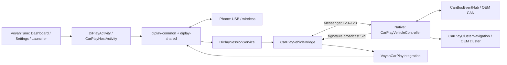

# DiPlay в VoyahTune: спецификация интеграции и восстановления

Этот документ — контракт адаптации, по которому восстанавливают интеграцию после
полной замены исходников DiPlay. Он описывает текущее рабочее дерево на **8 октября
2026**, включая ещё не закоммиченные изменения; это не описание опубликованного
релиза. Имена upstream-классов могут измениться: при обновлении сохранять поведение
и границы ответственности, а не только переносить строки патча.

Правила работы лежат в [корневом AGENTS.md](../AGENTS.md), локальные правила DiPlay —
в [RestoreMode/diplay/AGENTS.md](../RestoreMode/diplay/AGENTS.md). Этот документ —
единственная полная спецификация; README и локальный AGENTS содержат ссылки на неё.

## 1. Происхождение и границы

- База: **DiPlay 0.2.14**, commit **`7887bb7bf2b52258e663a2a4ea1332382ed80ad8`**,
  репозиторий [shihabal3amri/DiPlay](https://github.com/shihabal3amri/DiPlay).
- Копия [RestoreMode/diplay](../RestoreMode/diplay/README.md) — vendored source,
  не submodule. Модули `common` и `shared` импортированы; `mobile` не используется.
- Иконка `ic_car_home.png` и таблица манёвров взяты/адаптированы из VoyahPlay,
  commit **`850b196b09dead3180b027a6f77ad4e040a9bea0`**. Таблица имеет происхождение
  GPL-3.0 и наблюдалась в форке на H97; это не подтверждение всех OEM-прошивок Voyah.
- Сохранять [LICENSE](../RestoreMode/diplay/LICENSE),
  [THIRD_PARTY_NOTICES](../RestoreMode/diplay/docs/THIRD_PARTY_NOTICES.md),
  лицензии вложенных компонентов и атрибуцию заимствованных частей.
- DiPlay входит в **один APK RestoreMode** (`ru.big.town.restoremode`). Иконка
  **VoyahTune CarPlay** — ещё одна точка входа того же APK. Отдельный APK DiPlay
  не устанавливается, официальное обновление его APK не обновляет встроенную копию.
- Протоколы AirPlay/iAP2/MFi, кодеки и JNI целиком не переписаны: наши изменения
  подключают UI, источники автомобиля, маршруты аудио и жизненный цикл сессии.
- Java-база Native/RestoreMode общая. Эта интеграция не требует правок PI/OD loader,
  Frida или root-службы. Не переносить её в `Packaging/pi/` и не создавать второй CAN-клиент.

## 2. Архитектура и обязательные границы



| Слой | Ответственность и инвариант |
| --- | --- |
| `RestoreMode/app` | Дизайн VoyahTune, настройки, выбор виджетов, Messenger-клиент Native. Здесь находятся зависимости от API приложения. |
| `diplay-common` | Штатные экраны подключения/проекции, сервис сессии, интерфейсы подключения UI и автомобиля. Не импортирует `ru.big.town.restoremode.R` или классы Native. |
| `diplay-shared` | Протоколы, медиатранспорт, буферы скорости/манёвров. iAP2/аудиопотоки не вызывают OEM Binder напрямую. |
| `Native` | Единственный доступ к автомобильным данным через общий `CanBusEventHub`, запуск на дисплеях и запись манёвров в OEM cluster. |
| `SharedAndroid` | Общие идентификаторы `CarPlayTarget` и контракт `CarPlayVehicleProtocol`; обе стороны компилируются с одним контрактом. |

`VoyahApplication.onCreate()` вне процесса `:ota` устанавливает два адаптера:

1. `VoyahCarPlayIntegration.install(new CarPlayVehicleBridge(this))`.
2. `CarPlayHomeUi.install(CarPlayHomeScreen::new)`.

Первый включает наличие интеграции (`available`) и источники Voyah, второй заменяет
только стартовый экран. Их отсутствие не должно требовать ссылки библиотеки на
приложение: штатный home остаётся fallback. Статические регистрации не должны
удерживать Activity; bridge хранит application context, фабрика создаёт отдельный View.

## 3. Сборка, манифест и authentication assets

[RestoreMode/settings.gradle.kts](../RestoreMode/settings.gradle.kts) подключает
`:diplay-common`, `:diplay-shared` и каталог `diplayLibs`. Внутри common зависимость
на `:shared` заменена на `:diplay-shared`, обращения к каталогу — на `diplayLibs`.
[app/build.gradle.kts](../RestoreMode/app/build.gradle.kts) зависит от common;
`common` экспортирует shared. Не подключать upstream `mobile`, applicationId или его launcher.

Текущая конфигурация: AGP **9.3.0**, Gradle **9.5.0**, compileSdk **37**; приложение
сохраняет minSdk **30**, targetSdk **35**. Библиотеки имеют minSdk 28; targetSdk 37
в shared не означает смены targetSdk APK. Проверенное окружение — JDK 21, NDK
**28.2.13676358** для DiPlay и **27.0.12077973** для голосовой части RestoreMode.
Release ABI приложения — arm64-v8a, debug включает arm64-v8a и x86_64; shared также
умеет armeabi-v7a, но итоговый набор определяется приложением. Версия APK — VoyahTune
из `versions.json`, версия DiPlay ведётся отдельно в этой спецификации.

Манифест библиотеки объединяется с
[манифестом приложения](../RestoreMode/app/src/main/AndroidManifest.xml). Сохранить:

| Компонент | Итоговое требование |
| --- | --- |
| `DiPlayActivity` | `singleTask`, affinity `${applicationId}.carplay.settings`, label VoyahTune CarPlay, иконка приложения; upstream intent-фильтры удалены через `tools:node="removeAll"`. |
| `CarPlayLauncherActivity` | Единственный launcher-вход CarPlay; exported, affinity `.carplay.launcher`, `excludeFromRecents`, прозрачная тема. Основной launcher VoyahTune сохраняется. |
| `CarPlayHostActivity` | `singleTask`, affinity `${applicationId}.carplay`, resizeable/configChanges и штатный USB attach intent из common. |
| `DiPlaySessionService` | Штатный foreground service connectedDevice/microphone/location с учётом разрешений; не отдельный процесс. |
| `BootReceiver` | `enabled=false` через manifest override. Наличие опции boot в штатном UI не включает этот receiver. |
| `AdbClusterActivity`, `MyCarAppService` | Удалены manifest merge overrides. Не возвращать при обновлении. |
| Native IPC | RestoreMode запрашивает `ru.big.town.anative.permission.BIND_SET_MODES_SERVICE`; служба Native защищена этой signature-permission. APK должны иметь совместимую подпись. |

Локальная пара хранится в `Credentials/CarPlayKeys/offline-mfi/` от корня проекта.
Весь `Credentials/` исключён из Git; файлы передаются отдельно от исходников.
Для сборки из корня проекта задать:

```sh
export DIPLAY_AUTH_ASSETS_DIR="$PWD/Credentials/CarPlayKeys"
```

Для LOCAL MFi Gradle получает **внешний** `DIPLAY_AUTH_ASSETS_DIR` со структурой:

```text
offline-mfi/
  identity.pk8
  certificate.p7b
```

В APK копируется вся указанная папка; она должна содержать только нужные runtime
assets. Если переменная задана, Gradle проверяет наличие файлов, но не соответствие
ключа сертификату. Без неё source-only сборка возможна, чистая LOCAL MFi установка
не заработает. Значение должно попасть в окружение самого Gradle/сборщика релиза.

`DiPlayBootstrap.ensure()` сначала применяет `VoyahCarPlayDefaults`, затем для
LOCAL MFi устанавливает assets в `noBackupFilesDir/offline-mfi` через staging,
проверку `LocalMfiAuthenticationClient.load` и rename. Существующая директория
не перезаписывается; новые assets в APK не заменяют установленную identity.
Process-local `ready` предотвращает повторную загрузку. Обновление identity — отдельная
миграция с проверкой новой пары и восстановлением после ошибки, без очистки данных
всего RestoreMode. Имя/формат каталога и identity должны пережить замену upstream.

В исходном эксперименте использовалась пара из APK DiPlay 0.2.14. Для восстановления
потребуется отдельно сохранённый доверенный runtime-артефакт: документ и исходники
не содержат ключей, сертификатов или механизма их автоматического получения.
Не печатать их содержимое в документацию, логи, патчи и Git. Настройки отдельного
старого экспериментального APK в RestoreMode автоматически не мигрируют.

## 4. Запуск, виджет и владение сессией

`CarPlayTarget` задаёт стабильные значения:

```text
PACKAGE  = ru.big.town.restoremode
ACTIVITY = com.shilapi.xcertplay.DiPlayActivity
LAUNCHER = ru.big.town.restoremode.carplay.CarPlayLauncherActivity
ID       = ru.big.town.restoremode/com.shilapi.xcertplay.DiPlayActivity
```

`ID` — компонент, а не имя пакета. `launchIntent` создаёт MAIN + LAUNCHER с явным
компонентом. `matches` для CarPlay принимает только `com.shilapi.xcertplay.*` внутри
RestoreMode: пакетная фильтрация без имени Activity закроет также Dashboard/настройки.

- Launcher связывается с Native и посылает существующее сообщение **34**, `arg1=1`,
  `left=CarPlayTarget.ID`, `right=""`. Тайм-аут ожидания службы — 5 секунд.
- `SettingsAppPicker` отображает отдельный логический выбор CarPlay, не дублируя
  launcher как обычный пакет. `TileOrderStore` проверяет существование `PACKAGE`.
- `MainSettingsFragment` предлагает **1×1** и **8×5–12×5**. **12×5** заполняет сетку
  из 12 колонок и 5 рядов рядом с OEM-доком; это не вся физическая панель.
- `DashboardActivity`: 1×1 открывает отдельное окно, не создаёт embedded Surface
  и не автозапускается при простой отрисовке Dashboard. Большие размеры используют
  существующий VirtualDisplay Native и штатную передачу ввода.
- `AppDisplayLauncher` завершает только прежние UI tasks CarPlay при смене дисплея,
  дожидается удаления и запускает целевой компонент с `launchDisplayId`. Не применять
  force-stop пакета. CarPlay исключён из обычного `DockLaunchGuard`.
- `DiPlayActivity.openProjection()` передаёт displayId собственного `decorView`
  (fallback 0) в `ActivityOptions`, `CarPlayHostActivity` открывается с REORDER_TO_FRONT.
  Без этого проекция может оказаться на физическом экране вместо виджета.

`CarPlayBackgroundSession` — штатный объект в памяти процесса: controller, sink,
размер, display, owner и stopAction. Это не персистентная сессия и не отдельный IPC-server.
Смена UI/Surface использует upstream store/snapshot/owner/clear; lifecycle старого
окна не должен закрывать уже переданную сессию. Не заменять механизм переноса своим
вторым controller/decoder.

В `DiPlaySessionService.onTaskRemoved` при выключенной `vehicleIntegrationEnabled`
выполняется ранний return: сессия не завершается при переносе task и удалении окна
из recents. Остановка — явное действие пользователя/сессии, не факт исчезновения UI.
`onCreate` вызывает `VoyahCarPlayIntegration.start`, `onDestroy` — `stop` и reset.
Сервис START_NOT_STICKY; сохранение в рамках процесса не обещает восстановление
после force-stop, смерти процесса или перезагрузки.

`MapEmbedService` upstream обслуживает дополнительную карту, не встраивание полного
экрана. Не подменять им VirtualDisplay-путь.

## 5. Стартовый экран, настройки и автоподключение

`CarPlayHomeUi` — интерфейс между common и app. `Factory.create(context, actions)`
возвращает `Screen(view, updateAutoConnect, update)`. Actions предоставляют wireless,
USB, settings, back, choosePhone, disconnect, setAutoConnect, hotspotSettings. В common
остаётся выполнение действий; app только рисует экран и передаёт события.

`DiPlayActivity.render()` создаёт этот Screen **только для page=home**, вставляет его
в fillViewport ScrollView; остальные страницы DiPlay штатные. Каждый render сбрасывает
старую ссылку Screen. `refreshStatus()` обновляет home и штатные controls, включая
ошибки auth/hotspot, выбранный телефон, подключение и наличие сессии.

`CarPlayHomeScreen` использует SettingsComponents, SettingsDesign и ресурсы
`settings_*`: Arimo, фон/цвета, скругления, ripple/focus. Сохранять **три равные крупные
карточки в один горизонтальный ряд**: беспроводное подключение, USB, настройки.
Компактный режим — высота <450dp или ширина <700dp; меняются размеры, не число колонок.
Карточки минимум 190/260dp по высоте, экран прокручивается при нехватке места.
В углу заголовка — предоставленный пользователем PNG `drawable-nodpi/carplay_home_logo.png`
(192×192), ImageView 46dp с FIT_CENTER без tint; цвета и прозрачность оригинала сохранены.
Значок декоративный: accessibility читает соседний заголовок CarPlay.
Работающая сессия меняет действие первой карточки на «Открыть CarPlay».
Статус, переключатель, выбор iPhone, ошибки и отключение — отдельные элементы.
Справа внизу всегда доступна кнопка «Выйти»: вызывает Actions.back →
DiPlayActivity.onBackPressedDispatcher.onBackPressed(), как системное «Назад».
Она не вызывает disconnect/stop сессии и не меняет автоподключение.
**Таймера и кнопки «Отмена» нет**: пользователь отменил эту идею.

Раздел **VoyahTune → CarPlay** имеет стабильный идентификатор **9** (`SettingsSection.CARPLAY`),
nav id `navCarPlay`, `savesImmediately=true`. `CarPlaySettingsFragment` через публичный
`CarPlaySettingsAccess` читает те же preferences и ту же process-local сессию:

- `DISCONNECTED`, `CONNECTING` (`hasSession`), `CONNECTED` (`active`);
- выбранный iPhone и общий переключатель;
- «Отключить» при подключении или активной сессии, через штатный асинхронный `stop`;
- «Открыть экран CarPlay» с `page=home`, REORDER_TO_FRONT — без автоподключения.

Обновление состояния — раз в секунду только в resumed-разделе; обработчики убираются
в pause/destroyView. Отметка «Подключён» берётся из сессии, не из сохранённого MAC.
На время остановки кнопка блокируется до callback. Библиотека не должна зависеть
от Fragment/SettingsActivity, адаптер не должен копировать preferences в DrivePreferences.

### Условия автоподключения

Одна настройка `diplay/auto_connect` используется на новом home, в разделе VoyahTune
и штатном пункте DiPlay «Подключаться при открытии». По умолчанию false. Без выбранного
телефона новый переключатель недоступен; ранее включённое значение можно выключить.

1. `onCreate` без extra `page` ставит `automaticConnectionPending`; при восстановлении
   берёт сохранённый флаг Bundle (по умолчанию false). `onNewIntent` без `page` ставит
   новый запрос. Любое наличие extra `page` означает явную навигацию, не автозапуск.
2. В `onResume` запрос потребляется один раз. Нужны home, живое окно, отсутствие
   `setupError` и сессии, включённый auto_connect и сохранённый `phone_address`.
3. Вызывается обычный `connect(autoConnectWireless(context))`. Транспорт определяется
   `default_connection_mode`: `wireless`, `usb`, `last_used` (fallback для неизвестного
   значения). Последний режим берётся из AirPlayPersistence; не принудительно wireless.
4. `connect` сохраняет штатные проверки hotspot/его параметров, телефона и разрешений;
   затем записывает выбранный транспорт и открывает проекцию на текущем дисплее.
   Сохранённый MAC не доказывает, что телефон сейчас рядом/доступен. Проблемы prerequisites
   могут оставить пользователя на настройке подключения, а не открыть проекцию.
5. Возврат из проекции, внутренних настроек и обычная смена размера не повторяют запрос.
   Установка переключателя сама по себе не запускает подключение в этот момент.
6. Существующая сессия при обычном launcher-входе открывается сразу по штатному пути,
   независимо от auto_connect; это показ текущей проекции, не новое подключение.

Android Back из проекции открывает home с `page=home`, сохраняя сессию. Штатный свайп
вниз тремя пальцами (число настраивается) открывает меню DiPlay с переходом в полные
настройки. Автозапуск при загрузке устройства — другой механизм; **BootReceiver в
нашем APK отключён**, его настройка не должна молча включаться при обновлении.

## 6. Автомобильный IPC, скорость и тема

Контракт: [CarPlayVehicleProtocol.java](../SharedAndroid/src/main/java/ru/big/town/common/CarPlayVehicleProtocol.java).
Направления и типы Bundle обязательны:

| Message.what | Направление | Поля/правило |
| --- | --- | --- |
| 120 WATCH | RestoreMode → Native | `replyTo`: Messenger подписчика. Один текущий владелец. |
| 121 UNWATCH | RestoreMode → Native | `replyTo`: снять только свою подписку. |
| 122 STATE | Native → replyTo | `speedKmh: int`, `gear: int`, `swReason: int`, `speedTime: long`. Неизвестные значения −1. |
| 123 NAVIGATION | RestoreMode → Native | `replyTo` владельца; `navigationActive: boolean`, `navigationTime: long`, при active также `navigationIcon: int`, `navigationDistance: int`, `navigationRoad: String`. |

Все timestamp — **SystemClock.elapsedRealtime**, миллисекунды одной загрузки ГУ,
не UTC и не время iPhone. WATCH/UNWATCH/NAVIGATION обрабатывает SetModesService;
проверку signature permission службы и совместимость подписей APK сохранять.

`CarPlayVehicleBridge` регистрируется Application, запускается сервисом сессии,
биндится к `ru.big.town.anative/.SetModesService`. При неудаче bind/dead binding
повтор через 5 секунд. Каждая новая связь получает новое поколение Messenger:
поздний ответ старого соединения игнорируется. Потеря связи очищает speed/night;
stop снимает подписку, Siri receiver, retry и navigation tick. Привязка к Activity
вместо сервиса нарушит Siri/данные в фоне и при переносе между дисплеями.

`CarPlayVehicleController` использует `CanBusEventHub` с interests CONNECTION,
GEAR, VEHICLE_SPEED, VEHICLE_STATE и фильтром **1072**. Запрашивает скорость/передачу
раз в секунду, vehicle state каждый десятый тик. Потеря CAN сбрасывает snapshot;
потеря подписчика останавливает polling и закрывает subscription.

Источник скорости: `CanBusEvent.Kind.VEHICLE_SPEED`, interest **1 << 7**, callback
OEM **16**, getter `getVehicleSpeed` в текущем CAN Binder — transaction **26**,
значение км/ч. Это дополнение к существующему hub/router, не новый транспорт.
OEM transaction проверять на целевой прошивке, не заменять условным показателем GPS.

`VoyahVehicleSpeedSource` реализует штатный `VehicleSpeedSource`:

- передача `0=P`, `1=R`, `2=N`, `3=D`, другое неизвестно;
- скорость допустима 0…300 км/ч, преобразование **км/ч / 3.6 → м/с**;
- максимум 32 отсчёта; возраст 0…3000ms, strictly newer timestamp; stale/unknown
  не превращается в нулевую скорость или передачу D;
- смена передачи очищает старые отсчёты; start/stop/reset очищают состояние;
- `drain` отдаёт свежие отсчёты с передачей и опустошает очередь.

`CarPlayHostActivity`: при available включены identification.locationInformationEnabled,
vehicleSpeedEnabled и config.locationReportingEnabled. `VehicleSpeedLocationProvider`
оборачивает GPS provider, а если GPS выключен — пустой provider. Благодаря этому
`$PASCD` со скоростью/передачей доступен по запросу iPhone без выдачи фиктивных GPS-координат.
Не связывать включение скорости Voyah с пользовательским GPS-переключателем.

SWReason **2/3/4** (`dark`, `tunnel`, `darkstart`) → night=true, **0/1** → false,
прочее → null. `VoyahCarPlayIntegration.update` хранит состояние и отправляет изменение
через текущий controller. `CarPlayHostActivity.syncAirPlayDarkMode` использует
`night ?: darkMode`; `CarPlayController.setVehicleNightMode` ставит `setNightMode`
в touchExecutor, проверяя closed и неизменность activeSession, перехватывая shutdown
race. Не выполнять сетевую отправку из CAN callback. Настройка темы самого iPhone
может влиять на видимый результат. **Заряд и запас хода не подключены**.

## 7. Siri, кнопки руля, медиа и звонки

В `DrivePreferences`: `carPlaySiriEnabled` (false по умолчанию) и
`voiceAssistantSteeringPress` (`short`/`long`, неизвестное нормализуется к long).
`VoiceSteeringPolicy` публикует `carplay_siri` на **противоположное** нажатие голосовой
кнопки: ассистент short → Siri long, ассистент long → Siri short.

`VoiceSettingsPage` содержит переключатель и пояснение действия; `SplitConfigSync`
применяет policy при экспорте slots `steerVoiceShort`/`steerVoiceLong` в Native.
Сохранённые пользовательские назначения не перезаписываются и возвращаются при
выключении функции. `SteeringSettingsFragment` показывает занятые слоты и переход
к голосовым настройкам. Не хранить назначение Siri вторым независимым preference.

`SetModesReceiverDynamic` обрабатывает действие `carplay_siri` и отправляет
`ru.big.town.restoremode.CARPLAY_SIRI` с package RestoreMode и signature permission.
Bridge принимает broadcast только при started и включённом `carPlaySiriEnabled`,
затем вызывает `VoyahCarPlayIntegration.requestSiri()` на текущем controller из
`CarPlayBackgroundSession`. Без сессии действие не запускает новую сессию.

При `VoyahCarPlayIntegration.available` в `CarPlayHostActivity.dispatchKeyEvent`
и `WheelKeyService` отключён штатный перехват Siri-клавиш. Иначе появятся двойные
вызовы или обход нашего выключателя. Это не отключает штатные медиаклавиши, Android
MediaSession или обработку звонков DiPlay. Их нельзя выдавать за дополнительно
реализованный OEM интерфейс звонков/медиаданных на приборке: BYD outputs отключены.

## 8. Манёвры на приборке

`VoyahNavigation` имеет отдельный owner-guarded `VoyahNavigationState`, использует
парсер `BydHudRouteState(keepAcrossNoRoute=false)`, но **не включает BYD outputs**.
`CarPlayController` обязан вызвать:

- `begin(this)` при start после проверки closed и при активации новой сессии;
- `onFrame(this, frame)` из обработки iAP2 route frame;
- `end(this)` при окончании текущей сессии и close.

Старый controller не очищает состояние нового владельца. No route/end очищает сразу,
штатная route-state устаревает через **30 секунд** без обновлений. Snapshot заменяет
NUL пробелом, ограничивает дорогу 120 символами, расстояние неотрицательное в метрах.

Таблица `VoyahManeuverCodes` (тип Apple → OEM icon):

| Типы | Icon | Значение |
| --- | --- | --- |
| 1, 20 | 7 | налево |
| 2, 21 | 3 | направо |
| 13, 22, 49, 52 | 8 | плавно налево |
| 14, 23, 50, 53 | 2 | плавно направо |
| 47 / 48 | 6 / 4 | резко налево / направо |
| 4, 18, 19, 26 | 5; при drivingSide=1 → 0 | разворот |
| 3, 5, 8, 9, 11, 51 | 1 | прямо |
| 6, 7, 28…46 | 9; при drivingSide=1 → 0 | круговое движение |
| прочее | 0 | неизвестный тип, без выдуманной стрелки |

Bridge отправляет snapshot раз в секунду сообщением 123. Native принимает его только
от `replyTo` текущего живого WATCH-владельца. При смене владельца, UNWATCH и потере
подписчика маршрут очищается. `CarPlayNavigationLease` принимает icon 0…9,
неотрицательное расстояние, timestamp не из будущего, возраст **<5000ms**; иначе
очищает. Пропадание обновлений также очищает через 5 секунд. Это отдельный timeout
доставки, не замена 30-секундному сроку route-state.

`CarPlayClusterNavigation`:

- явная служба `com.qinggan.cluster/.service.InstrumentClusterService`, action
  `com.qinggan.cluster.InstrumentClusterService`;
- проверка системного пакета и descriptor
  `com.qinggan.cluster.IInstrumentClusterManagerService`;
- OEM ClassLoader через createPackageContext(INCLUDE_CODE | IGNORE_SECURITY),
  `$Stub.asInterface`, классы `com.qinggan.cluster.info.NaviInfo`, `GuideState`;
- вызов **updateNaviInfo(NaviInfo)**: GuideState GUIDING/MAN_STOP, currentRoadName="",
  turnRoadName=road, destName="", display=active, tbtIconId=icon,
  nextDistance=метры; при очистке пустые/нулевые значения;
- один worker, объединение промежуточных snapshot, проверка актуальности Binder и
  запрошенного состояния после загрузки OEM-классов. Не копировать номера Binder
  transaction/Parcel layout из другой прошивки и не блокировать main/iAP2 thread;
- bind/retry с ограничением 5 секунд, отслеживание собственных записей для очистки;
  destroy делает ограниченную best-effort очистку и освобождает ресурсы.

Нужны оба APK с этим контрактом. На машине ещё требуется подтвердить права вызова,
видимость/значения OEM-иконок и расстояний. После force-stop Native MAN_STOP не
гарантирован. Поле приборки общее со штатной навигацией; арбитраж с OEM-навигаторами
не реализован. Это стрелка/расстояние/дорога, не полный видеопоток карты на приборку.

## 9. Аудио, видео, defaults и отключённые OEM-функции

DiPlay разделяет PCM по `AudioStreamId(type, audioType)`; сохранить раздельные renderer,
буферы и AudioTrack. `CarPlayHostActivity` передаёт `voyahAudioRouting=available` в
`AndroidMediaSink`, который выбирает override по логическому AudioChannel:

| Канал | Автоматический OEM stream |
| --- | --- |
| Музыка MEDIA | 3 |
| Навигация NAVIGATION | 1 |
| Звонок PHONE | 6 |
| Siri ASSISTANT | 22 |

Классификацию делает штатный AudioChannelMapper: media, telephony, speech recognition,
navigation/default/alert с учётом advanced mapping. Не назначать канал только по
частоте PCM или номеру transport stream. Ручные ненулевые каналы музыки/навигации
имеют приоритет. AudioChannelPreview для Automatic должен пробовать те же 3/1.

AudioTrack создаётся с legacy stream, затем проверяются initialized и фактический
`track.streamType`. `VoyahAudioRouting.accepted` требует точного совпадения. При
ошибке/подмене stream выполняется fallback на штатные AudioAttributes; лог содержит
requested/actual/accepted/fallback. Независимая громкость при fallback не обещается.
Stream IDs установлены по SDK SE 2025 rc5.1/Sport+ 13.1; четыре независимых регулятора
на автомобиле ещё нужно подтвердить.

`VoyahCarPlayDefaults.initialize` вызывается из DiPlayActivity и DiPlayBootstrap.
Основные defaults применяются один раз по `voyah_carplay/initialized`: OEM label
VoyahTune, audio focus=true, HEVC=false. Инициализация автоматического navigation
channel выполняется **до** раннего return по этому маркеру:

- store `xcertplay_airplay`, если ключа `navigation_audio_channel` нет → записать **0**;
- если ключ есть — сохранить его, включая ручной выбор;
- это исключает наследование legacy `navigation_stream_type=3`; отдельно отличить
  старый ручной выбор в одном только legacy-ключе от прежнего default невозможно.

Видеоадаптация цвета уже есть в upstream: `CarPlayPicture`, `CarPlayPicturePanel`,
TextureView/ColorMatrixColorFilter; saturation/contrast 0…200 (100 нейтрально),
brightness −50…50, warmth −100…100. Настройки хранятся в `carplay_picture`. Это не
наш новый видеокодек. В SurfaceView/smooth video или без hardware acceleration
настройка цвета недоступна; при обновлении не обещать её для любого renderer.

`VoyahPlatformPolicy.vehicleIntegrationEnabled=false` и `localAdbEnabled=false`
сохраняют изоляцию от BYD. Важны не только константы, но и guards:

- `LocalAdb.connect` → UNSUPPORTED **до** socket/connect/авторизации;
- `BydOutputSettings` запрещает enabled/available/navigationAvailable, battery,
  wheel speed, cluster stream pause, video-while-parked, cluster song и call controls;
- `BydNavigationOutputs` не выполняет OEM recovery/start/map-shown/route outputs и
  OEM cleanup. Разбор route/локальный overlay может остаться штатным;
- `DiPlaySessionService.onTaskRemoved` использует ту же policy для сохранения сессии.

Не включать глобальный BYD-флаг ради манёвров Voyah. Новые upstream OEM/ADB/boot entry
points нужно проверять отдельно: эти guards не покрывают ещё не существовавший код.
В DiPlayActivity скрыты advanced vehicle data при выключенном vehicleIntegrationEnabled
и ADB-раздел при выключенном localAdbEnabled; скрыта подсказка о недоступной штатной
навигации. Экспорт диагностики не добавляет отключённый vehicle-data probe.
Другие штатные настройки hotspot могут оставаться видимыми, но LocalAdb-зависимые
операции недоступны. На публичные Android USB/wireless transport этот запрет не распространяется.

Пользовательские строки во всех семи локалях (default, ru, uk, es, ar, zh-rCN,
zh-rTW) не содержат BYD/比亚迪/比亞迪. Формулировки нейтральные; подсказка теста звука
не обещает назначение stream 14, подсказка жестов не привязана к климату другой марки.
DEFAULT_OEM_LABEL в AirPlayPersistence — VoyahTune, в том числе при сбросе значения;
сохранённые пользовательские имена не переименовываются. Имена ресурсов, preferences,
классов, протоколов, технические логи и лицензии/атрибуция upstream сохраняются.
При обновлении повторить проверку текстов всех локалей и placeholders.

## 10. Полная карта адаптаций

### 10.1. Изменённые файлы vendored upstream

Сверено побайтово с чистым commit из §1: **23 изменённых upstream-файла**, включая
сборку, тест и изображение. Пути ниже относительно `RestoreMode/diplay`. Эта таблица
дополняет поведенческие контракты выше; удаление/переименование upstream-файла
требует найти новую точку подключения с той же ролью.

| Файл | Что восстановить |
| --- | --- |
| [common/build.gradle.kts](../RestoreMode/diplay/common/build.gradle.kts) | Переименовать catalog → diplayLibs, dependency → :diplay-shared; сохранить Compose/тестовое окружение. |
| [shared/build.gradle](../RestoreMode/diplay/shared/build.gradle) | Использовать diplayLibs; сохранить JNI/NDK и library namespace. |
| [common/src/main/java/com/shilapi/xcertplay/AirPlayPersistence.kt](../RestoreMode/diplay/common/src/main/java/com/shilapi/xcertplay/AirPlayPersistence.kt) | initializeAutomaticNavigationAudioChannel: 0 только при отсутствии нового ключа; DEFAULT_OEM_LABEL=VoyahTune. |
| [common/src/main/java/com/shilapi/xcertplay/AudioChannelPreview.kt](../RestoreMode/diplay/common/src/main/java/com/shilapi/xcertplay/AudioChannelPreview.kt) | Automatic использует OEM 3/1; проверять фактический AudioTrack stream и fallback. |
| [common/src/main/java/com/shilapi/xcertplay/CarPlayHostActivity.kt](../RestoreMode/diplay/common/src/main/java/com/shilapi/xcertplay/CarPlayHostActivity.kt) | available → источники скорости/темы/аудиомаршруты Voyah; Siri keys переданы Native. Сохранить штатное владение сессией/Surface. |
| [common/src/main/java/com/shilapi/xcertplay/DiPlayActivity.kt](../RestoreMode/diplay/common/src/main/java/com/shilapi/xcertplay/DiPlayActivity.kt) | Defaults; projection launchDisplayId; фабрика home + обновление состояния; одноразовый запрос автоподключения при открытии; guards OEM/ADB-разделов и vehicle-data probe в диагностике (§9). |
| [common/src/main/java/com/shilapi/xcertplay/DiPlayBootstrap.kt](../RestoreMode/diplay/common/src/main/java/com/shilapi/xcertplay/DiPlayBootstrap.kt) | Вызов VoyahCarPlayDefaults.initialize до штатной загрузки identity. |
| [common/src/main/java/com/shilapi/xcertplay/DiPlaySessionService.kt](../RestoreMode/diplay/common/src/main/java/com/shilapi/xcertplay/DiPlaySessionService.kt) | start/stop интеграции по жизни сервиса, сохранение сессии при onTaskRemoved на Voyah. |
| [common/src/main/java/com/shilapi/xcertplay/WheelKeyService.kt](../RestoreMode/diplay/common/src/main/java/com/shilapi/xcertplay/WheelKeyService.kt) | Guard штатного Siri-перехвата при available, остальная обработка клавиш сохраняется. |
| [common/src/main/res/raw/ic_car_home.png](../RestoreMode/diplay/common/src/main/res/raw/ic_car_home.png) | Бинарный ресурс из указанного commit VoyahPlay; не путать с launcher drawable/ic_carplay.xml. |
| [common/src/test/java/com/shilapi/xcertplay/WheelSiriWindowTest.kt](../RestoreMode/diplay/common/src/test/java/com/shilapi/xcertplay/WheelSiriWindowTest.kt) | Дополнительная проверка отсутствия конкурирующего Siri-перехвата на Voyah. |
| [shared/src/main/java/com/shilapi/xcertplay/adb/LocalAdb.kt](../RestoreMode/diplay/shared/src/main/java/com/shilapi/xcertplay/adb/LocalAdb.kt) | Ранний UNSUPPORTED по localAdbEnabled. |
| [shared/src/main/java/com/shilapi/xcertplay/hud/BydNavigationOutputs.kt](../RestoreMode/diplay/shared/src/main/java/com/shilapi/xcertplay/hud/BydNavigationOutputs.kt) | Guards OEM запуска/route/cleanup; не включать BYD ради VoyahNavigation. |
| [shared/src/main/java/com/shilapi/xcertplay/hud/BydOutputSettings.kt](../RestoreMode/diplay/shared/src/main/java/com/shilapi/xcertplay/hud/BydOutputSettings.kt) | Guards вычисляемых enabled/available и OEM-настроек независимо от старых preferences. |
| [shared/src/main/java/com/shilapi/xcertplay/media/AndroidMediaSink.kt](../RestoreMode/diplay/shared/src/main/java/com/shilapi/xcertplay/media/AndroidMediaSink.kt) | Флаг voyahAudioRouting до renderer, explicit override, stream validation, fallback и диагностический лог. |
| [shared/src/main/java/com/shilapi/xcertplay/orchestration/CarPlayController.kt](../RestoreMode/diplay/shared/src/main/java/com/shilapi/xcertplay/orchestration/CarPlayController.kt) | setVehicleNightMode с проверкой activeSession; begin/end/onFrame владельца VoyahNavigation. |
| [common/src/main/res/values/strings.xml](../RestoreMode/diplay/common/src/main/res/values/strings.xml)<br>[common/src/main/res/values-ru/strings.xml](../RestoreMode/diplay/common/src/main/res/values-ru/strings.xml)<br>[common/src/main/res/values-uk/strings.xml](../RestoreMode/diplay/common/src/main/res/values-uk/strings.xml)<br>[common/src/main/res/values-es/strings.xml](../RestoreMode/diplay/common/src/main/res/values-es/strings.xml)<br>[common/src/main/res/values-ar/strings.xml](../RestoreMode/diplay/common/src/main/res/values-ar/strings.xml)<br>[common/src/main/res/values-zh-rCN/strings.xml](../RestoreMode/diplay/common/src/main/res/values-zh-rCN/strings.xml)<br>[common/src/main/res/values-zh-rTW/strings.xml](../RestoreMode/diplay/common/src/main/res/values-zh-rTW/strings.xml) | Семь локализаций: нейтральные тексты без BYD, достоверные подсказки аудиоканалов и жестов; сохранить resource IDs и placeholders. |

Не импортированы из дерева common/shared/gradle baseline:
`gradle/gradle-daemon-jvm.properties`, `gradle/wrapper/gradle-wrapper.jar`,
`gradle/wrapper/gradle-wrapper.properties` (используется wrapper RestoreMode),
`shared/.gitignore` и дублирующий `shared/BYD_HUD_ICONS_NOTICE.md`.
Содержание последнего сохранено в
[assets/byd-hud-icons/NOTICE.txt](../RestoreMode/diplay/shared/src/main/assets/byd-hud-icons/NOTICE.txt),
рядом с лицензией этих assets. Удалённых Kotlin/Java/JNI-файлов в common/shared
относительно baseline при этой сверке нет.

В текущей копии `docs/` импортирован только THIRD_PARTY_NOTICES; упомянутые внутри
него upstream `docs/UPSTREAM-README.md` и `docs/licenses/` не перенесены. При подготовке
полного нового импорта учитывать эти исходные документы отдельно, не считать список
ссылок в notices доказательством наличия всех файлов в checkout.

### 10.2. Собственные файлы внутри DiPlay

Эти **8 файлов реализации** не придут из upstream; их нужно сохранить/перенести
вместе с собственными тестами. `AGENTS.md` и наш `README.md` также не заменять upstream-версией.

| Файл | Назначение |
| --- | --- |
| [common/src/main/java/com/shilapi/xcertplay/CarPlayHomeUi.kt](../RestoreMode/diplay/common/src/main/java/com/shilapi/xcertplay/CarPlayHomeUi.kt) | Контракт фабрики app-owned home и callbacks/state. |
| [common/src/main/java/com/shilapi/xcertplay/CarPlaySettingsAccess.kt](../RestoreMode/diplay/common/src/main/java/com/shilapi/xcertplay/CarPlaySettingsAccess.kt) | Java-friendly доступ настроек VoyahTune к preferences/состоянию/stop DiPlay. |
| [common/src/main/java/com/shilapi/xcertplay/VoyahCarPlayDefaults.kt](../RestoreMode/diplay/common/src/main/java/com/shilapi/xcertplay/VoyahCarPlayDefaults.kt) | Defaults с отдельной миграцией навигационного канала. |
| [common/src/main/java/com/shilapi/xcertplay/VoyahCarPlayIntegration.kt](../RestoreMode/diplay/common/src/main/java/com/shilapi/xcertplay/VoyahCarPlayIntegration.kt) | Регистрация Host, available, скорость, night, Siri через snapshot. |
| [shared/src/main/java/com/shilapi/xcertplay/VoyahPlatformPolicy.kt](../RestoreMode/diplay/shared/src/main/java/com/shilapi/xcertplay/VoyahPlatformPolicy.kt) | Оба ограничения BYD/ADB false. |
| [shared/src/main/java/com/shilapi/xcertplay/transport/VoyahVehicleSpeedSource.kt](../RestoreMode/diplay/shared/src/main/java/com/shilapi/xcertplay/transport/VoyahVehicleSpeedSource.kt) | Буфер/единицы/передачи/возраст данных. |
| [shared/src/main/java/com/shilapi/xcertplay/hud/VoyahNavigation.kt](../RestoreMode/diplay/shared/src/main/java/com/shilapi/xcertplay/hud/VoyahNavigation.kt) | Независимый route owner, таблица иконок, snapshot. |
| [shared/src/main/java/com/shilapi/xcertplay/media/VoyahAudioRouting.kt](../RestoreMode/diplay/shared/src/main/java/com/shilapi/xcertplay/media/VoyahAudioRouting.kt) | OEM streams и критерий accepted. |

Собственные тесты common: `VoyahSessionTransferTest`, `VoyahCarPlayIntegrationTest`,
`VoyahAudioDefaultsTest`, `CarPlayAutoConnectOnOpenTest`, `CarPlaySettingsAccessTest`.
Shared: `VoyahNavigationTest`, `VoyahAudioRoutingTest`. Они перечислены с путями в §12.

### 10.3. Код вне vendored дерева

Замена только `RestoreMode/diplay` не восстанавливает перечисленные ниже точки.
Сохранить их в checkout и заново связать с новой версией библиотеки.

| Файл/группа | Контракт |
| --- | --- |
| [RestoreMode/settings.gradle.kts](../RestoreMode/settings.gradle.kts)<br>[RestoreMode/app/build.gradle.kts](../RestoreMode/app/build.gradle.kts)<br>[RestoreMode/gradle/libs.versions.toml](../RestoreMode/gradle/libs.versions.toml)<br>[RestoreMode/gradle/wrapper/gradle-wrapper.properties](../RestoreMode/gradle/wrapper/gradle-wrapper.properties) | Модули, зависимости, AGP/Gradle, assets и ABI (§3). |
| [RestoreMode/app/src/main/AndroidManifest.xml](../RestoreMode/app/src/main/AndroidManifest.xml)<br>[Native/app/src/main/AndroidManifest.xml](../Native/app/src/main/AndroidManifest.xml) | Overrides компонентов/launcher/boot и signature permission (§3). |
| [RestoreMode/app/src/main/java/ru/big/town/restoremode/VoyahApplication.java](../RestoreMode/app/src/main/java/ru/big/town/restoremode/VoyahApplication.java) | Установка bridge и home factory вне :ota (§2). |
| [RestoreMode/app/src/main/java/ru/big/town/restoremode/carplay/CarPlayLauncherActivity.java](../RestoreMode/app/src/main/java/ru/big/town/restoremode/carplay/CarPlayLauncherActivity.java)<br>[SharedAndroid/src/main/java/ru/big/town/common/CarPlayTarget.java](../SharedAndroid/src/main/java/ru/big/town/common/CarPlayTarget.java) | Адресный launcher и стабильный component ID (§4). |
| [RestoreMode/app/src/main/java/ru/big/town/restoremode/settings/ui/dialogs/SettingsAppPicker.java](../RestoreMode/app/src/main/java/ru/big/town/restoremode/settings/ui/dialogs/SettingsAppPicker.java)<br>[RestoreMode/app/src/main/java/ru/big/town/restoremode/settings/sections/main/MainSettingsFragment.java](../RestoreMode/app/src/main/java/ru/big/town/restoremode/settings/sections/main/MainSettingsFragment.java)<br>[RestoreMode/app/src/main/java/ru/big/town/restoremode/dashboard/tiles/TileOrderStore.java](../RestoreMode/app/src/main/java/ru/big/town/restoremode/dashboard/tiles/TileOrderStore.java)<br>[RestoreMode/app/src/main/java/ru/big/town/restoremode/dashboard/DashboardActivity.java](../RestoreMode/app/src/main/java/ru/big/town/restoremode/dashboard/DashboardActivity.java) | Выбор CarPlay, имя/иконка, размеры, 1×1 и embedded (§4). |
| [Native/app/src/main/java/ru/big/town/anative/AppDisplayLauncher.java](../Native/app/src/main/java/ru/big/town/anative/AppDisplayLauncher.java)<br>[Native/app/src/main/java/ru/big/town/anative/AppDisplayTaskPlan.java](../Native/app/src/main/java/ru/big/town/anative/AppDisplayTaskPlan.java)<br>[Native/app/src/main/java/ru/big/town/anative/SetModesService.java](../Native/app/src/main/java/ru/big/town/anative/SetModesService.java) | Запуск и фильтрация tasks, перенос/cleanup дисплеев, сообщения 34/120/121/123, destroy контроллера (§4/6). |
| [RestoreMode/app/src/main/java/ru/big/town/restoremode/carplay/CarPlayHomeScreen.java](../RestoreMode/app/src/main/java/ru/big/town/restoremode/carplay/CarPlayHomeScreen.java)<br>[RestoreMode/app/src/main/res/drawable/carplay_home_wireless.xml](../RestoreMode/app/src/main/res/drawable/carplay_home_wireless.xml)<br>[RestoreMode/app/src/main/res/drawable/carplay_home_usb.xml](../RestoreMode/app/src/main/res/drawable/carplay_home_usb.xml)<br>[RestoreMode/app/src/main/res/values/carplay_home.xml](../RestoreMode/app/src/main/res/values/carplay_home.xml)<br>[RestoreMode/app/src/main/res/drawable-nodpi/carplay_home_logo.png](../RestoreMode/app/src/main/res/drawable-nodpi/carplay_home_logo.png) | Home в дизайн-системе; собственные иконки и строки (§5). |
| [RestoreMode/app/src/main/java/ru/big/town/restoremode/settings/sections/carplay/CarPlaySettingsFragment.java](../RestoreMode/app/src/main/java/ru/big/town/restoremode/settings/sections/carplay/CarPlaySettingsFragment.java)<br>[RestoreMode/app/src/main/java/ru/big/town/restoremode/settings/core/SettingsSection.java](../RestoreMode/app/src/main/java/ru/big/town/restoremode/settings/core/SettingsSection.java)<br>[RestoreMode/app/src/main/java/ru/big/town/restoremode/settings/core/SettingsSectionLayouts.java](../RestoreMode/app/src/main/java/ru/big/town/restoremode/settings/core/SettingsSectionLayouts.java)<br>[RestoreMode/app/src/main/res/layout/settings_carplay.xml](../RestoreMode/app/src/main/res/layout/settings_carplay.xml)<br>[RestoreMode/app/src/main/res/layout/view_settings_navigation_rail.xml](../RestoreMode/app/src/main/res/layout/view_settings_navigation_rail.xml) | Раздел 9, navigation, общий переключатель и живой статус (§5). |
| [RestoreMode/app/src/main/java/ru/big/town/restoremode/carplay/CarPlayVehicleBridge.java](../RestoreMode/app/src/main/java/ru/big/town/restoremode/carplay/CarPlayVehicleBridge.java)<br>[SharedAndroid/src/main/java/ru/big/town/common/CarPlayVehicleProtocol.java](../SharedAndroid/src/main/java/ru/big/town/common/CarPlayVehicleProtocol.java)<br>[Native/app/src/main/java/ru/big/town/anative/CarPlayVehicleController.java](../Native/app/src/main/java/ru/big/town/anative/CarPlayVehicleController.java) | Двунаправленный IPC, owner/generation/подписки (§6/8). |
| [Native/app/src/main/java/ru/big/town/anative/CanBusEvent.java](../Native/app/src/main/java/ru/big/town/anative/CanBusEvent.java)<br>[Native/app/src/main/java/ru/big/town/anative/CanBusEventRouter.java](../Native/app/src/main/java/ru/big/town/anative/CanBusEventRouter.java)<br>[Native/app/src/main/java/ru/big/town/anative/CanBusEventHub.java](../Native/app/src/main/java/ru/big/town/anative/CanBusEventHub.java) | Скорость, interests, OEM callback/getter в общем CAN hub (§6). |
| [RestoreMode/app/src/main/java/ru/big/town/restoremode/voice/commands/VoiceSteeringPolicy.java](../RestoreMode/app/src/main/java/ru/big/town/restoremode/voice/commands/VoiceSteeringPolicy.java)<br>[RestoreMode/app/src/main/java/ru/big/town/restoremode/settings/sections/voice/VoiceSettingsPage.java](../RestoreMode/app/src/main/java/ru/big/town/restoremode/settings/sections/voice/VoiceSettingsPage.java)<br>[RestoreMode/app/src/main/java/ru/big/town/restoremode/integration/config/SplitConfigSync.java](../RestoreMode/app/src/main/java/ru/big/town/restoremode/integration/config/SplitConfigSync.java)<br>[RestoreMode/app/src/main/java/ru/big/town/restoremode/settings/sections/steering/SteeringSettingsFragment.java](../RestoreMode/app/src/main/java/ru/big/town/restoremode/settings/sections/steering/SteeringSettingsFragment.java)<br>[RestoreMode/app/src/main/res/layout/settings_steering_reserved.xml](../RestoreMode/app/src/main/res/layout/settings_steering_reserved.xml)<br>[Native/app/src/main/java/ru/big/town/anative/SetModesReceiverDynamic.java](../Native/app/src/main/java/ru/big/town/anative/SetModesReceiverDynamic.java) | Выбор нажатия Siri, пояснение, экспорт действия и broadcast (§7). |
| [Native/app/src/main/java/ru/big/town/anative/CarPlayNavigationLease.java](../Native/app/src/main/java/ru/big/town/anative/CarPlayNavigationLease.java)<br>[Native/app/src/main/java/ru/big/town/anative/CarPlayClusterNavigation.java](../Native/app/src/main/java/ru/big/town/anative/CarPlayClusterNavigation.java) | Срок действия snapshot и OEM writer (§8). |

## 11. Восстановление после полной замены upstream

### 11.1. Что сохранить до замены

Зафиксировать точный исходный commit и новый целевой commit. Сохранить текущее
рабочее дерево адаптаций **включая untracked-файлы** из §10; один `git diff` их не
содержит. Не опираться только на названия Voyah*: UI facade и изменения штатных
файлов имеют другие имена. Не считать старый опубликованный commit заменой текущей
реализации: сверить staged/unstaged/untracked отдельно. Создание коммита, push и
публикация по-прежнему требуют явного поручения пользователя.

Получить три независимых дерева: чистый старый upstream (commit §1), наша текущая
адаптация, чистый новый upstream. Рабочие сравнения держать в `tmp/`, не в каталогах
приложений. Старый baseline нужен именно чистый: экспериментальный checkout может
содержать дополнительные изменения, не вошедшие в продукт.

Authentication assets и бинарную иконку сохранить отдельно от текстового diff.
Для identity сохранить доступ к доверенному артефакту и возможность проверить
соответствие пары, не добавляя секреты в Git. Для иконки достаточно ресурса из
репозитория или указанного commit VoyahPlay. Локальные абсолютные пути на машине
разработчика не являются частью переносимой процедуры.

### 11.2. Порядок восстановления

1. **База и сборка.** Импортировать новые common/shared и зависимости. Учитывать
   удалённые/переименованные upstream-файлы; не накладывать новую версию поверх старой
   вслепую. Сохранить local AGENTS/README/лицензии. Восстановить модули и manifest
   overrides §3. Проверить новые receivers/services/OEM/ADB entry points.
2. **Ограничения платформы и identity.** Вернуть policy и все guards §9, defaults,
   отдельную миграцию аудиоканала, bootstrap assets. Не включать BYD global flag,
   boot receiver и не стирать preferences/noBackupFilesDir ради прохождения запуска.
3. **Сессия и дисплеи.** Найти в новой версии аналоги controller/sink owner и фоновой
   сессии. Вернуть сервисные start/stop callbacks, onTaskRemoved и передачу displayId.
   Проверить компонентные идентификаторы/affinity против CarPlayTarget/Native.
4. **UI и preferences.** Подключить home factory только к home, обновление статуса,
   одноразовый запрос автоподключения и Java facade настроек. Восстановить app-owned
   экран, раздел 9, связь Application. Проверить, что explicit page=home/settings
   всегда доступен без автозапуска и таймера.
5. **Автомобильные данные.** Подключить Host, IPC и speed provider, включая режим без
   GPS, SWReason в активную сессию. Проверить единицы, timestamp, null/−1 и очистку.
6. **Siri.** Сохранить публикацию противоположного нажатия, защиту broadcast и запрет
   конкурирующих upstream Siri-key handlers. Не заменять сохранённые steering actions.
7. **Манёвры.** Подключить route frame новой версии к owner-bound state, события
   start/end/close; восстановить snapshot → message 123 → lease → OEM writer.
   Сверить формат iAP2 route и enum maneuver types с новой версией.
8. **Аудио/видео.** Найти новое место создания AudioTrack; восстановить logical-channel
   routing/explicit overrides/validation/fallback/preview. Сохранить независимые
   renderer. Проверить штатный TextureView picture path, не обходить ограничения
   SurfaceView, не менять кодеки без необходимости.
9. **Контроль полноты.** Для каждой строки §10 отметить новую точку реализации и тест
   либо явно согласованное удаление функции. Конфликт при merge разрешается по
   контракту поведения, не безусловным ours/theirs. Отсутствие конфликта не доказывает,
   что новый upstream вообще вызывает сохранённый adapter.
10. **Проверка и фиксация baseline.** Выполнить проверки затронутых контрактов §12,
    описать непроверенное на ГУ, обновить commit/версии upstream и карту §10.
    Новые APK/релиз оформляются по [правилам выпуска](releasing.md); не подменять
    внутреннюю версию VoyahTune версией DiPlay.

Если upstream полностью поменял архитектуру, заново реализовать требуемые интерфейсы
из §§2–9 на его новых extension points. Копирование старой Activity целиком вместе
со старым протокольным стеком не является обновлением: получится два несовместимых
владельца сессии. На выходе должен остаться один движок, один набор preferences и
одна подписка на автомобиль на сессию.

## 12. Критерии восстановления и проверки

Для чистой правки этой документации сборка не нужна. После обновления кода выбирать
минимальный набор по затронутым строкам; расширенный набор — только по явному запросу.
При полной замене DiPlay затронуты все библиотечные контракты ниже. Успех JVM-тестов
и эмулятора не подтверждает OEM Binder, независимую громкость или связь с iPhone.

| Контракт | Существующие целевые тесты |
| --- | --- |
| Task/component/display | Native `CarPlayTargetTest`, `AppDisplayTaskPlanTest`; common `VoyahSessionTransferTest`, `LauncherIntentTest` |
| Автоподключение и настройки | common `CarPlayAutoConnectOnOpenTest`, `CarPlaySettingsAccessTest`, `DefaultConnectionModeTest` |
| Скорость, gear, SWReason | common `VoyahCarPlayIntegrationTest`; Native `CanBusEventRouterTest` |
| Siri | app `VoiceSteeringPolicyTest`; common `WheelSiriWindowTest` (включает Voyah guard) |
| Манёвры | shared `hud.VoyahNavigationTest`; Native `CarPlayNavigationLeaseTest` |
| Аудио | shared `media.VoyahAudioRoutingTest`, `media.LegacyAudioFallbackTest`, `airplay.CarPlayAudioStreamIsolationTest`; common `VoyahAudioDefaultsTest` |

Пути тестов: common — `RestoreMode/diplay/common/src/test/java/com/shilapi/xcertplay/`,
shared — `RestoreMode/diplay/shared/src/test/java/com/shilapi/xcertplay/`,
Native — `Native/app/src/test/java/ru/big/town/anative/`,
app — `RestoreMode/app/src/test/java/ru/big/town/restoremode/voice/commands/`.
Это проверки отдельных контрактов, не полное покрытие: реальный выбор дисплея,
динамический OEM ClassLoader, Binder-доступ и готовый UI требуют отдельной проверки.

Примеры команд из корня; настроить JAVA_HOME/SDK/NDK и внешний DIPLAY_AUTH_ASSETS_DIR.
Не копировать локальные пути Gradle cache/SDK из машины автора.

```sh
voyah_release_version="$(python3 -c 'import json; print(json.load(open("versions.json"))["voyahtune"])')-od"

RestoreMode/gradlew -p RestoreMode :app:assembleDebug \
  -PvoyahReleaseVersion="$voyah_release_version" -PvoyahInfrastructure=od

RestoreMode/gradlew -p RestoreMode :diplay-common:testDebugUnitTest \
  --tests com.shilapi.xcertplay.VoyahSessionTransferTest \
  --tests com.shilapi.xcertplay.VoyahCarPlayIntegrationTest \
  --tests com.shilapi.xcertplay.VoyahAudioDefaultsTest \
  --tests com.shilapi.xcertplay.CarPlayAutoConnectOnOpenTest \
  --tests com.shilapi.xcertplay.CarPlaySettingsAccessTest \
  --tests com.shilapi.xcertplay.DefaultConnectionModeTest \
  --tests com.shilapi.xcertplay.LauncherIntentTest \
  --tests com.shilapi.xcertplay.WheelSiriWindowTest

RestoreMode/gradlew -p RestoreMode :diplay-shared:testDebugUnitTest \
  --tests com.shilapi.xcertplay.hud.VoyahNavigationTest \
  --tests com.shilapi.xcertplay.media.VoyahAudioRoutingTest \
  --tests com.shilapi.xcertplay.media.LegacyAudioFallbackTest \
  --tests com.shilapi.xcertplay.airplay.CarPlayAudioStreamIsolationTest

RestoreMode/gradlew -p RestoreMode :app:testDebugUnitTest \
  --tests ru.big.town.restoremode.voice.commands.VoiceSteeringPolicyTest

Native/gradlew -p Native :app:assembleDebug :app:testDebugUnitTest \
  --tests ru.big.town.anative.CarPlayTargetTest \
  --tests ru.big.town.anative.AppDisplayTaskPlanTest \
  --tests ru.big.town.anative.CanBusEventRouterTest \
  --tests ru.big.town.anative.CarPlayNavigationLeaseTest \
  -PvoyahReleaseVersion="$voyah_release_version" -PvoyahInfrastructure=od
```

При изменениях только RestoreMode/DiPlay сборка Native нужна лишь если затронуты
его исходники/контракты. При изменении сообщений 120–123, единиц или owner semantics
проверять обе стороны. Проверить merged manifest (компоненты, boot, permission,
process/affinity), итоговые ABI/подписи/наличие assets, не выводя содержимое identity.

Контроль на устройстве после полного обновления:

| Сценарий | Требуемый результат |
| --- | --- |
| Чистые данные и обновление поверх | Bootstrap работает; старые identity/preferences не потеряны; явные audio channels не сброшены. |
| Launcher / 1×1 / 8×5 / 12×5 | Правильный дисплей, один ряд карточек, работающие касания/resize; 1×1 не создаёт Surface. |
| Виджет ↔ Activity во время сессии | Только один controller/audio output, session service и CAN subscription сохраняются; Dashboard не закрывается. |
| Auto on/off, нет телефона, Back, home/settings | Нет нежелательных циклов запуска; все три UI показывают одно значение, таймера нет. |
| Раздел CarPlay | Живое состояние; Disconnect завершает сессию, opening home не делает reconnect. |
| Скорость/передача, отключённый GPS | km/h→m/s, корректные P/R/N/D, stale/unknown не передаются как действительные данные. |
| SWReason | Только известные 2/3/4 тёмные, 0/1 светлые; восстановление темы после reconnect. |
| Siri | Оба short/long варианта, отключённая опция, фон и виджет; ровно один вызов, сохранённые назначения возвращаются. |
| Аудио | Музыка/подсказки/телефон/Siri одновременно и отдельно, независимая регулировка, проверка фактических streams и fallback. |
| Навигация | Иконка/метры/дорога; end route, disconnect, потеря bridge, смена owner, timeout; отсутствие старой стрелки. |
| Фон/сон/пробуждение/потеря Native | Нет зависшей подписки/устаревших данных, есть переподключение или понятное неактивное состояние. |

Обновление движка поставляется через новый RestoreMode APK. Для изменения Native
IPC/CAN/cluster/запуска нужен согласованный Native APK. **Установщик/root-служба
не требуют изменения только из-за обновления DiPlay**; пересборка установщика нужна
при изменении его исполняемого кода, recipe или встроенных ресурсов по общим правилам.
Релизы Payload/Installers, установка на автомобиль, S3, коммит и push не следуют
автоматически из задачи обновления библиотеки.

## 13. Подтверждённое состояние и ограничения

Зафиксированная карта §10 сверена с чистым upstream commit по текущим исходникам.
В предыдущих шагах скомпилированы Native/RestoreMode и пройдены целевые проверки
скорости/темы, Siri, аудио, манёвров, сессии и автоподключения. Последний UI-раздел
проверен компиляцией и 8 тестами CarPlayAutoConnectOnOpenTest/CarPlaySettingsAccessTest.
Debug RestoreMode **4.0.0-od** установлен и DiPlayActivity открыт на Android-эмуляторе;
визуальную проверку пользователь решил выполнить сам. Это не подтверждение качества
всех размеров UI или реального подключения телефона.

Ранее пользователь подтвердил беспроводное подключение экспериментальной отдельной
сборки. Новые автомобильные интеграции, OEM AudioTrack routes и приборка на машине
пока не подтверждены. Заряд/запас хода, собственная панель управления автомобилем
в интерфейсе iPhone CarPlay, OEM-арбитраж навигации и автоматическое обновление identity
не входят в реализованный контракт. Не добавлять их при обновлении upstream как
неявное «восстановление» существующих функций.
